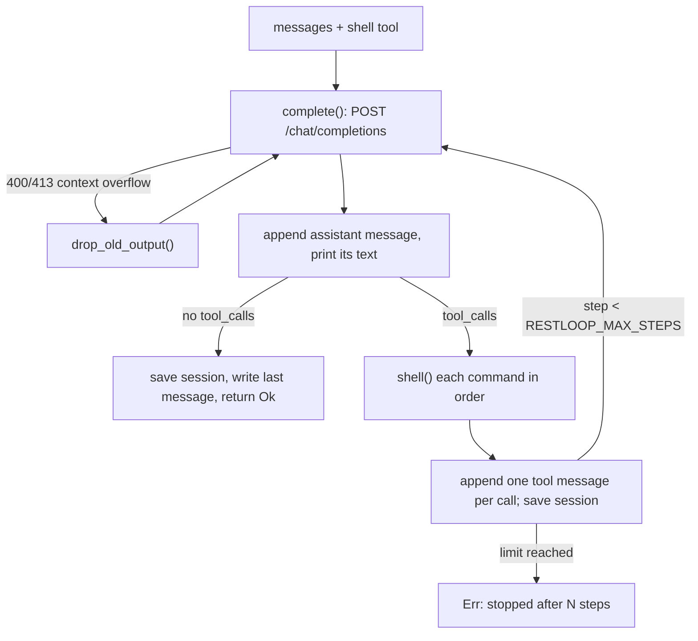

# How it works

**English** · [中文](zh/03-how-it-works.md)

Everything happens in `run()`: one iteration (a step) is one model reply plus the commands it requested.

Sources: [main.rs:126-131](../src/main.rs#L126-L131) · [main.rs:140-150](../src/main.rs#L140-L150) · [main.rs:213-215](../src/main.rs#L213-L215)

## What the conversation holds

The first message is the system prompt from `system_prompt()`: the agent's instructions plus the OS, the shell (`sh`, `bash (Git Bash)` or `PowerShell`), the working directory, the command timeout and, with a deadline, the total budget. Then come user tasks, and for every model reply an assistant message that keeps only `content`, `tool_calls` and, when the provider returns it, `reasoning_content`.

Each tool call gets one `tool` message with the matching `tool_call_id`. If the arguments are not JSON with a `command` string, the content is an error that quotes the arguments, so the model can correct itself instead of the run failing. Calls run one at a time, in the listed order.

Sources: [main.rs:82-99](../src/main.rs#L82-L99) · [main.rs:161-174](../src/main.rs#L161-L174) · [main.rs:186-211](../src/main.rs#L186-L211)

## Requests and retries

`complete()` posts `{"model", "messages", "tools"}` and nothing else (no sampling parameters, token limit or streaming), so provider defaults apply. Each attempt may take up to 600 s.

Network errors, HTTP 429, HTTP 5xx and, since `333b7b64`, an HTTP 200 without `choices[0].message` are retried, five attempts in all, sleeping 2, 4, 8 and 16 s between them and printing `restloop: <what>, retrying`. The 200 case covers MiniMax, which reports some errors that way and once ended the run as an empty final reply. Any other status, or the fifth failure, becomes `HTTP <status>: <body>` (or `request failed: ...`, `no reply: ...`) and fails the task: a run with a task argument exits 1, while stdin mode reports it and reads the next line. A 200 whose body is not JSON fails at once with `bad response`. Overflow detection reads the body kept in the error.

Sources: [main.rs:304-346](../src/main.rs#L304-L346) · [commit 333b7b64](https://github.com/lhwzds/restloop/commit/333b7b64)

## Recovering from a full context window

Before `21f3c1dc`, a context overflow ended the run. `too_long()` recognises it: the status is 400 or 413 and the body contains a phrase providers use (`context_length_exceeded`, "maximum context length", "context window exceeds", "prompt is too long", "exceeds the available context size"). Commit `04004c68` narrowed this from looser words like "too long", because an unrelated 400 (an overlong `tool_call_id`) could trigger history cuts.

On a match, `drop_old_output()` takes the `tool` messages not yet shortened, replaces the older half (rounded up) with their first line (normally the `exit:` line) plus `[output removed to fit the context window]`, and empties old reasoning with `trim_thinking()` (below), its only caller. The request is retried. Each retry halves what is left, and once nothing more can change, the overflow error is returned. Commands and visible replies are never removed, so the model still knows what it did.

Sources: [main.rs:141-150](../src/main.rs#L141-L150) · [main.rs:259-302](../src/main.rs#L259-L302) · [commit 21f3c1dc](https://github.com/lhwzds/restloop/commit/21f3c1dc) · [commit 04004c68](https://github.com/lhwzds/restloop/commit/04004c68)

## Emptying old reasoning

`trim_thinking()` empties the reasoning of every assistant message except the last two: `reasoning_content` becomes `""` and any text up to `</think>` is cut from `content`. Since `70f40924` the key is kept with an empty value rather than deleted, because DeepSeek's thinking mode (deepseek-flash) answers HTTP 400 when an assistant message in a tool turn has lost the field, but accepts an empty string. A message already emptied does not count as changed, so repeated overflow retries terminate.

In v0.1.0 it also ran past a token threshold (RESTLOOP_TRIM_THINKING_AT); `f09603f4` removed that because a Terminal-Bench A/B showed no benefit. Callers can rewrite the session file between runs.

Sources: [main.rs:233-257](../src/main.rs#L233-L257) · [commit 70f40924](https://github.com/lhwzds/restloop/commit/70f40924) · [commit f09603f4](https://github.com/lhwzds/restloop/commit/f09603f4)

## The time budget

In Terminal-Bench, tasks that hit the limit spent it on installs and long sweeps without knowing the budget (`f9d3b4f0`). `RESTLOOP_DEADLINE` does three things:

1. A new conversation's system prompt ends with `You have Ns in total for this task; each tool result ends with the time used so far.` A resumed session keeps its system prompt, so the new task carries a similar sentence instead (see [Usage and configuration](02-usage.md)), timed from this process's start.
2. Each command's tool result ends with `[time used: Ns of Ds]` (not an invalid-arguments error).
3. Each command's timeout becomes the smaller of `RESTLOOP_TIMEOUT` and the time left; only the time left is floored at 1 s, so `RESTLOOP_TIMEOUT=0` still gives 0 s.

RestLoop never stops the model at the deadline; the caller enforces it. Time counts from process start, so in stdin mode the budget covers all tasks.

Sources: [main.rs:86-98](../src/main.rs#L86-L98) · [main.rs:101-111](../src/main.rs#L101-L111) · [main.rs:192-203](../src/main.rs#L192-L203) · [commit f9d3b4f0](https://github.com/lhwzds/restloop/commit/f9d3b4f0)

## Running a command

Each command runs in a fresh shell in the current directory: `sh -c` on Unix; on Windows, `Git\bin\bash.exe` under `ProgramFiles` or `ProgramFiles(x86)` if present (models write bash, and PowerShell 5.1 writes UTF-8 with a BOM), else `powershell -NoProfile -NonInteractive` with UTF-8 output. stdin is null and `GIT_TERMINAL_PROMPT=0` is set, so nothing waits for input; `PYTHONUTF8=1` keeps Python I/O in UTF-8.

Two threads read stdout and stderr into one buffer. After the shell exits, processes still holding its pipes get up to 2 s more, never past the command's own timeout; then the whole process group (a job object on Windows) is killed, and `exit:` still reports the shell's own code. To keep a background service alive, redirect its output (`server > log 2>&1 &`): the pipes close when the shell exits and nothing is killed. A command timeout kills everything the command started, redirected or not. The kill uses the shell builtin `kill -9 -<pgid>`, since slim containers often lack `/bin/kill`.

Sources: [main.rs:347-437](../src/main.rs#L347-L437) · [commit 92c09fd2](https://github.com/lhwzds/restloop/commit/92c09fd2) · [commit 3b27682c](https://github.com/lhwzds/restloop/commit/3b27682c)

## What the model sees from a command

A command's tool result is `exit: <status>` on the first line, then the combined output. Two differ: invalid arguments give `error: arguments must be JSON…`, a shell that cannot start gives `error: <reason>`. The status is the exit code, `killed` when a signal ended the shell, or `timeout after Ns`. Output over 10,000 characters (`MAX_OUTPUT`) keeps the first and last 5,000 with `... [N chars truncated] ...` in between. Invalid UTF-8 is replaced. Overflow recovery keeps only this first line plus a note.

Sources: [main.rs:429-450](../src/main.rs#L429-L450)
