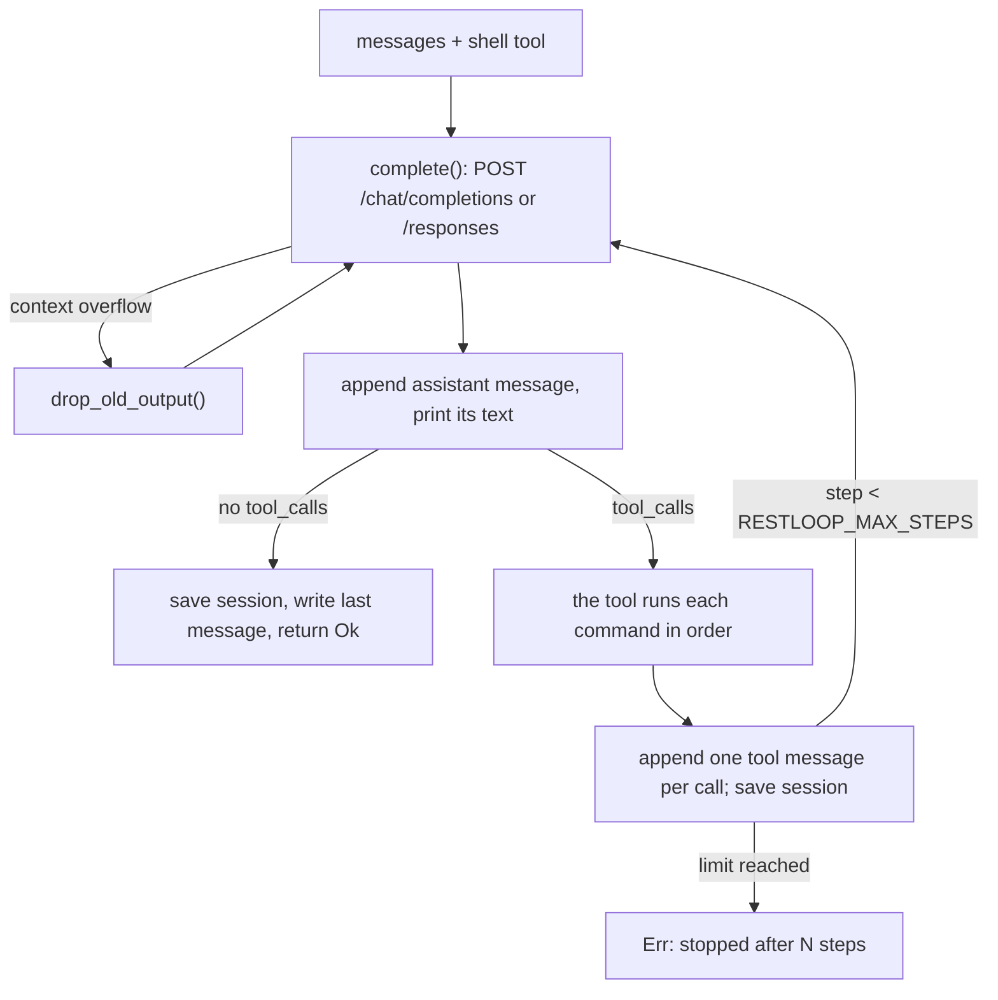

# How it works

**English** · [中文](zh/03-how-it-works.md)

`run()` in `src/lib.rs` does everything: a step is one model reply plus the commands it requested.

Sources: [lib.rs:82-114](../src/lib.rs#L82-L114) · [lib.rs:181-185](../src/lib.rs#L181-L185)

## What the conversation holds

The system prompt (`system_prompt()`) comes first: instructions plus OS, shell, working directory, command timeout and, with a deadline, the budget. Then come user tasks and, per model reply, an assistant message keeping only `content`, `tool_calls` and, when present, `reasoning_content` and the Responses API's `output_items`.

Each tool call gets one `tool` message with the matching `tool_call_id`.

Sources: [lib.rs:204-215](../src/lib.rs#L204-L215) · [lib.rs:125-141](../src/lib.rs#L125-L141) · [lib.rs:152-155](../src/lib.rs#L152-L155) · [lib.rs:180-181](../src/lib.rs#L180-L181)

## Requests and retries

`complete()` posts `{"model", "messages", "tools"}` to `/chat/completions`, plus `reasoning_effort` if set, without sampling parameters, token limit or streaming. The key is reread per attempt; an unreadable key file fails with `cannot read <path>`, a key with an inner line break with `the key cannot go in a header`. Redirects are not followed (a 3xx fails), so the extra headers ([Usage and configuration](02-usage.md)) never reach another host.

Network errors, HTTP 429, 5xx, a 200 without `choices[0].message` (MiniMax errors, `333b7b64`) and an empty reply (no tool call, no text past a leading `<think>`) are retried: five attempts, sleeping 2, 4, 8, 16 s, printing `restloop: <what>, retrying`; a fifth empty reply is final. A body with `insufficient_quota` or `subscription_sharing_usage_limit_exceeded` fails at once, unless the reply is empty. Other statuses and a fifth failure fail the task: `<what>: <text>` (`HTTP <status>`, `request failed` or `no reply`), or the deadline form below. A non-JSON 200 fails at once with `bad response`.

Sources: [lib.rs:319-450](../src/lib.rs#L319-L450) · [commit 333b7b64](https://github.com/lhwzds/restloop/commit/333b7b64)

## The Responses API

With `RESTLOOP_WIRE_API=responses`, `complete()` posts to `/responses`. The conversation stays in chat format; `responses_request()` converts it per request: a leading system message becomes `instructions`, a `tool` message a `function_call_output`, and an assistant message its `output_items` or, lacking them, its text and `function_call` items. It adds `store: false`, `stream: true`, encrypted reasoning in `include`, a `prompt_cache_key` hashed from the system prompt and, if set, `reasoning.effort`.

`responses_reply()` reads the event stream until `response.completed` and builds a chat reply: text (or refusal), tool calls, usage under chat names, and `output_items`, the output in `output_index` order minus message and call ids. These go back verbatim, so reasoning survives without server-side storage. A stream that breaks or ends early is retried; a reported failure (`response.failed`, `response.incomplete`, `error`) only for `server_error`, `rate_limit` or `unavailable`.

Sources: [lib.rs:320-333](../src/lib.rs#L320-L333) · [lib.rs:377-387](../src/lib.rs#L377-L387) · [lib.rs:413-429](../src/lib.rs#L413-L429) · [lib.rs:452-565](../src/lib.rs#L452-L565)

## Recovering from a full context window

`too_long()` (`21f3c1dc`) recognises a context overflow: an HTTP 400 or 413, or a Responses stream failure (`no reply: `), whose text contains a provider phrase (`context_length_exceeded`, "maximum context length", "context window exceeds", "prompt is too long", "exceeds the available context size"). `04004c68` dropped looser words like "too long", which an overlong `tool_call_id` matched.

On a match, `drop_old_output()` cuts the older half (rounded up) of the `tool` messages not yet shortened to their first line plus `[output removed to fit the context window]`, empties old reasoning with `trim_thinking()`, and the request is retried. Each retry halves the rest; when nothing changes, the error is returned. Commands and visible replies stay.

Sources: [lib.rs:103-114](../src/lib.rs#L103-L114) · [lib.rs:248-284](../src/lib.rs#L248-L284) · [commit 21f3c1dc](https://github.com/lhwzds/restloop/commit/21f3c1dc) · [commit 04004c68](https://github.com/lhwzds/restloop/commit/04004c68)

## Emptying old reasoning

`trim_thinking()` empties the reasoning of every assistant message except the last two: `reasoning_content` becomes `""`, `reasoning` items are removed from `output_items` (message items keep their phase), and a leading `<think>` block is cut from `content`. The key stays, empty (`70f40924`): DeepSeek's thinking mode rejects (HTTP 400) a tool-turn assistant message without it. Already emptied messages do not count as changed, so retries terminate.

Sources: [lib.rs:217-246](../src/lib.rs#L217-L246) · [commit 70f40924](https://github.com/lhwzds/restloop/commit/70f40924) · [commit f09603f4](https://github.com/lhwzds/restloop/commit/f09603f4)

## The time budget

`RESTLOOP_DEADLINE` (`f9d3b4f0`: Terminal-Bench tasks ran out of time unaware) bounds the task:

1. A new conversation's system prompt ends with `You have Ns in total for this task; each tool result ends with the time used so far.`; a resumed session's new task, a similar sentence ([Usage and configuration](02-usage.md)).
2. Each command's tool result ends with `[time used: Ns of Ds]`.
3. A command's timeout is the smaller of `RESTLOOP_TIMEOUT` and the time left (floored at 1 s); the CLI starts none after it.
4. A model request gets the time left after the key is read (600 s at most); none starts after it: `restloop: deadline of <N>s reached`. A retry sleep reaching it stops with `deadline of <N>s reached (<what>: <text>)`; a failed fifth attempt only if the deadline has passed (`a4ba4994`).

Time counts from process start; one budget covers all stdin tasks.

Sources: [lib.rs:207-215](../src/lib.rs#L207-L215) · [main.rs:55-63](../src/main.rs#L55-L63) · [lib.rs:158-163](../src/lib.rs#L158-L163) · [lib.rs:169-174](../src/lib.rs#L169-L174) · [lib.rs:340-364](../src/lib.rs#L340-L364) · +4

## Running a command

`run()` takes the runner as a callback; the CLI's, the public `shell::shell()`, runs each command in a fresh shell in the current directory: `sh -c` on Unix; on Windows, `Git\bin\bash.exe` under `ProgramFiles` or `ProgramFiles(x86)` if present (models write bash; PowerShell 5.1 adds a BOM), else `powershell -NoProfile -NonInteractive` with UTF-8 output. stdin is null and `GIT_TERMINAL_PROMPT=0`; `PYTHONUTF8=1` keeps Python I/O in UTF-8.

After the shell exits, processes holding its pipes get up to 2 s more, never past the timeout; then the whole process group (a job object on Windows) is stopped, and `exit:` still reports the shell's code. On Unix a stop is SIGTERM, up to 1 s, then SIGKILL; Windows uses `TerminateJobObject`. A background service that redirects its output (`server > log 2>&1 &`) lives until the task ends: [Overview](01-overview.md). Inherited variables: [Usage and configuration](02-usage.md).

Sources: [shell.rs:44-54](../src/shell.rs#L44-L54) · [shell.rs:101-206](../src/shell.rs#L101-L206) · [shell.rs:279-332](../src/shell.rs#L279-L332) · [main.rs:65-67](../src/main.rs#L65-L67) · [commit 92c09fd2](https://github.com/lhwzds/restloop/commit/92c09fd2) · +1

## What the model sees from a command

A command's tool result is `exit: <status>` on the first line, then the combined output. Except: invalid arguments give `error: arguments must be JSON…`, a shell that cannot start gives `error: <reason>`. The status is the exit code, `killed` when a signal ended the shell, `exited, status unknown` when the child is gone without one, or `timeout after Ns`; a stopped command not seen to exit adds `(child did not exit after SIGKILL)`. Output over 10,000 characters (`MAX_OUTPUT`) keeps the first and last 5,000 with `... [N chars truncated] ...` between. Output past 1 MiB is dropped first; invalid UTF-8 is replaced.

Sources: [shell.rs:171-176](../src/shell.rs#L171-L176) · [shell.rs:184-189](../src/shell.rs#L184-L189) · [shell.rs:14-16](../src/shell.rs#L14-L16) · [shell.rs:136-139](../src/shell.rs#L136-L139) · [shell.rs:199-219](../src/shell.rs#L199-L219) · +1
