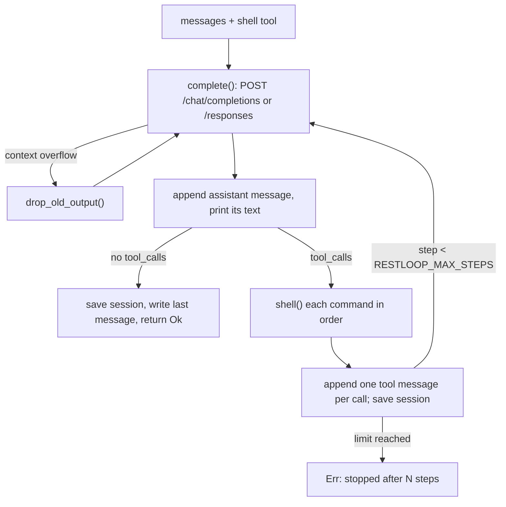

# How it works

**English** · [中文](zh/03-how-it-works.md)

Everything happens in `run()`: one iteration (a step) is one model reply plus the commands it requested.

Sources: [main.rs:126-131](../src/main.rs#L126-L131) · [main.rs:140-150](../src/main.rs#L140-L150) · [main.rs:216-218](../src/main.rs#L216-L218)

## What the conversation holds

The first message is the system prompt from `system_prompt()`: the agent's instructions plus the OS, the shell (`sh`, `bash (Git Bash)` or `PowerShell`), the working directory, the command timeout and, with a deadline, the budget. Then come user tasks and, per model reply, an assistant message keeping only `content`, `tool_calls` and, when present, `reasoning_content` and the Responses API's `output_items`.

Each tool call gets one `tool` message with the matching `tool_call_id`. Arguments that are not JSON with a `command` string get an error quoting them, so the model can correct itself. Calls run one at a time, in order.

Sources: [main.rs:82-99](../src/main.rs#L82-L99) · [main.rs:161-177](../src/main.rs#L161-L177) · [main.rs:189-214](../src/main.rs#L189-L214)

## Requests and retries

`complete()` posts `{"model", "messages", "tools"}` to `/chat/completions`, plus `reasoning_effort` if set, with no sampling parameters, token limit or streaming. The key is read before every attempt (see [Usage and configuration](02-usage.md)); an unreadable key file fails the task with `cannot read <path>`. Each attempt may take up to 600 s.

Network errors, HTTP 429, HTTP 5xx and an HTTP 200 without `choices[0].message` (how MiniMax reports some errors, `333b7b64`) are retried, five attempts in all, sleeping 2, 4, 8 and 16 s and printing `restloop: <what>, retrying`. A body naming `insufficient_quota` or `subscription_sharing_usage_limit_exceeded` (credits or plan used up) fails at once. Any other status, or the fifth failure, becomes `HTTP <status>: <body>` (or `request failed: ...`, `no reply: ...`) and fails the task (exit codes in [Usage and configuration](02-usage.md)). A 200 whose body is not JSON fails at once with `bad response`.

Sources: [main.rs:313-399](../src/main.rs#L313-L399) · [commit 333b7b64](https://github.com/lhwzds/restloop/commit/333b7b64)

## The Responses API

With `RESTLOOP_WIRE_API=responses`, `complete()` posts to `/responses`. The conversation stays in chat format, in memory and in the session file; `responses_request()` converts it per request: a leading system message becomes `instructions`, a `tool` message a `function_call_output`, and an assistant message its `output_items` or, lacking them, its text and `function_call` items. It adds `store: false`, `stream: true`, encrypted reasoning in `include`, a `prompt_cache_key` hashed from the system prompt and, if set, `reasoning.effort`.

`responses_reply()` reads the event stream until `response.completed` and builds a chat reply: text (or refusal), tool calls, usage under chat names, and `output_items`, the output in `output_index` order minus message and call ids. These go back verbatim, so reasoning survives without server-side storage. A stream that breaks or ends early is retried; a reported failure (`response.failed`, `response.incomplete`, `error`) only for `server_error`, `rate_limit` or `unavailable`.

Sources: [main.rs:313-328](../src/main.rs#L313-L328) · [main.rs:373-394](../src/main.rs#L373-L394) · [main.rs:401-514](../src/main.rs#L401-L514)

## Recovering from a full context window

Since `21f3c1dc`, `too_long()` recognises a context overflow: an HTTP 400 or 413, or a Responses stream failure (`no reply: `), whose text contains a provider phrase (`context_length_exceeded`, "maximum context length", "context window exceeds", "prompt is too long", "exceeds the available context size"). `04004c68` dropped looser words like "too long" after an overlong `tool_call_id` triggered history cuts.

On a match, `drop_old_output()` cuts the older half (rounded up) of the `tool` messages not yet shortened to their first line plus `[output removed to fit the context window]`, empties old reasoning with `trim_thinking()`, and the request is retried. Each retry halves what is left; when nothing changes, the error is returned. Commands and visible replies stay, so the model still knows what it did.

Sources: [main.rs:141-150](../src/main.rs#L141-L150) · [main.rs:268-311](../src/main.rs#L268-L311) · [commit 21f3c1dc](https://github.com/lhwzds/restloop/commit/21f3c1dc) · [commit 04004c68](https://github.com/lhwzds/restloop/commit/04004c68)

## Emptying old reasoning

`trim_thinking()` empties the reasoning of every assistant message except the last two: `reasoning_content` becomes `""`, `reasoning` items are removed from `output_items` (message items keep their phase), and any text up to `</think>` is cut from `content`. Since `70f40924` the key is kept with an empty value rather than deleted, because DeepSeek's thinking mode answers HTTP 400 when an assistant message in a tool turn has lost the field. A message already emptied does not count as changed, so repeated overflow retries terminate.

Sources: [main.rs:235-266](../src/main.rs#L235-L266) · [commit 70f40924](https://github.com/lhwzds/restloop/commit/70f40924) · [commit f09603f4](https://github.com/lhwzds/restloop/commit/f09603f4)

## The time budget

`RESTLOOP_DEADLINE` (`f9d3b4f0`, after Terminal-Bench tasks spent their limit on installs and sweeps unaware of it) does three things:

1. A new conversation's system prompt ends with `You have Ns in total for this task; each tool result ends with the time used so far.` A resumed session's new task carries a similar sentence (see [Usage and configuration](02-usage.md)).
2. Each command's tool result ends with `[time used: Ns of Ds]`.
3. Each command's timeout becomes the smaller of `RESTLOOP_TIMEOUT` and the time left; only the time left is floored at 1 s.

RestLoop never stops the model at the deadline; the caller does. Time counts from process start, so in stdin mode the budget covers all tasks.

Sources: [main.rs:86-98](../src/main.rs#L86-L98) · [main.rs:101-111](../src/main.rs#L101-L111) · [main.rs:195-206](../src/main.rs#L195-L206) · [commit f9d3b4f0](https://github.com/lhwzds/restloop/commit/f9d3b4f0)

## Running a command

Each command runs in a fresh shell in the current directory: `sh -c` on Unix; on Windows, `Git\bin\bash.exe` under `ProgramFiles` or `ProgramFiles(x86)` if present (models write bash; PowerShell 5.1 adds a BOM), else `powershell -NoProfile -NonInteractive` with UTF-8 output. stdin is null and `GIT_TERMINAL_PROMPT=0` is set, so nothing waits for input; `PYTHONUTF8=1` keeps Python I/O in UTF-8.

After the shell exits, processes holding its pipes get up to 2 s more, never past the timeout; then the whole process group (a job object on Windows) is killed, and `exit:` still reports the shell's code. A background service survives if its output is redirected (`server > log 2>&1 &`). A timeout kills everything the command started. On Unix the kills use the shell builtin `kill -9 -<pgid>` (slim containers often lack `/bin/kill`); Windows uses `TerminateJobObject`.

Sources: [main.rs:516-606](../src/main.rs#L516-L606) · [commit 92c09fd2](https://github.com/lhwzds/restloop/commit/92c09fd2) · [commit 3b27682c](https://github.com/lhwzds/restloop/commit/3b27682c)

## What the model sees from a command

A command's tool result is `exit: <status>` on the first line, then the combined output. Two differ: invalid arguments give `error: arguments must be JSON…`, a shell that cannot start gives `error: <reason>`. The status is the exit code, `killed` when a signal ended the shell, or `timeout after Ns`. Output over 10,000 characters (`MAX_OUTPUT`) keeps the first and last 5,000 with `... [N chars truncated] ...` between. Invalid UTF-8 is replaced.

Sources: [main.rs:598-619](../src/main.rs#L598-L619)
