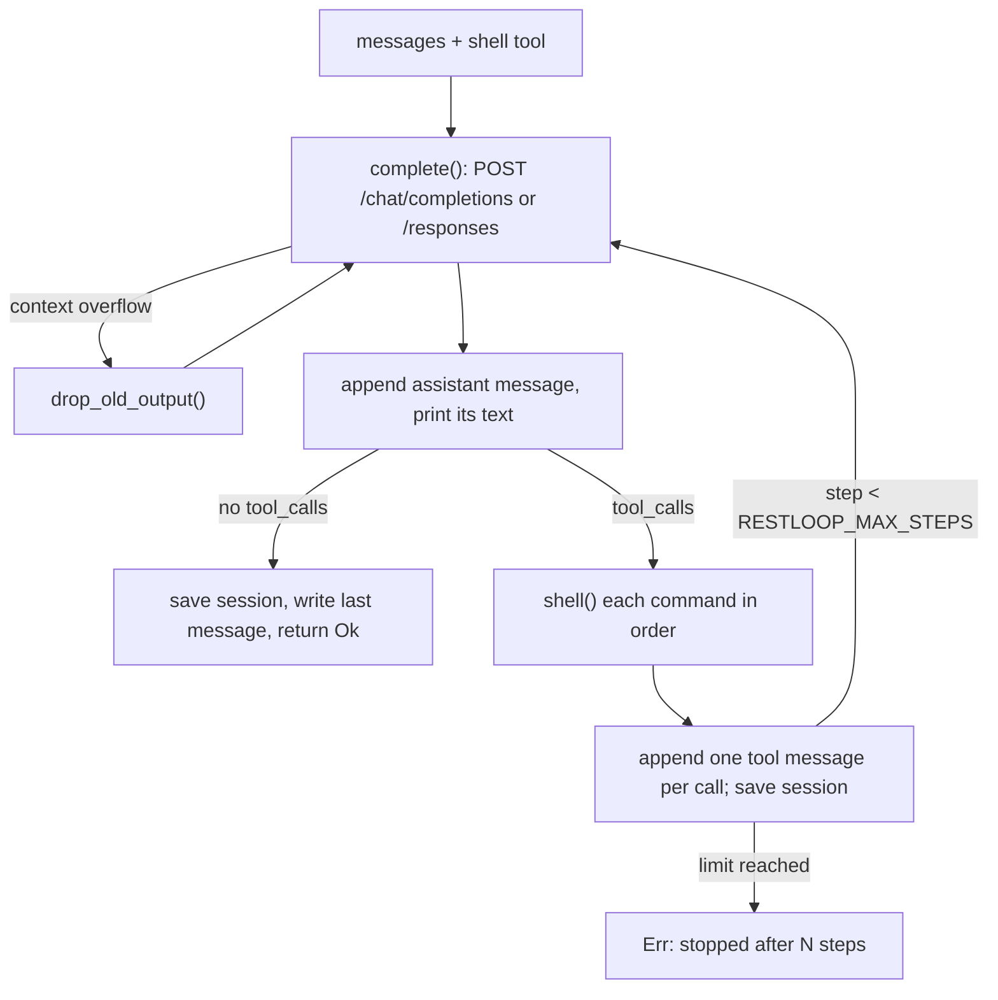
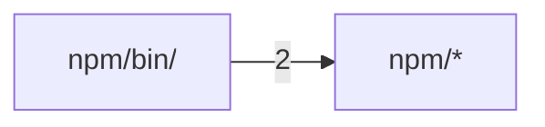

# restloop

<sub>**English** · [中文](zh/all.md)</sub>

These docs go one level below the README for RestLoop, a single-file Rust agent loop that gives a model one `shell` tool. They describe v0.3.0. Compared with v0.2.0 it adds the Responses API (`RESTLOOP_WIRE_API=responses`), `RESTLOOP_API_KEY_FILE` and `RESTLOOP_REASONING_EFFORT`; a used-up quota is no longer retried, model requests are bounded by `RESTLOOP_DEADLINE`, an unreadable response body is retried, and CI checks these docs. Read them in order: what RestLoop is and the first run, the exact command-line and environment interface, how the loop, the HTTP client and the command runner work and why, and finally how binaries are built and released and how to change the code.

<a id="overview"></a>

## Overview

RestLoop is a coding agent reduced to its loop: it sends a conversation and one tool, `shell`, to an OpenAI-compatible `/chat/completions` endpoint (or OpenAI's `/responses`), runs every command the model asks for, sends back the output, and stops when the model answers without a tool call. The whole program is `src/main.rs`; its only dependencies are `ureq` for HTTPS and `serde_json`.

It exists because its predecessor, RestFlow (up to 0.5), had grown into a TUI, a daemon, a runner and an executable-skills system. Commit `33511748` replaced all of that with one file and no storage, and `cad33d13` renamed the result RestLoop and restarted versioning at 0.1.0. Most later features (a configurable step limit, the time budget, usage logging) were added in response to benchmark runs, mostly Terminal-Bench, and each is an environment variable: the time budget and usage logging stay off unless set, and the step limit defaults to 100 steps.

<sub>Sources: [main.rs:1-13](../src/main.rs#L1-L13) · [README.md:33-35](../README.md#L33-L35) · [Cargo.toml:1-11](../Cargo.toml#L1-L11) · [commit 33511748](https://github.com/lhwzds/restloop/commit/33511748) · [commit cad33d13](https://github.com/lhwzds/restloop/commit/cad33d13)</sub>

### What it deliberately leaves out

- **One tool.** The model reads, writes and edits files through `shell`; there is no file-edit, search or patch tool. Its only parameter is `command`.
- **No model-facing knobs.** The system prompt from `system_prompt()` and the tool schema are fixed. Commit `3b27682c` records why the command timeout is not a tool parameter: in A/B runs a model-adjustable timeout roughly doubled the number of steps.
- **No configuration file and no database.** All options are environment variables read at the point of use; RestLoop itself writes only the optional session and last-message files (see [Usage and configuration](#usage)).
- **No sandbox and no confirmation.** Commands run with your permissions in the current directory. Isolation is the caller's job: a container or a throwaway checkout.

<sub>Sources: [main.rs:82-99](../src/main.rs#L82-L99) · [main.rs:126-131](../src/main.rs#L126-L131) · [commit 3b27682c](https://github.com/lhwzds/restloop/commit/3b27682c)</sub>

### A first result

Install with Homebrew (`brew install lhwzds/tap/restloop`), npm (`npm install -g restloop`) or `cargo install --git https://github.com/lhwzds/restloop`. Only `RESTLOOP_MODEL` is required. The endpoint defaults to `https://api.openai.com/v1`, so for OpenAI a key and a model name are enough:

```bash
export RESTLOOP_API_KEY=sk-...
export RESTLOOP_MODEL=<model-id>
cd some-checkout
restloop "make the failing test pass"
```

For other providers set `RESTLOOP_BASE_URL` to the part before `/chat/completions`. Exit codes and every option are described in [Usage and configuration](#usage).

<sub>Sources: [README.md:19-26](../README.md#L19-L26) · [README.md:31-39](../README.md#L31-L39) · [main.rs:314-315](../src/main.rs#L314-L315)</sub>

<a id="usage"></a>

## Usage and configuration

RestLoop has no flags except `-h`/`--help`, which prints the list of environment variables. Everything else is the task text and the environment. This page lists the exact interface; [How it works](#how-it-works) explains what each option does to the loop.

<sub>Sources: [main.rs:15-27](../src/main.rs#L15-L27)</sub>

### One task or a stdin session

All arguments are joined with spaces into one task: `restloop fix the build` and `restloop "fix the build"` are the same.

- **With a task**, RestLoop runs it and exits: status 0 when the model finished, 1 when the run failed (an API error after retries, or the step limit).
- **Without a task**, it prints `> ` on stderr and reads one task per line from stdin until end of input. Empty lines are skipped. All tasks share one conversation, so a later line can refer to earlier work. A failed task is reported on stderr and the loop continues.

Status 2 means the run never started: `RESTLOOP_MODEL` is unset, or `RESTLOOP_SESSION` names a file that is not a session.

<sub>Sources: [main.rs:15-27](../src/main.rs#L15-L27) · [main.rs:29-62](../src/main.rs#L29-L62)</sub>

### Environment variables

| Variable | Default | Effect |
|---|---|---|
| `RESTLOOP_MODEL` | required | `model` field of every request |
| `RESTLOOP_API_KEY` | empty | sent as `Authorization: Bearer <key>` |
| `RESTLOOP_API_KEY_FILE` | unset | file holding the key instead, read and trimmed before every request, so another program can refresh a short-lived token |
| `RESTLOOP_BASE_URL` | `https://api.openai.com/v1` | `/chat/completions` (or `/responses`) is appended; a trailing `/` is ignored |
| `RESTLOOP_WIRE_API` | chat completions | `responses` uses the OpenAI Responses API; other values are ignored |
| `RESTLOOP_REASONING_EFFORT` | unset | e.g. `low`, sent as `reasoning_effort` (or `reasoning.effort`) |
| `RESTLOOP_TIMEOUT` | `120` | seconds a single command may run |
| `RESTLOOP_MAX_STEPS` | `100` | steps per task: one model reply and its commands (retries and overflow recovery stay within the step) |
| `RESTLOOP_DEADLINE` | unset | seconds for the whole task; see [How it works](#how-it-works) |
| `RESTLOOP_LOG_USAGE` | unset | `1` logs the token usage of each model reply on stderr |
| `RESTLOOP_LAST_MESSAGE` | unset | file that receives the final reply |
| `RESTLOOP_SESSION` | unset | conversation file to resume and save |

Numbers that do not parse as an unsigned integer silently fall back to the default (`env_num`). `RESTLOOP_LOG_USAGE` must be exactly `1`; empty strings count as unset for the key file and the effort.

<sub>Sources: [main.rs:10-13](../src/main.rs#L10-L13) · [main.rs:112-124](../src/main.rs#L112-L124) · [main.rs:132-140](../src/main.rs#L132-L140) · [main.rs:313-350](../src/main.rs#L313-L350) · [commit f09603f4](https://github.com/lhwzds/restloop/commit/f09603f4)</sub>

### What goes to stdout and stderr

stdout carries only the model's text: every non-empty reply is printed, trimmed, including the short comments a model writes alongside tool calls. There is no separator between steps, so a script that needs only the final answer should use `RESTLOOP_LAST_MESSAGE`.

stderr carries everything else: each command as a dimmed `$ <command>`, then its duration and the first 10 lines of its output, retry and context-overflow notices, and with `RESTLOOP_LOG_USAGE=1` one line per step that gets a reply, from that reply's usage (retried requests are not logged):

```
usage: step=3 prompt_tokens=8123 completion_tokens=412 cached_tokens=7936 elapsed=41s
```

Fields the provider does not report print as `null`.

<sub>Sources: [main.rs:151-165](../src/main.rs#L151-L165) · [main.rs:189-214](../src/main.rs#L189-L214) · [main.rs:144-147](../src/main.rs#L144-L147)</sub>

### The final-reply file

With `RESTLOOP_LAST_MESSAGE=<path>`, each task first deletes that file, then, when the model replies without a tool call, writes the reply text to it with a trailing newline. Anything up to the last `</think>` is cut off, for models that inline their reasoning. The delete is best-effort (errors are ignored), so a run that ends early (step limit, API error, kill) usually leaves no file rather than the previous answer; for certainty, pass a fresh path on every run.

<sub>Sources: [main.rs:134-139](../src/main.rs#L134-L139) · [main.rs:178-187](../src/main.rs#L178-L187) · [commit e8312d19](https://github.com/lhwzds/restloop/commit/e8312d19)</sub>

### Session files: resume and fork

`RESTLOOP_SESSION=<path>` persists the conversation as JSON:

```json
{"version": 1, "messages": [{"role": "system", "content": "..."}, ...]}
```

`messages` is exactly what the next request will send, in OpenAI chat format (with the Responses API, before conversion). `conversation()` loads it: a missing file starts a new conversation, created after the first step; an existing file needs `version` 1 and a non-empty `messages` array, or RestLoop exits with status 2. Nothing else is checked, so the file may be edited between runs: any valid chat messages are sent as they are. After editing an assistant message, remove its `output_items`, which would otherwise be sent instead.

Run again with the same path to resume; copy the file first to fork. The saved system prompt is reused unchanged. With `RESTLOOP_DEADLINE`, a resumed task gets `[You have Ns in total for this request; the time used in tool results counts from now.]` appended. The file is replaced after every step through a `<path>.<pid>.tmp` rename, so after a kill it holds the last complete step. Concurrent runs never corrupt it, but the last writer wins.

<sub>Sources: [main.rs:28-29](../src/main.rs#L28-L29) · [main.rs:63-80](../src/main.rs#L63-L80) · [main.rs:220-233](../src/main.rs#L220-L233) · [README.md:62-79](../README.md#L62-L79) · [commit ffd11c37](https://github.com/lhwzds/restloop/commit/ffd11c37) · +2</sub>

<a id="how-it-works"></a>

## How it works

Everything happens in `run()`: one iteration (a step) is one model reply plus the commands it requested.



<sub>Sources: [main.rs:126-131](../src/main.rs#L126-L131) · [main.rs:140-150](../src/main.rs#L140-L150) · [main.rs:216-218](../src/main.rs#L216-L218)</sub>

### What the conversation holds

The system prompt from `system_prompt()` comes first: instructions plus OS, shell, working directory, command timeout and, with a deadline, the budget. Then come user tasks and, per model reply, an assistant message keeping only `content`, `tool_calls` and, when present, `reasoning_content` and the Responses API's `output_items`.

Each tool call gets one `tool` message with the matching `tool_call_id`. Arguments that are not JSON with a `command` string get an error quoting them, so the model can fix them.

<sub>Sources: [main.rs:82-99](../src/main.rs#L82-L99) · [main.rs:161-177](../src/main.rs#L161-L177) · [main.rs:189-214](../src/main.rs#L189-L214)</sub>

### Requests and retries

`complete()` posts `{"model", "messages", "tools"}` to `/chat/completions`, plus `reasoning_effort` if set, without sampling parameters, token limit or streaming. The key is reread per attempt ([Usage and configuration](#usage)); an unreadable key file fails with `cannot read <path>`. An attempt may take min(600 s, time left).

Network errors (unreadable bodies included), HTTP 429, 5xx and a 200 without `choices[0].message` (some MiniMax errors, `333b7b64`) are retried: five attempts, sleeping 2, 4, 8, 16 s, printing `restloop: <what>, retrying`. A body with `insufficient_quota` or `subscription_sharing_usage_limit_exceeded` fails at once. Other statuses fail the task at once with `<what>: <text>`, `<what>` being `HTTP <status>`, `request failed` or `no reply`; so does the fifth failure (once the deadline is reached, the deadline form below). A 200 whose body is not JSON fails at once with `bad response`.

<sub>Sources: [main.rs:313-422](../src/main.rs#L313-L422) · [commit 333b7b64](https://github.com/lhwzds/restloop/commit/333b7b64)</sub>

### The Responses API

With `RESTLOOP_WIRE_API=responses`, `complete()` posts to `/responses`. The conversation stays in chat format, in memory and on disk; `responses_request()` converts it per request: a leading system message becomes `instructions`, a `tool` message a `function_call_output`, and an assistant message its `output_items` or, lacking them, its text and `function_call` items. It adds `store: false`, `stream: true`, encrypted reasoning in `include`, a `prompt_cache_key` hashed from the system prompt and, if set, `reasoning.effort`.

`responses_reply()` reads the event stream until `response.completed` and builds a chat reply: text (or refusal), tool calls, usage under chat names, and `output_items`, the output in `output_index` order minus message and call ids. These go back verbatim, so reasoning survives without server-side storage. A stream that breaks or ends early is retried; a reported failure (`response.failed`, `response.incomplete`, `error`) only for `server_error`, `rate_limit` or `unavailable`.

<sub>Sources: [main.rs:313-328](../src/main.rs#L313-L328) · [main.rs:359-364](../src/main.rs#L359-L364) · [main.rs:387-401](../src/main.rs#L387-L401) · [main.rs:425-538](../src/main.rs#L425-L538)</sub>

### Recovering from a full context window

Since `21f3c1dc`, `too_long()` recognises a context overflow: an HTTP 400 or 413, or a Responses stream failure (`no reply: `), whose text contains a provider phrase (`context_length_exceeded`, "maximum context length", "context window exceeds", "prompt is too long", "exceeds the available context size"). `04004c68` dropped looser words like "too long" after an overlong `tool_call_id` triggered history cuts.

On a match, `drop_old_output()` cuts the older half (rounded up) of the `tool` messages not yet shortened to their first line plus `[output removed to fit the context window]`, empties old reasoning with `trim_thinking()`, and the request is retried. Each retry halves the rest; when nothing changes, the error is returned. Commands and visible replies stay, so the model knows what it did.

<sub>Sources: [main.rs:141-150](../src/main.rs#L141-L150) · [main.rs:268-311](../src/main.rs#L268-L311) · [commit 21f3c1dc](https://github.com/lhwzds/restloop/commit/21f3c1dc) · [commit 04004c68](https://github.com/lhwzds/restloop/commit/04004c68)</sub>

### Emptying old reasoning

`trim_thinking()` empties the reasoning of every assistant message except the last two: `reasoning_content` becomes `""`, `reasoning` items are removed from `output_items` (message items keep their phase), and any text up to `</think>` is cut from `content`. Since `70f40924` the key is kept with an empty value rather than deleted, since DeepSeek's thinking mode rejects (HTTP 400) a tool-turn assistant message missing it. Already emptied messages do not count as changed, so retries terminate.

<sub>Sources: [main.rs:235-266](../src/main.rs#L235-L266) · [commit 70f40924](https://github.com/lhwzds/restloop/commit/70f40924) · [commit f09603f4](https://github.com/lhwzds/restloop/commit/f09603f4)</sub>

### The time budget

`RESTLOOP_DEADLINE` (`f9d3b4f0`: Terminal-Bench tasks ran out of time unaware) bounds the task:

1. A new conversation's system prompt ends with `You have Ns in total for this task; each tool result ends with the time used so far.`; a resumed session's new task, a similar sentence ([Usage and configuration](#usage)).
2. Each command's tool result ends with `[time used: Ns of Ds]`.
3. A command's timeout is the smaller of `RESTLOOP_TIMEOUT` and the time left (floored at 1 s).
4. A model request gets the time left after the key file is read (600 s at most); none starts after it: `restloop: deadline of <N>s reached`. A retry sleep reaching it stops with `deadline of <N>s reached (<what>: <text>)`; a failed fifth attempt (no sleep) only if the deadline has passed (`a4ba4994`).

Time counts from process start: in stdin mode one budget covers all tasks.

<sub>Sources: [main.rs:86-98](../src/main.rs#L86-L98) · [main.rs:101-111](../src/main.rs#L101-L111) · [main.rs:195-206](../src/main.rs#L195-L206) · [main.rs:342-350](../src/main.rs#L342-L350) · [main.rs:405-418](../src/main.rs#L405-L418) · +2</sub>

### Running a command

Each command runs in a fresh shell in the current directory: `sh -c` on Unix; on Windows, `Git\bin\bash.exe` under `ProgramFiles` or `ProgramFiles(x86)` if present (models write bash; PowerShell 5.1 adds a BOM), else `powershell -NoProfile -NonInteractive` with UTF-8 output. stdin is null and `GIT_TERMINAL_PROMPT=0` is set, so nothing waits for input; `PYTHONUTF8=1` keeps Python I/O in UTF-8.

After the shell exits, processes holding its pipes get up to 2 s more, never past the timeout; then the whole process group (a job object on Windows) is killed, and `exit:` still reports the shell's code. A background service survives once it stops holding those pipes, e.g. by redirecting output (`server > log 2>&1 &`). A timeout kills the process group; on Unix a child that left it survives. On Unix the kills use the shell builtin `kill -9 -<pgid>` (slim containers often lack `/bin/kill`); Windows uses `TerminateJobObject`.

<sub>Sources: [main.rs:540-630](../src/main.rs#L540-L630) · [commit 92c09fd2](https://github.com/lhwzds/restloop/commit/92c09fd2) · [commit 3b27682c](https://github.com/lhwzds/restloop/commit/3b27682c)</sub>

### What the model sees from a command

A command's tool result is `exit: <status>` on the first line, then the combined output. Two differ: invalid arguments give `error: arguments must be JSON…`, a shell that cannot start gives `error: <reason>`. The status is the exit code, `killed` when a signal ended the shell, or `timeout after Ns`. Output over 10,000 characters (`MAX_OUTPUT`) keeps the first and last 5,000 with `... [N chars truncated] ...` between. Invalid UTF-8 is replaced.

<sub>Sources: [main.rs:622-643](../src/main.rs#L622-L643)</sub>

<a id="contributing"></a>

## Building, releasing and contributing

`cargo build --release` produces `target/release/restloop`. The crate uses edition 2024 and `let` chains inside `if`, so it needs a toolchain where both are stable (Rust 1.88 or newer). The release profile optimises for size (`opt-level = "z"`, LTO, one codegen unit, `panic = "abort"`, stripped).

Tests live in `src/tests.rs` and run with `cargo test`; `.github/workflows/ci.yml` runs `cargo fmt --check`, `cargo clippy --all-targets -- -D warnings` and the tests on macOS, Linux and Windows for every push to `main` and every pull request. Run the same three commands before opening one. A `docs` job on Linux checks out the full history (`fetch-depth: 0`, so cited commits resolve), installs Codocia 0.2 and runs `codocia check`, so stale docs or `README_CN.md` fail CI.

<sub>Sources: [Cargo.toml:1-18](../Cargo.toml#L1-L18) · [main.rs:601-608](../src/main.rs#L601-L608) · [ci.yml:1-34](../.github/workflows/ci.yml#L1-L34)</sub>

### What the tests cover

Unit tests pin: `too_long()` accepts recorded provider wordings and rejects near misses (an overlong `tool_call_id`, a 500, a network error); `drop_old_output()` halves until it returns 0; `trim_thinking()` spares the last two replies, empties `reasoning_content` and drops only `reasoning` items of `output_items`; `truncate()` keeps head and tail. `shell()` tests (every CI platform): the exit line with both streams, a timeout kill, a background `sleep 30 &` not blocking.

One end-to-end test drives `run()` against `serve()`, a local canned-reply server: a tool call, an overflow 400 and its retry, a session resume, a retried 200 without `choices`. Over the Responses API: the key file, output items sent back in order (only `message` and `function_call` items lose `id`), retried server and unavailable-plan failures, overflow recovery, failing at once on a used-up plan, content filter, invalid request or unreadable key file. Under a deadline: a server that hangs before or after its 200 headers, and repeated 500s, stop early with `deadline of`; a 400 is reported as usual; a passed deadline sends nothing. It alone touches `RESTLOOP_*`, clearing them and any `*_PROXY` first.

<sub>Sources: [tests.rs:8-97](../src/tests.rs#L8-L97) · [tests.rs:96-151](../src/tests.rs#L96-L151) · [tests.rs:153-438](../src/tests.rs#L153-L438) · [commit 4c468f27](https://github.com/lhwzds/restloop/commit/4c468f27) · [commit 333b7b64](https://github.com/lhwzds/restloop/commit/333b7b64) · +1</sub>

### Changing the loop

Conventions the history suggests:

- **Options are environment variables with the old behaviour as default.** Read numbers with `env_num` so an invalid value falls back to the default, and add the variable to the `--help` text in `main()` and to the README.
- **Keep the model-facing surface fixed** (see [Overview](#overview)). Changes to `system_prompt()` or the tool schema should come with benchmark evidence.
- **Keep the prompt prefix stable.** Anything that rewrites earlier messages breaks provider prompt caching; RestLoop does it only when the provider reports an overflow. A threshold-based trim was removed after an A/B showed no benefit (`f09603f4`).
- **Keep the program in one file with two dependencies.** The program is `src/main.rs`; its tests live in `src/tests.rs`. Its size and readability are the point.

<sub>Sources: [main.rs:118-124](../src/main.rs#L118-L124) · [tests.rs:1-6](../src/tests.rs#L1-L6) · [commit 3b27682c](https://github.com/lhwzds/restloop/commit/3b27682c) · [commit 740555b1](https://github.com/lhwzds/restloop/commit/740555b1) · [commit f09603f4](https://github.com/lhwzds/restloop/commit/f09603f4)</sub>

### How a release is made

Pushing a tag `vX.Y.Z` (prerelease tags do not match) runs `.github/workflows/release.yml`:

1. **build** compiles five targets: macOS arm64 and x86_64, Linux x86_64 and arm64 (static musl), Windows x86_64, named `restloop-<target>[.exe]`.
2. **release** writes `SHA256SUMS` plus one `.sha256` per binary and creates the GitHub release. It refuses to run if the release already exists: published binaries are never replaced, because the npm package pins their checksums. Re-run only failed jobs instead.
3. **homebrew** regenerates the `restloop` formula in `lhwzds/homebrew-tap` (needs the `HOMEBREW_TAP_TOKEN` secret) and commits only if it changed.
4. **npm**, also after **release**, stamps and publishes the npm package with trusted publishing; the npm package section below explains it.

Running the workflow by hand (`workflow_dispatch`) builds and checksums but publishes nothing, which makes it a dry run.

<sub>Sources: [release.yml:1-75](../.github/workflows/release.yml#L1-L75) · [release.yml:76-95](../.github/workflows/release.yml#L76-L95) · [release.yml:123-138](../.github/workflows/release.yml#L123-L138) · [release.yml:140-164](../.github/workflows/release.yml#L140-L164) · [commit b41c62a7](https://github.com/lhwzds/restloop/commit/b41c62a7) · +1</sub>

### The npm package

The npm package contains no binary. `npm/bin/restloop.js` looks up `"<platform> <arch>"` in `checksums.json`, and on first run downloads that asset from the `v<version>` GitHub release, verifies its SHA-256, and stores it next to itself (temporary file and rename). Later runs skip the download. Either way the launcher runs the binary, passing arguments and stdio through and returning its exit status.

A tag publishes the package from CI (`f76038cb`): after the GitHub release, the `npm` job runs `node npm/stamp.js X.Y.Z dist/SHA256SUMS`, which sets the package version and rewrites `checksums.json` for five platforms, then `npm publish --access public` from `npm/`. It uses npm trusted publishing (OIDC, `id-token: write`, npm 11.5.1 or later), so no npm token or secret is involved. Earlier releases were published by hand (`a21f7c21`).

The stamped `package.json` and `checksums.json` exist only on the runner and are never committed back, so the repository copies stay at the last manual stamp (0.3.0) and will lag the published version. At this commit `checksums.json` holds the five v0.3.0 entries: `darwin arm64`, `darwin x64`, `linux x64`, `linux arm64` (musl) and `win32 x64`.

<sub>Sources: [restloop.js:1-61](../npm/bin/restloop.js#L1-L61) · [stamp.js:1-31](../npm/stamp.js#L1-L31) · [checksums.json](../npm/checksums.json) · [release.yml:140-164](../.github/workflows/release.yml#L140-L164) · [commit a21f7c21](https://github.com/lhwzds/restloop/commit/a21f7c21) · +1</sub>

<a id="structure"></a>

## Code structure

Generated by Codocia from the code on every build: areas, each area's own description, import dependencies between areas, and the pages that explain them.

In scope: 12 files, 1,716 lines; excluded `Cargo.lock`, `LICENSE`, `.gitignore`

### Files

**Repository root**

- (root files) — 235 lines, 3 files. A minimal agent loop: one model, one shell tool.\
  Explained in: [Overview](#overview) (2), [Usage and configuration](#usage) (1), [Building, releasing and contributing](#contributing) (1)
- `.github/` — 198 lines, 2 files\
  Explained in: [Building, releasing and contributing](#contributing) (3)
- `src/` — 1,121 lines, 2 files\
  Hub files: `main.rs` `tests.rs`\
  Explained in: [Overview](#overview) (3), [Usage and configuration](#usage) (6), [How it works](#how-it-works) (9), [Building, releasing and contributing](#contributing) (3)

**`npm/`**

- (files) — 101 lines, 4 files. A minimal coding-agent loop: it keeps working on your task so you can rest.\
  Hub files: `stamp.js`\
  Explained in: [Building, releasing and contributing](#contributing) (1)
- `bin/` — 61 lines, 1 file\
  Hub files: `restloop.js`\
  Explained in: [Building, releasing and contributing](#contributing) (1)


### Dependencies

A → B means files in A import B; the number counts file-level imports. Showing the strongest 1 of 1 edges.


