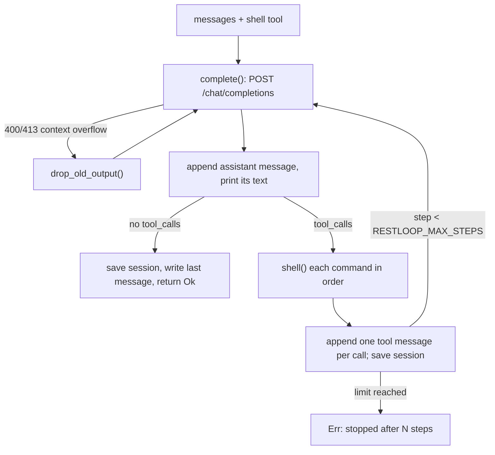
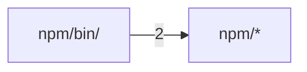

# restloop

These docs go one level below the README for RestLoop, a single-file Rust agent loop that gives a model one `shell` tool. They describe v0.2.0 at commit f09603f4. Compared with v0.1.0 it adds context-overflow recovery, `RESTLOOP_SESSION`, a test suite with CI and retries of HTTP 200 responses without a reply, and drops `RESTLOOP_TRIM_THINKING_AT`. Read them in order: what RestLoop is and the first run, the exact command-line and environment interface, how the loop, the HTTP client and the command runner work and why, and finally how binaries are built and released and how to change the code.

<a id="overview"></a>

## Overview

RestLoop is a coding agent reduced to its loop: it sends a conversation and one tool, `shell`, to an OpenAI-compatible `/chat/completions` endpoint, runs every command the model asks for, sends back the output, and stops when the model answers without a tool call. The whole program is `src/main.rs`; its only dependencies are `ureq` for HTTPS and `serde_json`.

It exists because its predecessor, RestFlow (up to 0.5), had grown into a TUI, a daemon, a runner and an executable-skills system. Commit `33511748` replaced all of that with one file and no storage, and `cad33d13` renamed the result RestLoop and restarted versioning at 0.1.0. Most later features (step limit, time budget, usage logging) were added in response to benchmark runs, mostly Terminal-Bench, which is why each one is an opt-in environment variable rather than a changed default.

<sub>Sources: [main.rs:1-13](../src/main.rs#L1-L13) · [Cargo.toml:1-11](../Cargo.toml#L1-L11) · [commit 33511748](https://github.com/lhwzds/restloop/commit/33511748) · [commit cad33d13](https://github.com/lhwzds/restloop/commit/cad33d13)</sub>

### What it deliberately leaves out

- **One tool.** The model reads, writes and edits files through `shell`; there is no file-edit, search or patch tool. Its only parameter is `command`.
- **No model-facing knobs.** The system prompt from `system_prompt()` and the tool schema are fixed. Commit `3b27682c` records why the command timeout is not a tool parameter: in A/B runs a model-adjustable timeout roughly doubled the number of steps.
- **No configuration file and no database.** All options are environment variables read at the point of use; RestLoop itself writes only the optional session and last-message files (see [Usage and configuration](#usage)).
- **No sandbox and no confirmation.** Commands run with your permissions in the current directory. Isolation is the caller's job: a container or a throwaway checkout.

<sub>Sources: [main.rs:82-99](../src/main.rs#L82-L99) · [main.rs:126-131](../src/main.rs#L126-L131) · [commit 3b27682c](https://github.com/lhwzds/restloop/commit/3b27682c)</sub>

### A first result

Install with Homebrew (`brew install lhwzds/tap/restloop`), npm (`npm install -g restloop`) or `cargo install --git https://github.com/lhwzds/restloop`. Only `RESTLOOP_MODEL` is required. The endpoint defaults to `https://api.openai.com/v1`, so for OpenAI a key and a model name are enough:

```bash
export RESTLOOP_API_KEY=sk-...
export RESTLOOP_MODEL=<model-id>
cd some-checkout
restloop "make the failing test pass"
```

For other providers set `RESTLOOP_BASE_URL` to the part before `/chat/completions`. Exit codes and every option are described in [Usage and configuration](#usage).

<sub>Sources: [README.md:17-24](../README.md#L17-L24) · [README.md:29-37](../README.md#L29-L37) · [main.rs:305-307](../src/main.rs#L305-L307)</sub>

<a id="usage"></a>

## Usage and configuration

RestLoop has no flags except `-h`/`--help`, which prints the list of environment variables. Everything else is the task text and the environment. This page lists the exact interface; [How it works](#how-it-works) explains what each option does to the loop.

<sub>Sources: [main.rs:15-27](../src/main.rs#L15-L27)</sub>

### One task or a stdin session

All arguments are joined with spaces into one task: `restloop fix the build` and `restloop "fix the build"` are the same.

- **With a task**, RestLoop runs it and exits: status 0 when the model finished, 1 when the run failed (an API error after retries, or the step limit).
- **Without a task**, it prints `> ` on stderr and reads one task per line from stdin until end of input. Empty lines are skipped. All tasks share one conversation, so a later line can refer to earlier work. A failed task is reported on stderr and the loop continues.

Status 2 means the run never started: `RESTLOOP_MODEL` is unset, or `RESTLOOP_SESSION` names a file that is not a session.

<sub>Sources: [main.rs:15-27](../src/main.rs#L15-L27) · [main.rs:29-62](../src/main.rs#L29-L62)</sub>

### Environment variables

| Variable | Default | Effect |
|---|---|---|
| `RESTLOOP_MODEL` | required | `model` field of every request |
| `RESTLOOP_API_KEY` | empty | sent as `Authorization: Bearer <key>` |
| `RESTLOOP_BASE_URL` | `https://api.openai.com/v1` | `/chat/completions` is appended; a trailing `/` is ignored |
| `RESTLOOP_TIMEOUT` | `120` | seconds a single command may run |
| `RESTLOOP_MAX_STEPS` | `100` | model calls per task |
| `RESTLOOP_DEADLINE` | unset | seconds for the whole task; see [How it works](#how-it-works) |
| `RESTLOOP_LOG_USAGE` | unset | `1` logs token usage per request on stderr |
| `RESTLOOP_LAST_MESSAGE` | unset | file that receives the final reply |
| `RESTLOOP_SESSION` | unset | conversation file to resume and save |

Numeric values that do not parse as an unsigned integer silently fall back to the default (`env_num`). `RESTLOOP_LOG_USAGE` must be exactly `1`.

<sub>Sources: [main.rs:10-13](../src/main.rs#L10-L13) · [main.rs:101-124](../src/main.rs#L101-L124) · [main.rs:132-140](../src/main.rs#L132-L140) · [main.rs:305-307](../src/main.rs#L305-L307) · [commit f09603f4](https://github.com/lhwzds/restloop/commit/f09603f4)</sub>

### What goes to stdout and stderr

stdout carries only the model's text: every non-empty reply is printed, trimmed, including the short comments a model writes alongside tool calls. There is no separator between steps, so a script that needs only the final answer should use `RESTLOOP_LAST_MESSAGE`.

stderr carries everything else: each command as a dimmed `$ <command>`, then its duration and the first 10 lines of its output, retry and context-overflow notices, and with `RESTLOOP_LOG_USAGE=1` one line per model call:

```
usage: step=3 prompt_tokens=8123 completion_tokens=412 cached_tokens=7936 elapsed=41s
```

Fields the provider does not report print as `null`.

<sub>Sources: [main.rs:151-165](../src/main.rs#L151-L165) · [main.rs:186-211](../src/main.rs#L186-L211) · [main.rs:144-147](../src/main.rs#L144-L147)</sub>

### The final-reply file

With `RESTLOOP_LAST_MESSAGE=<path>`, each task first deletes that file, then, when the model replies without a tool call, writes the reply text to it with a trailing newline. Anything up to the last `</think>` is cut off, for models that inline their reasoning. The delete is best-effort (a failure such as a permission error is ignored), so a run that ends early (step limit, API error, kill) usually, but not always, leaves no file instead of the previous answer. Callers that need certainty should pass a fresh path on every run.

<sub>Sources: [main.rs:134-139](../src/main.rs#L134-L139) · [main.rs:175-184](../src/main.rs#L175-L184) · [commit e8312d19](https://github.com/lhwzds/restloop/commit/e8312d19)</sub>

### Session files: resume and fork

`RESTLOOP_SESSION=<path>` persists the conversation as JSON:

```json
{"version": 1, "messages": [{"role": "system", "content": "..."}, ...]}
```

`messages` is exactly what the next request will send, in OpenAI chat format. `conversation()` loads it: a missing file starts a new conversation, created after the first step; an existing file needs `version` 1 and a non-empty `messages` array, or RestLoop exits with status 2. Nothing else is checked, so the file may be edited between runs (trimmed, rewritten, merged): any valid chat messages under version 1 are read in and sent as they are.

Run again with the same path to resume; copy the file first to fork. The saved system prompt is reused unchanged. With `RESTLOOP_DEADLINE`, a resumed task gets `[You have Ns in total for this request; the time used in tool results counts from now.]` appended. The file is replaced after every step through a `<path>.<pid>.tmp` rename, so after a kill it holds the last complete step. Use one file per run at a time: concurrent runs never corrupt it, but the last writer wins.

<sub>Sources: [main.rs:28-29](../src/main.rs#L28-L29) · [main.rs:63-80](../src/main.rs#L63-L80) · [main.rs:217-230](../src/main.rs#L217-L230) · [README.md:55-62](../README.md#L55-L62) · [commit ffd11c37](https://github.com/lhwzds/restloop/commit/ffd11c37) · +2</sub>

<a id="how-it-works"></a>

## How it works

Everything happens in `run()`: one iteration is one model call, followed by the commands it requested.



<sub>Sources: [main.rs:126-131](../src/main.rs#L126-L131) · [main.rs:140-150](../src/main.rs#L140-L150) · [main.rs:213-215](../src/main.rs#L213-L215)</sub>

### What the conversation holds

The first message is the system prompt from `system_prompt()`: the agent's instructions plus the OS, the shell (`sh`, `bash (Git Bash)` or `PowerShell`), the working directory, the command timeout and, with a deadline, the total budget. Then come user tasks, and for every model reply an assistant message that keeps only `content`, `tool_calls` and, when the provider returns it, `reasoning_content`.

Each tool call gets one `tool` message with the matching `tool_call_id`. If the arguments are not JSON with a `command` string, the content is an error that quotes the arguments, so the model can correct itself instead of the run failing. Calls run sequentially in the order the model listed them.

<sub>Sources: [main.rs:82-99](../src/main.rs#L82-L99) · [main.rs:161-174](../src/main.rs#L161-L174) · [main.rs:186-211](../src/main.rs#L186-L211)</sub>

### Requests and retries

`complete()` posts `{"model", "messages", "tools"}` and nothing else: no sampling parameters, no token limit, no streaming, so provider defaults apply. Each attempt may take up to 600 s (a per-request global timeout; retries are separate).

Network errors, HTTP 429, HTTP 5xx and, since `333b7b64`, an HTTP 200 without `choices[0].message` are retried, five attempts in all, sleeping 2, 4, 8 and 16 s between them and printing `restloop: <what>, retrying`. The 200 case covers MiniMax, which reports some errors that way; it once ended the run as an empty final reply with exit 0, and now ends with `restloop: no reply: <body>` and exit 1. Any other status, or the fifth failure, becomes `HTTP <status>: <body>` (or `request failed: ...`), ending the task with status 1. A 200 whose body is not JSON fails at once with `bad response`. Overflow detection reads the body kept in the error.

<sub>Sources: [main.rs:304-346](../src/main.rs#L304-L346) · [commit 333b7b64](https://github.com/lhwzds/restloop/commit/333b7b64)</sub>

### Recovering from a full context window

Before `21f3c1dc`, a context overflow ended the run. `too_long()` recognises it: the status is 400 or 413 and the body contains a phrase providers use (`context_length_exceeded`, "maximum context length", "context window exceeds", "prompt is too long", "exceeds the available context size"). Commit `04004c68` narrowed this from looser words like "too long", because an unrelated 400 (an overlong `tool_call_id`) could trigger history cuts.

On a match, `drop_old_output()` takes the `tool` messages not yet shortened, replaces the older half (rounded up) with their first line, the `exit:` line, plus `[output removed to fit the context window]`, and empties old reasoning with `trim_thinking()` (below), its only caller. The request is retried. Each retry halves what is left, and once nothing more can change, the overflow error is returned. Commands and visible replies are never removed, so the model still knows what it did.

<sub>Sources: [main.rs:141-150](../src/main.rs#L141-L150) · [main.rs:259-302](../src/main.rs#L259-L302) · [commit 21f3c1dc](https://github.com/lhwzds/restloop/commit/21f3c1dc) · [commit 04004c68](https://github.com/lhwzds/restloop/commit/04004c68)</sub>

### Emptying old reasoning

`trim_thinking()` empties the reasoning of every assistant message except the last two: `reasoning_content` becomes `""` and any text up to `</think>` is cut from `content`. Since `70f40924` the key is kept with an empty value rather than deleted, because DeepSeek's thinking mode (deepseek-flash) answers HTTP 400 when an assistant message in a tool turn has lost the field, but accepts an empty string. A message already emptied does not count as changed, so repeated overflow retries terminate.

In v0.1.0 it also ran whenever the prompt passed a token threshold set by RESTLOOP_TRIM_THINKING_AT; commit `f09603f4` removed that switch because a Terminal-Bench A/B showed no benefit. Callers can instead rewrite the session file between runs.

<sub>Sources: [main.rs:233-257](../src/main.rs#L233-L257) · [commit 70f40924](https://github.com/lhwzds/restloop/commit/70f40924) · [commit f09603f4](https://github.com/lhwzds/restloop/commit/f09603f4)</sub>

### The time budget

In Terminal-Bench, tasks that hit the limit spent it on installs and long sweeps without knowing the budget (`f9d3b4f0`). `RESTLOOP_DEADLINE` does three things:

1. A new conversation's system prompt ends with `You have Ns in total for this task; each tool result ends with the time used so far.` A resumed session keeps its old system prompt, so the new task instead carries a differently worded sentence (quoted in [Usage and configuration](#usage)), and the clock restarts at this process's start.
2. Each tool result ends with `[time used: Ns of Ds]`.
3. Each command's timeout becomes the smaller of `RESTLOOP_TIMEOUT` and the time left (at least 1 s).

RestLoop never stops the model when the deadline passes; enforcing it is up to the caller. Time is measured from process start, so in stdin mode the budget covers all tasks together.

<sub>Sources: [main.rs:86-98](../src/main.rs#L86-L98) · [main.rs:101-111](../src/main.rs#L101-L111) · [main.rs:192-203](../src/main.rs#L192-L203) · [commit f9d3b4f0](https://github.com/lhwzds/restloop/commit/f9d3b4f0)</sub>

### Running a command

Each command runs in a fresh shell in the current directory: `sh -c` on Unix; on Windows, `Git\bin\bash.exe` under `ProgramFiles` or `ProgramFiles(x86)` if present (models write bash, and PowerShell 5.1 writes UTF-8 with a BOM), else `powershell -NoProfile -NonInteractive` with UTF-8 output. stdin is null and `GIT_TERMINAL_PROMPT=0` is set, so nothing waits for input; `PYTHONUTF8=1` keeps Python I/O in UTF-8.

stdout and stderr are read by two threads into one buffer as they arrive. After the shell exits, processes still holding its stdout or stderr get 2 s more; then the whole process group (a job object on Windows) is killed exactly as on a timeout, and `exit:` still reports the shell's own code. To keep a background service alive, redirect its output (`server > log 2>&1 &`): the pipes close when the shell exits and nothing is killed. A command timeout kills everything the command started, redirected or not. The kill uses the shell builtin `kill -9 -<pgid>`, since slim containers often lack `/bin/kill`.

<sub>Sources: [main.rs:347-437](../src/main.rs#L347-L437) · [commit 92c09fd2](https://github.com/lhwzds/restloop/commit/92c09fd2) · [commit 3b27682c](https://github.com/lhwzds/restloop/commit/3b27682c)</sub>

### What the model sees from a command

The tool result is `exit: <status>` on the first line, then the combined output. The status is the exit code, `killed` when a signal ended the shell, or `timeout after Ns`. Output over 10,000 characters (`MAX_OUTPUT`) keeps the first and last 5,000 with `... [N chars truncated] ...` between them. Invalid UTF-8 is replaced rather than rejected. The first line being the status is what lets overflow recovery shrink a result to just that line.

<sub>Sources: [main.rs:429-450](../src/main.rs#L429-L450)</sub>

<a id="contributing"></a>

## Building, releasing and contributing

`cargo build --release` produces `target/release/restloop`. The crate uses edition 2024 and `let` chains inside `if` (in `shell()`), so it needs a toolchain where both are stable (Rust 1.88 or newer). The release profile optimises for size (`opt-level = "z"`, LTO, one codegen unit, `panic = "abort"`, stripped).

Tests live in `src/tests.rs` and run with `cargo test`; `.github/workflows/ci.yml` runs `cargo fmt --check`, `cargo clippy --all-targets -- -D warnings` and the tests on macOS, Linux and Windows for every push to `main` and every pull request. Run the same three commands before opening one.

<sub>Sources: [Cargo.toml:1-18](../Cargo.toml#L1-L18) · [main.rs:408-415](../src/main.rs#L408-L415) · [ci.yml:1-25](../.github/workflows/ci.yml#L1-L25)</sub>

### What the tests cover

The unit tests pin the behaviour the other pages describe: `too_long()` accepts the recorded provider wordings and rejects near misses (an overlong `tool_call_id`, a 500, a network error); `drop_old_output()` halves the remaining outputs until it returns 0; `trim_thinking()` spares the last two replies and empties, not removes, `reasoning_content`; `truncate()` keeps head and tail. The `shell()` tests run on each CI platform and check the exit line with both streams, a kill at the timeout, and that a background `sleep 30 &` does not hold the command open.

One end-to-end test starts a local HTTP server (`serve()`) that replays canned replies, and drives `run()` through a tool call, a context-overflow 400 and its retry, then resumes from the saved session and checks that the same messages are sent and no temporary file is left. It also checks that an HTTP 200 without `choices` is retried rather than taken as a final reply. It is the only test that touches `RESTLOOP_*` variables; it clears them and any `*_PROXY` first, so your shell's settings cannot leak in.

<sub>Sources: [tests.rs:8-88](../src/tests.rs#L8-L88) · [tests.rs:90-126](../src/tests.rs#L90-L126) · [tests.rs:128-215](../src/tests.rs#L128-L215) · [commit 4c468f27](https://github.com/lhwzds/restloop/commit/4c468f27) · [commit 333b7b64](https://github.com/lhwzds/restloop/commit/333b7b64)</sub>

### Changing the loop

The project's history suggests a few conventions:

- **Options are environment variables with the old behaviour as default.** Read numbers with `env_num` so an invalid value falls back to the default, and add the variable to the `--help` text in `main()` and to the README.
- **Keep the model-facing surface fixed** (see [Overview](#overview)). Changes to `system_prompt()` or the tool schema should come with benchmark evidence.
- **Keep the prompt prefix stable.** Anything that rewrites earlier messages breaks provider prompt caching; RestLoop does it only when the provider reports an overflow. A threshold-based trim was removed after an A/B showed no benefit (`f09603f4`).
- **Keep the program in one file with two dependencies.** The program is `src/main.rs`; its tests live in `src/tests.rs`. The size and readability of the program is the point of the project.

<sub>Sources: [main.rs:118-124](../src/main.rs#L118-L124) · [tests.rs:1-6](../src/tests.rs#L1-L6) · [commit 3b27682c](https://github.com/lhwzds/restloop/commit/3b27682c) · [commit 740555b1](https://github.com/lhwzds/restloop/commit/740555b1) · [commit f09603f4](https://github.com/lhwzds/restloop/commit/f09603f4)</sub>

### How a release is made

Pushing a tag `vX.Y.Z` (prerelease tags do not match) runs `.github/workflows/release.yml`:

1. **build** compiles five targets: macOS arm64 and x86_64, Linux x86_64 and arm64 (static musl), Windows x86_64, named `restloop-<target>[.exe]`.
2. **release** writes `SHA256SUMS` plus one `.sha256` per binary and creates the GitHub release. It refuses to run if the release already exists: published binaries are never replaced, because the npm package pins their checksums. Re-run only failed jobs instead.
3. **homebrew** regenerates the `restloop` formula in `lhwzds/homebrew-tap` (needs the `HOMEBREW_TAP_TOKEN` secret) and commits only if it changed.

Running the workflow by hand (`workflow_dispatch`) builds and checksums but publishes nothing, which makes it a dry run.

<sub>Sources: [release.yml:1-75](../.github/workflows/release.yml#L1-L75) · [release.yml:77-96](../.github/workflows/release.yml#L77-L96) · [release.yml:124-139](../.github/workflows/release.yml#L124-L139) · [commit b41c62a7](https://github.com/lhwzds/restloop/commit/b41c62a7) · [commit e077f5e0](https://github.com/lhwzds/restloop/commit/e077f5e0)</sub>

### The npm package

The npm package contains no binary. `npm/bin/restloop.js` looks up `"<platform> <arch>"` in `checksums.json`, and on first run downloads that asset from the `v<version>` GitHub release, verifies its SHA-256, and stores it next to itself (temporary file and rename). Later runs skip the download. Either way the launcher runs the binary, passing arguments and stdio through and returning its exit status.

Publishing is manual because npm trusted publishing would need an account setting, so npm stays out of the workflow (`a21f7c21`): after the GitHub release, run `node npm/stamp.js X.Y.Z SHA256SUMS`, which sets the package version and rewrites `checksums.json` for five platforms, then `npm publish --access public` from `npm/`. At this commit `checksums.json` still holds the four v0.1.0 entries, without `linux arm64`, so the npm launcher reports no binary on Linux arm64 until the next stamp.

<sub>Sources: [restloop.js:1-61](../npm/bin/restloop.js#L1-L61) · [stamp.js:1-31](../npm/stamp.js#L1-L31) · [checksums.json](../npm/checksums.json) · [release.yml:5-6](../.github/workflows/release.yml#L5-L6) · [commit a21f7c21](https://github.com/lhwzds/restloop/commit/a21f7c21)</sub>

<a id="structure"></a>

## Code structure

Generated by Codocia from the code on every build: areas, each area's own description, import dependencies between areas, and the pages that explain them.

In scope: 11 files, 1,105 lines; excluded `Cargo.lock`, `LICENSE`, `.gitignore`

### Files

**Repository root**

- (files) — 110 lines, 2 files. A minimal agent loop: one model, one shell tool.\
  Explained in: [Overview](#overview) (2), [Usage and configuration](#usage) (1), [Building, releasing and contributing](#contributing) (1)
- `.github/` — 164 lines, 2 files\
  Explained in: [Building, releasing and contributing](#contributing) (3)
- `src/` — 705 lines, 2 files\
  Hub files: `main.rs` `tests.rs`\
  Explained in: [Overview](#overview) (3), [Usage and configuration](#usage) (6), [How it works](#how-it-works) (8), [Building, releasing and contributing](#contributing) (3)

**`npm/`**

- (files) — 65 lines, 4 files. A minimal coding-agent loop: it keeps working on your task so you can rest.\
  Hub files: `stamp.js`\
  Explained in: [Building, releasing and contributing](#contributing) (1)
- `bin/` — 61 lines, 1 files\
  Hub files: `restloop.js`\
  Explained in: [Building, releasing and contributing](#contributing) (1)


### Dependencies

A → B means files in A import B; the number counts file-level imports. Showing the strongest 1 of 1 edges.


