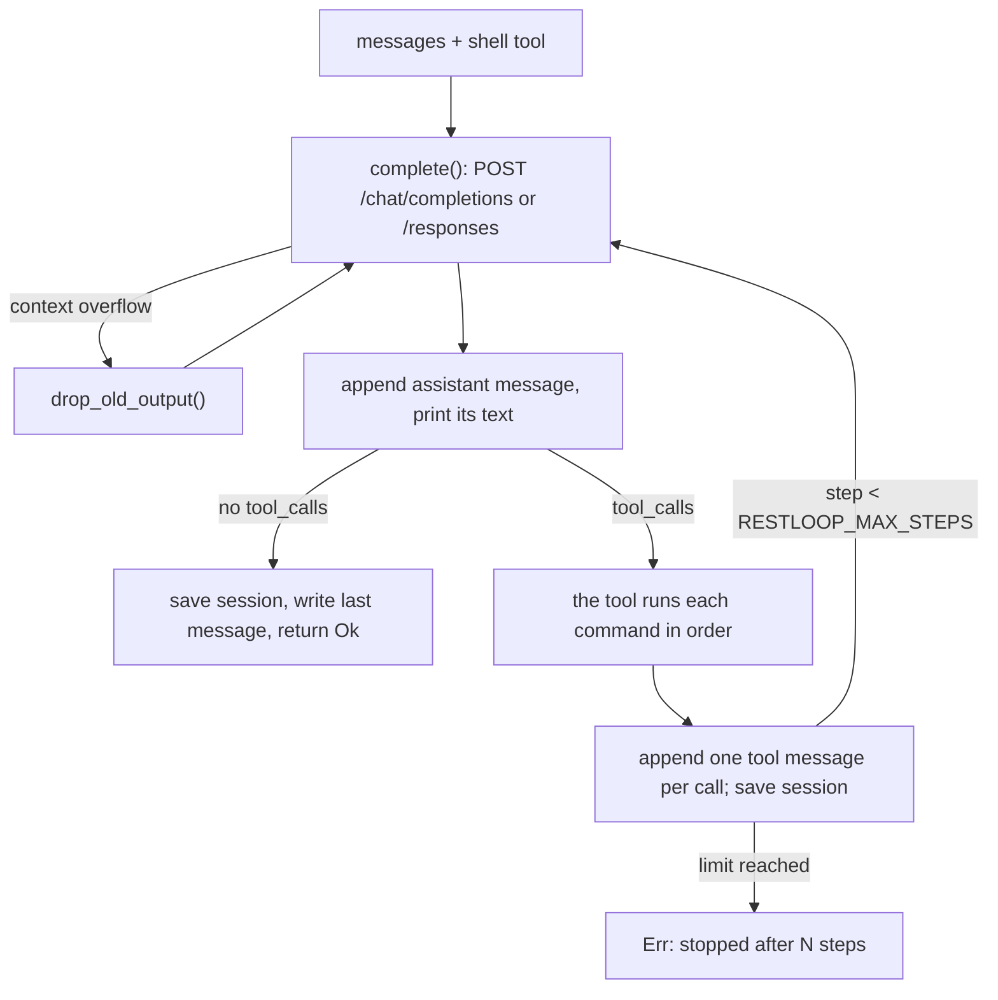

# restloop

<sub>**English** · [中文](zh/all.md)</sub>

These docs go one level below the README for RestLoop, a small Rust agent loop that gives a model one `shell` tool. They describe v0.6.0, which adds `RESTLOOP_HEADERS` (extra request headers), no longer follows redirects, and ends the run on a key HTTP cannot carry. Since v0.5.0 the process groups a task's commands started are stopped when the task ends and on SIGHUP, SIGINT or SIGTERM, so a background server no longer outlives its task (see the overview). Since v0.4.0 the core is a library: `src/lib.rs` runs the loop from a `Config` and a tool callback and can be used on its own, `src/shell.rs` is the default command runner and `src/main.rs` the CLI. Read them in order: what RestLoop is and the first run, the exact command-line and environment interface, how the loop, the HTTP client and the command runner work and why, and finally how binaries are built and released and how to change the code.

<a id="overview"></a>

## Overview

RestLoop is a coding agent reduced to its loop: it sends a conversation and one tool, `shell`, to an OpenAI-compatible `/chat/completions` endpoint (or OpenAI's `/responses`), runs every command the model asks for, sends back the output, and stops when the model answers without a tool call. The core, the loop and the model client, is `src/lib.rs` and can be used as a library; `src/shell.rs` is the default command runner and `src/main.rs` the CLI. Its only dependencies are `ureq` for HTTPS, `serde_json` and, on Unix, `libc`.

It exists because its predecessor, RestFlow (up to 0.5), had grown into a TUI, a daemon, a runner and an executable-skills system. Commit `33511748` replaced all of that with one file and no storage, and `cad33d13` renamed the result RestLoop and restarted versioning at 0.1.0. Most later features (a configurable step limit, the time budget, usage logging) were added in response to benchmark runs, mostly Terminal-Bench, and each is an environment variable: the time budget and usage logging stay off unless set, and the step limit defaults to 100 steps.

<sub>Sources: [lib.rs:1-9](../src/lib.rs#L1-L9) · [main.rs:1-4](../src/main.rs#L1-L4) · [shell.rs:1](../src/shell.rs#L1) · [README.md:54-56](../README.md#L54-L56) · [Cargo.toml:1-15](../Cargo.toml#L1-L15) · +2</sub>

### What it deliberately leaves out

- **One tool.** The model reads, writes and edits files through `shell`; there is no file-edit, search or patch tool. Its only parameter is `command`.
- **No model-facing knobs.** The system prompt from `system_prompt()` and the tool schema are fixed. Commit `3b27682c` records why the command timeout is not a tool parameter: in A/B runs a model-adjustable timeout roughly doubled the number of steps.
- **No configuration file and no database.** All options are environment variables, which the CLI reads once at start (the key before every request) into the core's `Config`; RestLoop itself writes only the optional session and last-message files (see [Usage and configuration](#usage)).
- **No sandbox and no confirmation.** Commands run with your permissions in the current directory. Isolation is the caller's job: a container or a throwaway checkout.

<sub>Sources: [lib.rs:93-97](../src/lib.rs#L93-L97) · [lib.rs:204-215](../src/lib.rs#L204-L215) · [main.rs:93-128](../src/main.rs#L93-L128) · [commit 3b27682c](https://github.com/lhwzds/restloop/commit/3b27682c)</sub>

### What a run leaves behind

Nothing a task's commands started should outlive it. When a task ends (in stdin mode, each one), and on a handled signal, every process group its commands started gets SIGTERM and, after about a second, SIGKILL if the group remains; the task's deadline cuts that wait short. On Unix the handled signals are SIGHUP, SIGINT and SIGTERM, unless inherited as ignored (`nohup`), and RestLoop then exits with 129, 130 or 143. On Windows the job object is closed, which kills its processes with no graceful phase. A background server keeps running between the steps of one task.

This is CLI setup: a library caller of `shell::shell()` calls `shell::install()` and `shell::stop_all()` itself.

<sub>Sources: [main.rs:42-46](../src/main.rs#L42-L46) · [main.rs:68-69](../src/main.rs#L68-L69) · [shell.rs:56-75](../src/shell.rs#L56-L75) · [shell.rs:279-311](../src/shell.rs#L279-L311) · [shell.rs:396-421](../src/shell.rs#L396-L421) · +1</sub>

### The limits of that cleanup

- On Unix, a process that calls `setsid` or daemonizes escapes; use a container or a cgroup.
- On Unix at most 32 groups may live at once; the next command gets an error instead of running.
- Output past 1 MiB per command is dropped.
- Inherited file descriptors are marked close-on-exec, and a failure to mark one is ignored; when `/dev/fd` cannot be read, only those up to 1023 are marked.
- A process group id reused within one process is a known small gap.
- With an npm install, a SIGTERM sent only to the launcher (`npm/bin/restloop.js`) kills node and leaves RestLoop and its commands running.

<sub>Sources: [shell.rs:229-232](../src/shell.rs#L229-L232) · [shell.rs:354-360](../src/shell.rs#L354-L360) · [shell.rs:423-437](../src/shell.rs#L423-L437) · [restloop.js:56-58](../npm/bin/restloop.js#L56-L58)</sub>

### A first result

Install with Homebrew (`brew install lhwzds/tap/restloop`), npm (`npm install -g restloop`) or `cargo install --git https://github.com/lhwzds/restloop`. Only `RESTLOOP_MODEL` is required. The endpoint defaults to `https://api.openai.com/v1`, so for OpenAI a key and a model name are enough:

```bash
export RESTLOOP_API_KEY=sk-...
export RESTLOOP_MODEL=<model-id>
cd some-checkout
restloop "make the failing test pass"
```

For other providers set `RESTLOOP_BASE_URL` to the part before `/chat/completions`. Exit codes and every option are described in [Usage and configuration](#usage).

<sub>Sources: [README.md:40-47](../README.md#L40-L47) · [README.md:52-60](../README.md#L52-L60) · [main.rs:100-101](../src/main.rs#L100-L101)</sub>

<a id="usage"></a>

## Usage and configuration

RestLoop has no flags except `-h`/`--help`, which prints the list of environment variables. Everything else is the task text and the environment; [How it works](#how-it-works) explains what each option does to the loop.

<sub>Sources: [main.rs:17-25](../src/main.rs#L17-L25)</sub>

### One task or a stdin session

All arguments are joined with spaces into one task: `restloop fix the build` equals `restloop "fix the build"`.

- **With a task**, RestLoop runs it and exits: status 0 when the model finished, 1 when the run failed (an API error after retries, a key error, or the step limit).
- **Without a task**, it prints `> ` on stderr and reads one task per line from stdin, skipping empty lines. All tasks share one conversation, so a later line can refer to earlier work. A failed task is reported on stderr and the loop continues.

Status 2 means the run never started: `RESTLOOP_MODEL` is unset, `RESTLOOP_HEADERS` has a bad line or is not valid UTF-8, or `RESTLOOP_SESSION` names a file that is not a session. On Unix, SIGHUP, SIGINT and SIGTERM give 129, 130 and 143 ([Overview](#overview)).

<sub>Sources: [main.rs:17-36](../src/main.rs#L17-L36) · [main.rs:76-90](../src/main.rs#L76-L90) · [shell.rs:390-394](../src/shell.rs#L390-L394) · [main.rs:26-37](../src/main.rs#L26-L37)</sub>

### Environment variables

| Variable | Default | Effect |
|---|---|---|
| `RESTLOOP_MODEL` | required | `model` field of every request |
| `RESTLOOP_API_KEY` | empty | sent as `Authorization: Bearer <key>` |
| `RESTLOOP_API_KEY_FILE` | unset | file holding the key instead, reread and trimmed before every request, so a short-lived token can be refreshed |
| `RESTLOOP_BASE_URL` | `https://api.openai.com/v1` | `/chat/completions` (or `/responses`) is appended; a trailing `/` is ignored |
| `RESTLOOP_WIRE_API` | chat completions | `responses` uses the OpenAI Responses API; other values are ignored |
| `RESTLOOP_REASONING_EFFORT` | unset | e.g. `low`, sent as `reasoning_effort` (or `reasoning.effort`) |
| `RESTLOOP_HEADERS` | unset | extra request headers; see below |
| `RESTLOOP_TIMEOUT` | `120` | seconds a single command may run |
| `RESTLOOP_MAX_STEPS` | `100` | steps per task: one model reply and its commands (retries and overflow recovery stay within the step) |
| `RESTLOOP_DEADLINE` | unset | seconds for the whole task; see [How it works](#how-it-works) |
| `RESTLOOP_LOG_USAGE` | unset | `1` logs the token usage of each model reply on stderr |
| `RESTLOOP_LAST_MESSAGE` | unset | file that receives the final reply |
| `RESTLOOP_SESSION` | unset | conversation file to resume and save |

Invalid numbers (not unsigned integers) silently fall back to the default (`env_num`). `RESTLOOP_LOG_USAGE` must be exactly `1`; empty strings count as unset for the key file and the effort.

<sub>Sources: [main.rs:12-15](../src/main.rs#L12-L15) · [main.rs:93-128](../src/main.rs#L93-L128) · [main.rs:169-177](../src/main.rs#L169-L177) · [commit f09603f4](https://github.com/lhwzds/restloop/commit/f09603f4)</sub>

### What commands inherit

Commands get none of RestLoop's settings: every `RESTLOOP_*` name is removed before a command starts (`restloop_var`), so the key, key file, URL and headers do not reach it; on Windows the match ignores case. Commands inherit everything else, including any copy of the key under another name. A command running as the same user can still reach restloop's environment (`/proc/$PPID/environ`, `ps -E`) or read the key file if it knows the path; a sandbox or another user is the real fix.

<sub>Sources: [shell.rs:29-42](../src/shell.rs#L29-L42) · [shell.rs:130-135](../src/shell.rs#L130-L135) · [commit 8d5e3a78](https://github.com/lhwzds/restloop/commit/8d5e3a78)</sub>

### Extra request headers

`RESTLOOP_HEADERS` holds extra request headers, one `Name: value` per line (blank lines skipped, CRLF fine), sent with every model request; a name given twice goes twice. OpenCode Go, for example, wants `x-opencode-session: <id>`. These names are refused, in any case: `Authorization`, `Proxy-Authorization`, `Content-Type`, `Content-Length`, `Host`, `Transfer-Encoding`, `Accept-Encoding`; any other valid name is sent. A bad line (no `:`, an invalid or refused header) or non-UTF-8 text exits with 2 first. The error gives the line number (`RESTLOOP_HEADERS: line 2 has no ':'`) and, for a refused name, the name, never the value; the UTF-8 error has no line number. Library callers set `Config.headers`, which `run()` refuses first (`restloop::bad_header()`).

<sub>Sources: [main.rs:26-37](../src/main.rs#L26-L37) · [main.rs:179-201](../src/main.rs#L179-L201) · [lib.rs:46-75](../src/lib.rs#L46-L75) · [lib.rs:82-92](../src/lib.rs#L82-L92)</sub>

### What goes to stdout and stderr

stdout carries only the model's text: every non-empty reply, trimmed, including comments written alongside tool calls. Steps have no separator; for the final answer only, use `RESTLOOP_LAST_MESSAGE`.

stderr carries everything else: each command as a dimmed `$ <command>`, then its duration and the first 10 lines of its output, retry and context-overflow notices, and with `RESTLOOP_LOG_USAGE=1` one line per step that gets a reply, from that reply's usage (retried requests are not logged):

```
usage: step=3 prompt_tokens=8123 completion_tokens=412 cached_tokens=7936 elapsed=41s
```

Fields the provider does not report print as `null`. They come from the core's `run()`, so a library caller gets them too; only the stdin prompt `> ` is the CLI's. The default runner adds `restloop: cannot stop a process group` when a SIGKILL fails on a group that is still there.

<sub>Sources: [shell.rs:270-277](../src/shell.rs#L270-L277) · [lib.rs:77-81](../src/lib.rs#L77-L81) · [lib.rs:115-129](../src/lib.rs#L115-L129) · [lib.rs:156-157](../src/lib.rs#L156-L157) · [lib.rs:164-168](../src/lib.rs#L164-L168) · +2</sub>

### The final-reply file

With `RESTLOOP_LAST_MESSAGE=<path>`, each task first deletes that file (unless RestLoop exited with status 2 first), then, when the model replies without a tool call, writes the reply text to it with a trailing newline. A leading `<think>` block (inline reasoning) is cut off up to the first `</think>` (unclosed, nothing is left); any other reply is written whole, even if it quotes `</think>`. Surrounding whitespace is trimmed either way. The delete is best-effort, so a run that ends early (step limit, API error, kill) usually leaves no file rather than the previous answer; to be sure, pass a fresh path each run.

<sub>Sources: [lib.rs:98-102](../src/lib.rs#L98-L102) · [lib.rs:142-150](../src/lib.rs#L142-L150) · [lib.rs:286-294](../src/lib.rs#L286-L294) · [commit e8312d19](https://github.com/lhwzds/restloop/commit/e8312d19) · [main.rs:26-37](../src/main.rs#L26-L37) · +1</sub>

### Session files: resume and fork

`RESTLOOP_SESSION=<path>` persists the conversation as JSON:

```json
{"version": 1, "messages": [{"role": "system", "content": "..."}, ...]}
```

`messages` is what the next request sends, in OpenAI chat format (before any Responses conversion). `conversation()` loads it: a missing file starts a new conversation, created after the first step; an existing file needs `version` 1 and a non-empty `messages` array, or RestLoop exits with status 2. Nothing else is checked, so the file may be edited between runs. After editing an assistant message, remove its `output_items`, which would otherwise be sent instead.

Run again with the same path to resume; copy the file first to fork. The saved system prompt is reused. With `RESTLOOP_DEADLINE`, a resumed task gets `[You have Ns in total for this request; the time used in tool results counts from now.]` appended. The file is replaced after every step through a `<path>.<pid>.tmp` rename, so after a kill it holds the last complete step; concurrent runs never corrupt it, the last writer wins.

<sub>Sources: [main.rs:54-64](../src/main.rs#L54-L64) · [main.rs:130-153](../src/main.rs#L130-L153) · [lib.rs:188-202](../src/lib.rs#L188-L202) · [README.md:84-102](../README.md#L84-L102) · [commit ffd11c37](https://github.com/lhwzds/restloop/commit/ffd11c37) · +1</sub>

<a id="how-it-works"></a>

## How it works

`run()` in `src/lib.rs` does everything: a step is one model reply plus the commands it requested.



<sub>Sources: [lib.rs:82-114](../src/lib.rs#L82-L114) · [lib.rs:181-185](../src/lib.rs#L181-L185)</sub>

### What the conversation holds

The system prompt (`system_prompt()`) comes first: instructions plus OS, shell, working directory, command timeout and, with a deadline, the budget. Then come user tasks and, per model reply, an assistant message keeping only `content`, `tool_calls` and, when present, `reasoning_content` and the Responses API's `output_items`.

Each tool call gets one `tool` message with the matching `tool_call_id`.

<sub>Sources: [lib.rs:204-215](../src/lib.rs#L204-L215) · [lib.rs:125-141](../src/lib.rs#L125-L141) · [lib.rs:152-155](../src/lib.rs#L152-L155) · [lib.rs:180-181](../src/lib.rs#L180-L181)</sub>

### Requests and retries

`complete()` posts `{"model", "messages", "tools"}` to `/chat/completions`, plus `reasoning_effort` if set, without sampling parameters, token limit or streaming. The key is reread per attempt; an unreadable key file fails with `cannot read <path>`, a key with an inner line break with `the key cannot go in a header`. Redirects are not followed (a 3xx fails), so the extra headers ([Usage and configuration](#usage)) never reach another host.

Network errors, HTTP 429, 5xx, a 200 without `choices[0].message` (MiniMax errors, `333b7b64`) and an empty reply (no tool call, no text past a leading `<think>`) are retried: five attempts, sleeping 2, 4, 8, 16 s, printing `restloop: <what>, retrying`; a fifth empty reply is final. A body with `insufficient_quota` or `subscription_sharing_usage_limit_exceeded` fails at once, unless the reply is empty. Other statuses and a fifth failure fail the task: `<what>: <text>` (`HTTP <status>`, `request failed` or `no reply`), or the deadline form below. A non-JSON 200 fails at once with `bad response`.

<sub>Sources: [lib.rs:319-450](../src/lib.rs#L319-L450) · [commit 333b7b64](https://github.com/lhwzds/restloop/commit/333b7b64)</sub>

### The Responses API

With `RESTLOOP_WIRE_API=responses`, `complete()` posts to `/responses`. The conversation stays in chat format; `responses_request()` converts it per request: a leading system message becomes `instructions`, a `tool` message a `function_call_output`, and an assistant message its `output_items` or, lacking them, its text and `function_call` items. It adds `store: false`, `stream: true`, encrypted reasoning in `include`, a `prompt_cache_key` hashed from the system prompt and, if set, `reasoning.effort`.

`responses_reply()` reads the event stream until `response.completed` and builds a chat reply: text (or refusal), tool calls, usage under chat names, and `output_items`, the output in `output_index` order minus message and call ids. These go back verbatim, so reasoning survives without server-side storage. A stream that breaks or ends early is retried; a reported failure (`response.failed`, `response.incomplete`, `error`) only for `server_error`, `rate_limit` or `unavailable`.

<sub>Sources: [lib.rs:320-333](../src/lib.rs#L320-L333) · [lib.rs:377-387](../src/lib.rs#L377-L387) · [lib.rs:413-429](../src/lib.rs#L413-L429) · [lib.rs:452-565](../src/lib.rs#L452-L565)</sub>

### Recovering from a full context window

`too_long()` (`21f3c1dc`) recognises a context overflow: an HTTP 400 or 413, or a Responses stream failure (`no reply: `), whose text contains a provider phrase (`context_length_exceeded`, "maximum context length", "context window exceeds", "prompt is too long", "exceeds the available context size"). `04004c68` dropped looser words like "too long", which an overlong `tool_call_id` matched.

On a match, `drop_old_output()` cuts the older half (rounded up) of the `tool` messages not yet shortened to their first line plus `[output removed to fit the context window]`, empties old reasoning with `trim_thinking()`, and the request is retried. Each retry halves the rest; when nothing changes, the error is returned. Commands and visible replies stay.

<sub>Sources: [lib.rs:103-114](../src/lib.rs#L103-L114) · [lib.rs:248-284](../src/lib.rs#L248-L284) · [commit 21f3c1dc](https://github.com/lhwzds/restloop/commit/21f3c1dc) · [commit 04004c68](https://github.com/lhwzds/restloop/commit/04004c68)</sub>

### Emptying old reasoning

`trim_thinking()` empties the reasoning of every assistant message except the last two: `reasoning_content` becomes `""`, `reasoning` items are removed from `output_items` (message items keep their phase), and a leading `<think>` block is cut from `content`. The key stays, empty (`70f40924`): DeepSeek's thinking mode rejects (HTTP 400) a tool-turn assistant message without it. Already emptied messages do not count as changed, so retries terminate.

<sub>Sources: [lib.rs:217-246](../src/lib.rs#L217-L246) · [commit 70f40924](https://github.com/lhwzds/restloop/commit/70f40924) · [commit f09603f4](https://github.com/lhwzds/restloop/commit/f09603f4)</sub>

### The time budget

`RESTLOOP_DEADLINE` (`f9d3b4f0`: Terminal-Bench tasks ran out of time unaware) bounds the task:

1. A new conversation's system prompt ends with `You have Ns in total for this task; each tool result ends with the time used so far.`; a resumed session's new task, a similar sentence ([Usage and configuration](#usage)).
2. Each command's tool result ends with `[time used: Ns of Ds]`.
3. A command's timeout is the smaller of `RESTLOOP_TIMEOUT` and the time left (floored at 1 s); the CLI starts none after it.
4. A model request gets the time left after the key is read (600 s at most); none starts after it: `restloop: deadline of <N>s reached`. A retry sleep reaching it stops with `deadline of <N>s reached (<what>: <text>)`; a failed fifth attempt only if the deadline has passed (`a4ba4994`).

Time counts from process start; one budget covers all stdin tasks.

<sub>Sources: [lib.rs:207-215](../src/lib.rs#L207-L215) · [main.rs:55-63](../src/main.rs#L55-L63) · [lib.rs:158-163](../src/lib.rs#L158-L163) · [lib.rs:169-174](../src/lib.rs#L169-L174) · [lib.rs:340-364](../src/lib.rs#L340-L364) · +4</sub>

### Running a command

`run()` takes the runner as a callback; the CLI's, the public `shell::shell()`, runs each command in a fresh shell in the current directory: `sh -c` on Unix; on Windows, `Git\bin\bash.exe` under `ProgramFiles` or `ProgramFiles(x86)` if present (models write bash; PowerShell 5.1 adds a BOM), else `powershell -NoProfile -NonInteractive` with UTF-8 output. stdin is null and `GIT_TERMINAL_PROMPT=0`; `PYTHONUTF8=1` keeps Python I/O in UTF-8.

After the shell exits, processes holding its pipes get up to 2 s more, never past the timeout; then the whole process group (a job object on Windows) is stopped, and `exit:` still reports the shell's code. On Unix a stop is SIGTERM, up to 1 s, then SIGKILL; Windows uses `TerminateJobObject`. A background service that redirects its output (`server > log 2>&1 &`) lives until the task ends: [Overview](#overview). Inherited variables: [Usage and configuration](#usage).

<sub>Sources: [shell.rs:44-54](../src/shell.rs#L44-L54) · [shell.rs:101-206](../src/shell.rs#L101-L206) · [shell.rs:279-332](../src/shell.rs#L279-L332) · [main.rs:65-67](../src/main.rs#L65-L67) · [commit 92c09fd2](https://github.com/lhwzds/restloop/commit/92c09fd2) · +1</sub>

### What the model sees from a command

A command's tool result is `exit: <status>` on the first line, then the combined output. Except: invalid arguments give `error: arguments must be JSON…`, a shell that cannot start gives `error: <reason>`. The status is the exit code, `killed` when a signal ended the shell, `exited, status unknown` when the child is gone without one, or `timeout after Ns`; a stopped command not seen to exit adds `(child did not exit after SIGKILL)`. Output over 10,000 characters (`MAX_OUTPUT`) keeps the first and last 5,000 with `... [N chars truncated] ...` between. Output past 1 MiB is dropped first; invalid UTF-8 is replaced.

<sub>Sources: [shell.rs:171-176](../src/shell.rs#L171-L176) · [shell.rs:184-189](../src/shell.rs#L184-L189) · [shell.rs:14-16](../src/shell.rs#L14-L16) · [shell.rs:136-139](../src/shell.rs#L136-L139) · [shell.rs:199-219](../src/shell.rs#L199-L219) · +1</sub>

<a id="contributing"></a>

## Building, releasing and contributing

`cargo build --release` produces `target/release/restloop`. The crate uses edition 2024 and `let` chains inside `if`, so it needs a toolchain where both are stable (Rust 1.88 or newer). The release profile optimises for size (`opt-level = "z"`, LTO, one codegen unit, `panic = "abort"`, stripped).

The core's and the runner's tests live in `src/tests.rs`, the CLI's (settings, key file, session file) in `src/main.rs`; all run with `cargo test`. `.github/workflows/ci.yml` runs `cargo fmt --check`, `cargo clippy --all-targets -- -D warnings` and the tests on macOS, Linux and Windows for every push to `main` and every pull request; on Unix it also runs `tests/cleanup.rs` in release. Run the same three commands before opening one. A `docs` job on Linux checks out the full history (`fetch-depth: 0`, so cited commits resolve), installs Codocia 0.2 and runs `codocia check`, so stale docs or `README_CN.md` fail CI.

<sub>Sources: [Cargo.toml:1-22](../Cargo.toml#L1-L22) · [tests.rs:1-2](../src/tests.rs#L1-L2) · [main.rs:208-209](../src/main.rs#L208-L209) · [ci.yml:1-37](../.github/workflows/ci.yml#L1-L37)</sub>

### What the tests cover

Unit tests in `src/tests.rs` pin: `too_long()` matches recorded provider wordings, not near misses; `drop_old_output()` halves until it returns 0; `trim_thinking()` spares the last two replies; `truncate()` keeps head and tail. `shell()`: the exit line with both streams, a timeout kill, a background `sleep 30 &` not blocking.

One end-to-end test drives `run()` against `serve()`, a canned-reply server: a tool call, overflow recovery, a resume, retried empty or `choices`-less replies; Responses output items sent back in order, retried and fatal failures; under a deadline, hangs, 500s and empty replies stop early with `deadline of`. Commands get none of restloop's settings. Environment tests hold one lock and restore it; request tests clear `*_PROXY`. Other core tests check that a passed deadline runs no command, a failing or unsendable key ends the run, extra headers arrive, a repeated name twice, a bad config header stops the run first and a redirect is not followed. `src/main.rs` tests `config()`, header parsing, the key file and session files; `tests/cleanup.rs` (Unix) checks no process outlives a run; `tests/cli.rs` (all platforms) checks the exit on a bad `RESTLOOP_HEADERS` ([Usage and configuration](#usage)).

<sub>Sources: [tests.rs:168-311](../src/tests.rs#L168-L311) · [tests.rs:30-96](../src/tests.rs#L30-L96) · [tests.rs:472-497](../src/tests.rs#L472-L497) · [tests.rs:861-937](../src/tests.rs#L861-L937) · [tests.rs:939-1078](../src/tests.rs#L939-L1078) · +9</sub>

### Changing the loop

Conventions the history suggests:

- **Options are environment variables with the old behaviour as default.** The CLI reads them in `config()` into a `Config` field; read numbers with `env_num` so an invalid value falls back to the default, and add the variable to the `--help` text in `main()` and to the README.
- **Keep the model-facing surface fixed** (see [Overview](#overview)). Changes to `system_prompt()` or the tool schema should come with benchmark evidence.
- **Keep the prompt prefix stable.** Anything that rewrites earlier messages breaks provider prompt caching; RestLoop does it only when the provider reports an overflow. A threshold-based trim was removed after an A/B showed no benefit (`f09603f4`).
- **Keep the core's settings in `Config`, with few dependencies.** `src/lib.rs` makes no direct environment reads (its HTTP client, `ureq`, honours `*_PROXY`) and starts no process; that belongs to the CLI (`src/main.rs`) and the default command runner, the public module `src/shell.rs`. Its size and readability are the point.

<sub>Sources: [lib.rs:1-9](../src/lib.rs#L1-L9) · [main.rs:203-206](../src/main.rs#L203-L206) · [tests.rs:1-2](../src/tests.rs#L1-L2) · [commit 3b27682c](https://github.com/lhwzds/restloop/commit/3b27682c) · [commit 740555b1](https://github.com/lhwzds/restloop/commit/740555b1) · +1</sub>

### How a release is made

Pushing a tag `vX.Y.Z` (prerelease tags do not match) runs `.github/workflows/release.yml`:

1. **build** compiles five targets: macOS arm64 and x86_64, Linux x86_64 and arm64 (static musl), Windows x86_64, named `restloop-<target>[.exe]`.
2. **release** writes `SHA256SUMS` plus one `.sha256` per binary and creates the GitHub release. It refuses to run if the release already exists: published binaries are never replaced, because the npm package pins their checksums. Re-run only failed jobs instead.
3. **homebrew** regenerates the `restloop` formula in `lhwzds/homebrew-tap` (needs the `HOMEBREW_TAP_TOKEN` secret) and commits only if it changed.
4. **npm**, also after **release**, stamps and publishes the npm package with trusted publishing; the npm package section below explains it.

Running the workflow by hand (`workflow_dispatch`) builds and checksums but publishes nothing, which makes it a dry run.

<sub>Sources: [release.yml:1-75](../.github/workflows/release.yml#L1-L75) · [release.yml:76-95](../.github/workflows/release.yml#L76-L95) · [release.yml:123-138](../.github/workflows/release.yml#L123-L138) · [release.yml:140-164](../.github/workflows/release.yml#L140-L164) · [commit b41c62a7](https://github.com/lhwzds/restloop/commit/b41c62a7) · +1</sub>

### The npm package

The npm package contains no binary. `npm/bin/restloop.js` looks up `"<platform> <arch>"` in `checksums.json`, and on first run downloads that asset from the `v<version>` GitHub release, verifies its SHA-256, and stores it next to itself (temporary file and rename). Later runs skip the download. Either way the launcher runs the binary, passing arguments and stdio through and returning its exit status.

A tag publishes the package from CI (`f76038cb`): after the GitHub release, the `npm` job runs `node npm/stamp.js X.Y.Z dist/SHA256SUMS`, which sets the package version and rewrites `checksums.json` for five platforms, then `npm publish --access public` from `npm/`. It uses npm trusted publishing (OIDC, `id-token: write`, npm 11.5.1 or later), so no npm token or secret is involved. Earlier releases were published by hand (`a21f7c21`).

The stamped `package.json` and `checksums.json` exist only on the runner and are never committed back, so the repository copies stay at the last manual stamp (0.3.0) and will lag the published version. At this commit `checksums.json` holds the five v0.3.0 entries: `darwin arm64`, `darwin x64`, `linux x64`, `linux arm64` (musl) and `win32 x64`.

<sub>Sources: [restloop.js:1-61](../npm/bin/restloop.js#L1-L61) · [stamp.js:1-31](../npm/stamp.js#L1-L31) · [checksums.json](../npm/checksums.json) · [release.yml:140-164](../.github/workflows/release.yml#L140-L164) · [commit a21f7c21](https://github.com/lhwzds/restloop/commit/a21f7c21) · +1</sub>

<a id="structure"></a>

## Code structure

Generated by Codocia from the code on every build: areas, each area's own description, import dependencies between areas, and the pages that explain them.

In scope: 16 files, 4,392 lines; excluded `Cargo.lock`, `LICENSE`, `.gitignore`

### Files

**Repository root**

- (root files) — 340 lines, 3 files. A minimal agent loop: one model, one shell tool.\
  Explained in: [Overview](#overview) (2), [Usage and configuration](#usage) (1), [Building, releasing and contributing](#contributing) (1)
- `.github/` — 201 lines, 2 files\
  Explained in: [Building, releasing and contributing](#contributing) (3)
- `npm/` — 162 lines, 5 files. A minimal coding-agent loop: it keeps working on your task so you can rest.\
  Hub files: `bin/restloop.js` `stamp.js`\
  Explained in: [Overview](#overview) (1), [Building, releasing and contributing](#contributing) (1)
- `src/` — 3,012 lines, 4 files. RestLoop's core: the agent loop and the model client.\
  Hub files: `lib.rs` `shell.rs` `tests.rs`\
  Explained in: [Overview](#overview) (5), [Usage and configuration](#usage) (8), [How it works](#how-it-works) (9), [Building, releasing and contributing](#contributing) (3)
- `tests/` — 677 lines, 2 files\
  Explained in: [Usage and configuration](#usage) (1), [Building, releasing and contributing](#contributing) (1)
