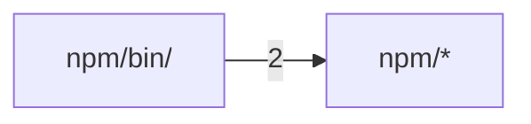

# Code structure

**English** · [中文](zh/structure.md)

Generated by Codocia from the code on every build: areas, each area's own description, import dependencies between areas, and the pages that explain them.

In scope: 12 files, 1,716 lines; excluded `Cargo.lock`, `LICENSE`, `.gitignore`

## Files

**Repository root**

- (root files) — 235 lines, 3 files. A minimal agent loop: one model, one shell tool.\
  Explained in: [Overview](01-overview.md) (2), [Usage and configuration](02-usage.md) (1), [Building, releasing and contributing](04-contributing.md) (1)
- `.github/` — 198 lines, 2 files\
  Explained in: [Building, releasing and contributing](04-contributing.md) (3)
- `src/` — 1,121 lines, 2 files\
  Hub files: `main.rs` `tests.rs`\
  Explained in: [Overview](01-overview.md) (3), [Usage and configuration](02-usage.md) (6), [How it works](03-how-it-works.md) (9), [Building, releasing and contributing](04-contributing.md) (3)

**`npm/`**

- (files) — 101 lines, 4 files. A minimal coding-agent loop: it keeps working on your task so you can rest.\
  Hub files: `stamp.js`\
  Explained in: [Building, releasing and contributing](04-contributing.md) (1)
- `bin/` — 61 lines, 1 file\
  Hub files: `restloop.js`\
  Explained in: [Building, releasing and contributing](04-contributing.md) (1)

## Dependencies

A → B means files in A import B; the number counts file-level imports. Showing the strongest 1 of 1 edges.

