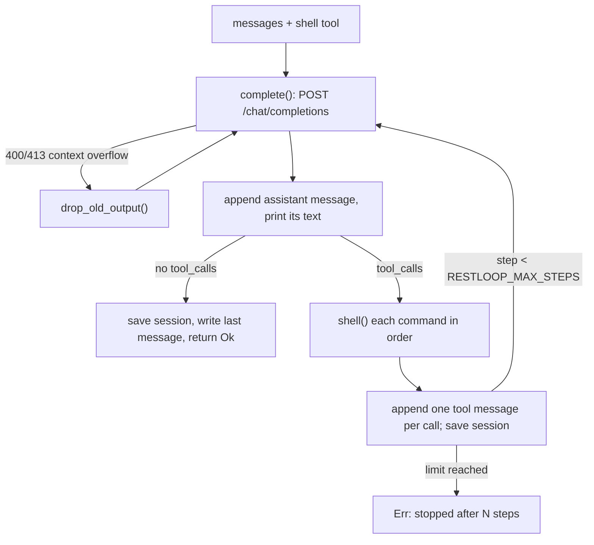

# 工作原理

[English](../03-how-it-works.md) · **中文**

所有事情都发生在 `run()` 里：一次迭代（即一步）就是一次模型回复，再加上它请求执行的命令。

来源: [main.rs:126-131](../../src/main.rs#L126-L131) · [main.rs:140-150](../../src/main.rs#L140-L150) · [main.rs:213-215](../../src/main.rs#L213-L215)

## 对话里有什么

第一条消息是 `system_prompt()` 生成的系统 prompt：agent 的指令，加上操作系统、shell（`sh`、`bash (Git Bash)` 或 `PowerShell`）、工作目录、命令超时，以及设置了 deadline 时的总预算。之后是用户任务；模型每次回复对应一条 assistant 消息，只保留 `content`、`tool_calls`，以及服务商返回时的 `reasoning_content`。

每个工具调用对应一条 `tool` 消息，带上匹配的 `tool_call_id`。如果参数不是带 `command` 字符串的 JSON，消息内容会是一条引用了原参数的错误，让模型自行纠正，而不是让整个运行失败。多个调用按模型列出的顺序依次执行。

来源: [main.rs:82-99](../../src/main.rs#L82-L99) · [main.rs:161-174](../../src/main.rs#L161-L174) · [main.rs:186-211](../../src/main.rs#L186-L211)

## 请求与重试

`complete()` 只 POST `{"model", "messages", "tools"}`，别的什么都不发（没有采样参数、token 上限或流式输出），因此一律采用服务商的默认值。每次尝试最多 600 s。

网络错误、HTTP 429、HTTP 5xx，以及自 `333b7b64` 起没有 `choices[0].message` 的 HTTP 200 都会重试，总共五次尝试，中间分别等待 2、4、8、16 s，并打印 `restloop: <what>, retrying`。200 这种情况是针对 MiniMax 的，它会用这种方式报告某些错误，过去这会被当成空的最终回复而结束运行。其他任何状态码，或第五次失败，都会变成 `HTTP <status>: <body>`（或 `request failed: ...`、`no reply: ...`），任务失败：带任务参数的运行以状态 1 退出，stdin 模式则报告错误并继续读下一行。body 不是 JSON 的 200 会立即以 `bad response` 失败。溢出检测读取的是错误中保留的 body。

来源: [main.rs:304-346](../../src/main.rs#L304-L346) · [commit 333b7b64](https://github.com/lhwzds/restloop/commit/333b7b64)

## 上下文窗口满了之后的恢复

在 `21f3c1dc` 之前，上下文溢出会直接结束运行。`too_long()` 负责识别溢出：状态码为 400 或 413，且 body 包含服务商使用的某个短语（`context_length_exceeded`、"maximum context length"、"context window exceeds"、"prompt is too long"、"exceeds the available context size"）。commit `04004c68` 把匹配范围从 "too long" 这类更宽泛的词收窄了，因为一个无关的 400（`tool_call_id` 过长）也可能触发历史裁剪。

匹配成功后，`drop_old_output()` 取出尚未缩短的 `tool` 消息，把其中较早的一半（向上取整）替换为它们的第一行（通常是 `exit:` 行）加上 `[output removed to fit the context window]`，并清空旧的推理内容：它是 `trim_thinking()`（见下文）唯一的调用方。然后重试请求。每次重试都会把剩下的再减半，直到没有可再改动的内容时，返回溢出错误。命令和可见的回复永远不会被删除，所以模型仍然知道自己做过什么。

来源: [main.rs:141-150](../../src/main.rs#L141-L150) · [main.rs:259-302](../../src/main.rs#L259-L302) · [commit 21f3c1dc](https://github.com/lhwzds/restloop/commit/21f3c1dc) · [commit 04004c68](https://github.com/lhwzds/restloop/commit/04004c68)

## 清空旧的推理内容

`trim_thinking()` 会清空除最后两条之外所有 assistant 消息的推理内容：`reasoning_content` 变为 `""`，`content` 中 `</think>` 及其之前的文本被截掉。自 `70f40924` 起，这个 key 会保留并置为空值，而不是删除，因为 DeepSeek 的思考模式（deepseek-flash）在工具轮次中的 assistant 消息缺少该字段时会返回 HTTP 400，但接受空字符串。已经清空过的消息不算作有改动，因此反复的溢出重试一定会终止。

在 v0.1.0 中，prompt 超过 token 阈值（RESTLOOP_TRIM_THINKING_AT）时它也会运行；`f09603f4` 删除了这一点，因为 Terminal-Bench A/B 测试显示没有收益。调用方可以在两次运行之间改写 session 文件。

来源: [main.rs:233-257](../../src/main.rs#L233-L257) · [commit 70f40924](https://github.com/lhwzds/restloop/commit/70f40924) · [commit f09603f4](https://github.com/lhwzds/restloop/commit/f09603f4)

## 时间预算

在 Terminal-Bench 中，触到时间上限的任务把时间花在了安装和长时间扫描上，却不知道自己有多少预算（`f9d3b4f0`）。`RESTLOOP_DEADLINE` 做三件事：

1. 新对话的系统 prompt 末尾加上 `You have Ns in total for this task; each tool result ends with the time used so far.`。恢复的 session 沿用原来的系统 prompt，所以改为在新任务中附带一句类似的话（见 [用法与配置](02-usage.md)），从本进程启动时计时。
2. 每条命令的工具结果末尾加上 `[time used: Ns of Ds]`（参数无效时的错误不加）。
3. 每条命令的超时取 `RESTLOOP_TIMEOUT` 和剩余时间中较小的那个；只有剩余时间有 1 s 的下限，所以 `RESTLOOP_TIMEOUT=0` 时超时仍是 0 s。

deadline 到了，RestLoop 也不会让模型停下；由调用方强制执行。时间从进程启动开始计算，所以在 stdin 模式下，预算覆盖所有任务。

来源: [main.rs:86-98](../../src/main.rs#L86-L98) · [main.rs:101-111](../../src/main.rs#L101-L111) · [main.rs:192-203](../../src/main.rs#L192-L203) · [commit f9d3b4f0](https://github.com/lhwzds/restloop/commit/f9d3b4f0)

## 执行一条命令

每条命令都在当前目录下一个全新的 shell 中执行：Unix 上用 `sh -c`；Windows 上，如果 `ProgramFiles` 或 `ProgramFiles(x86)` 下存在 `Git\bin\bash.exe` 就用它（模型写的是 bash，而 PowerShell 5.1 写出的 UTF-8 文件会带 BOM），否则用 `powershell -NoProfile -NonInteractive` 并设置 UTF-8 输出。stdin 为 null，并设置了 `GIT_TERMINAL_PROMPT=0`，所以不会有任何东西等待输入；`PYTHONUTF8=1` 让 Python 的 I/O 保持 UTF-8。

stdout 和 stderr 由两个线程读入同一个缓冲区。shell 退出后，仍占用其管道的进程最多还有 2 s，且不超过命令原本的超时；之后整个进程组（Windows 上是 job object）会被 kill，而 `exit:` 报告的仍是 shell 自身的退出码。要让后台服务继续运行，就重定向它的输出（`server > log 2>&1 &`）：shell 退出时管道关闭，不会 kill 任何进程。命令超时则会 kill 该命令启动的所有进程，不管有没有重定向。kill 使用 shell 内建的 `kill -9 -<pgid>`，因为精简容器里经常没有 `/bin/kill`。

来源: [main.rs:347-437](../../src/main.rs#L347-L437) · [commit 92c09fd2](https://github.com/lhwzds/restloop/commit/92c09fd2) · [commit 3b27682c](https://github.com/lhwzds/restloop/commit/3b27682c)

## 模型从命令中看到什么

命令的工具结果第一行是 `exit: <status>`，后面是合并后的输出。有两种例外：参数无效时返回 `error: arguments must be JSON…`，shell 无法启动时返回 `error: <reason>`。status 是退出码；如果 shell 被信号终止则为 `killed`，超时则为 `timeout after Ns`。超过 10,000 个字符（`MAX_OUTPUT`）的输出只保留开头和结尾各 5,000 个字符，中间插入 `... [N chars truncated] ...`。无效的 UTF-8 会被替换。溢出恢复只保留这第一行，再加一条说明。

来源: [main.rs:429-450](../../src/main.rs#L429-L450)
