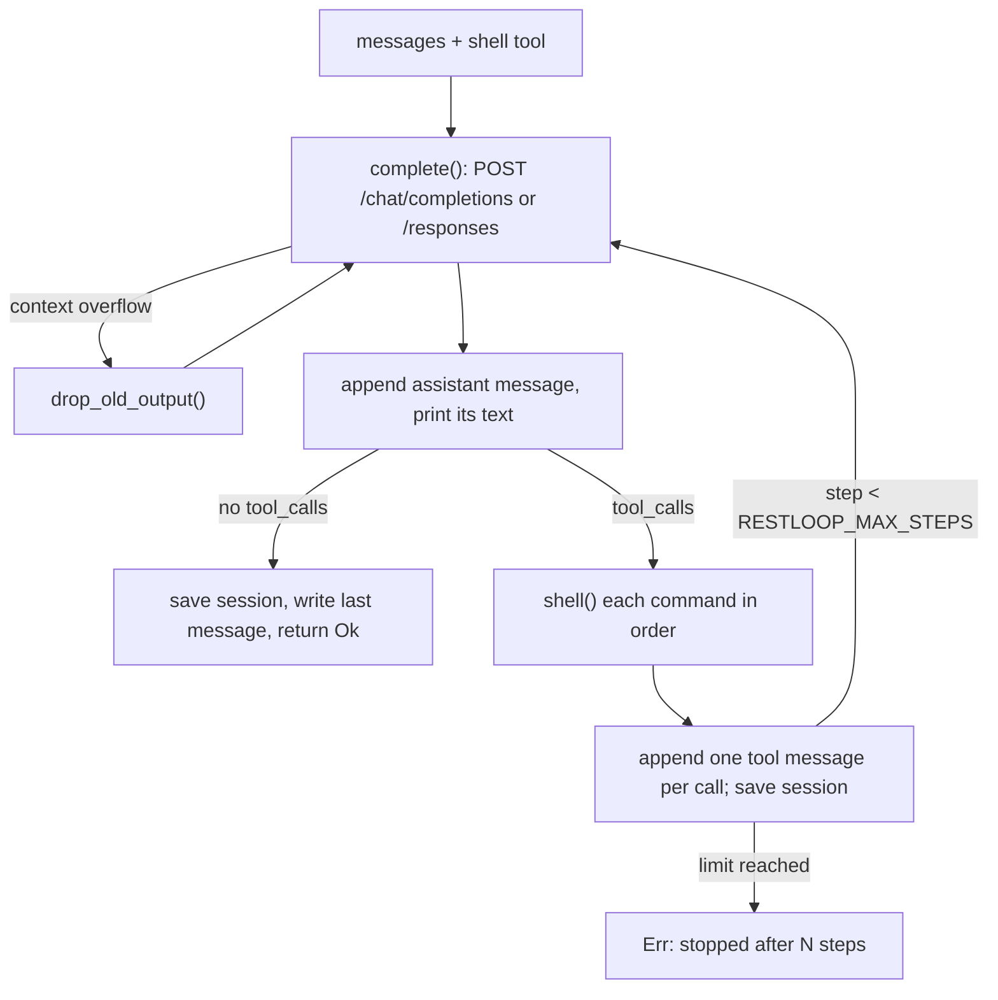

# 工作原理

[English](../03-how-it-works.md) · **中文**

所有事情都发生在 `run()` 里：一次迭代（即一步）就是一次模型回复，再加上它请求执行的命令。

来源: [main.rs:126-131](../../src/main.rs#L126-L131) · [main.rs:140-150](../../src/main.rs#L140-L150) · [main.rs:216-218](../../src/main.rs#L216-L218)

## 对话里有什么

第一条消息是 `system_prompt()` 生成的系统 prompt：agent 的指令，加上操作系统、shell（`sh`、`bash (Git Bash)` 或 `PowerShell`）、工作目录、命令超时，以及设置了 deadline 时的预算。之后是用户任务；模型每次回复对应一条 assistant 消息，只保留 `content`、`tool_calls`，以及存在时的 `reasoning_content` 和 Responses API 的 `output_items`。

每个工具调用对应一条 `tool` 消息，带上匹配的 `tool_call_id`。参数不是带 `command` 字符串的 JSON 时，返回一条引用了原参数的错误，让模型自行纠正。多个调用按顺序依次执行。

来源: [main.rs:82-99](../../src/main.rs#L82-L99) · [main.rs:161-177](../../src/main.rs#L161-L177) · [main.rs:189-214](../../src/main.rs#L189-L214)

## 请求与重试

`complete()` 向 `/chat/completions` POST `{"model", "messages", "tools"}`，设置了推理强度时再加上 `reasoning_effort`，没有采样参数、token 上限或流式输出。每次尝试前都会读取 key（见 [用法与配置](02-usage.md)）；key 文件无法读取时，任务立即以 `cannot read <path>` 失败。每次尝试最多 600 s。

网络错误、HTTP 429、HTTP 5xx，以及没有 `choices[0].message` 的 HTTP 200（MiniMax 用这种方式报告某些错误，`333b7b64`）都会重试，总共五次尝试，中间分别等待 2、4、8、16 s，并打印 `restloop: <what>, retrying`。body 中出现 `insufficient_quota` 或 `subscription_sharing_usage_limit_exceeded`（额度或套餐用尽）时立即失败。其他任何状态码，或第五次失败，都会变成 `HTTP <status>: <body>`（或 `request failed: ...`、`no reply: ...`），任务失败（退出码见 [用法与配置](02-usage.md)）。body 不是 JSON 的 200 会立即以 `bad response` 失败。

来源: [main.rs:313-399](../../src/main.rs#L313-L399) · [commit 333b7b64](https://github.com/lhwzds/restloop/commit/333b7b64)

## Responses API

设置 `RESTLOOP_WIRE_API=responses` 后，`complete()` 改为 POST 到 `/responses`。对话在内存和 session 文件中仍是 chat 格式；`responses_request()` 在每次请求时做转换：开头的 system 消息变成 `instructions`，`tool` 消息变成 `function_call_output`，assistant 消息换成它的 `output_items`，没有时换成它的文本和 `function_call` 项。请求还会加上 `store: false`、`stream: true`、`include` 中的加密推理、由系统 prompt 哈希得到的 `prompt_cache_key`，以及设置了时的 `reasoning.effort`。

`responses_reply()` 读取事件流直到 `response.completed`，构造出一条 chat 回复：文本（或拒绝内容）、工具调用、改用 chat 名称的用量，以及 `output_items`，即按 `output_index` 排序、去掉了 message 和 call id 的输出。这些项会原样发回，因此推理内容无需服务端存储也能保留。事件流中断或提前结束时会重试；流中报告的失败（`response.failed`、`response.incomplete`、`error`）只有在是 `server_error`、`rate_limit` 或 `unavailable` 时才重试。

来源: [main.rs:313-328](../../src/main.rs#L313-L328) · [main.rs:373-394](../../src/main.rs#L373-L394) · [main.rs:401-514](../../src/main.rs#L401-L514)

## 上下文窗口满了之后的恢复

自 `21f3c1dc` 起，`too_long()` 负责识别上下文溢出：HTTP 400 或 413，或 Responses 事件流报告的失败（`no reply: `），且文本包含服务商使用的某个短语（`context_length_exceeded`、"maximum context length"、"context window exceeds"、"prompt is too long"、"exceeds the available context size"）。`04004c68` 去掉了 "too long" 这类更宽泛的词，因为一个无关的 400（`tool_call_id` 过长）触发过历史裁剪。

匹配成功后，`drop_old_output()` 把尚未缩短的 `tool` 消息中较早的一半（向上取整）缩成它们的第一行加上 `[output removed to fit the context window]`，用 `trim_thinking()` 清空旧的推理内容，然后重试请求。每次重试都会把剩下的再减半；没有可改动的内容时，返回该错误。命令和可见的回复都会保留，所以模型仍然知道自己做过什么。

来源: [main.rs:141-150](../../src/main.rs#L141-L150) · [main.rs:268-311](../../src/main.rs#L268-L311) · [commit 21f3c1dc](https://github.com/lhwzds/restloop/commit/21f3c1dc) · [commit 04004c68](https://github.com/lhwzds/restloop/commit/04004c68)

## 清空旧的推理内容

`trim_thinking()` 会清空除最后两条之外所有 assistant 消息的推理内容：`reasoning_content` 变为 `""`，`output_items` 中的 `reasoning` 项被删除（message 项保留其 phase），`content` 中 `</think>` 及其之前的文本被截掉。自 `70f40924` 起，这个 key 会保留并置为空值，而不是删除，因为 DeepSeek 的思考模式在工具轮次中的 assistant 消息缺少该字段时会返回 HTTP 400。已经清空过的消息不算作有改动，因此反复的溢出重试一定会终止。

来源: [main.rs:235-266](../../src/main.rs#L235-L266) · [commit 70f40924](https://github.com/lhwzds/restloop/commit/70f40924) · [commit f09603f4](https://github.com/lhwzds/restloop/commit/f09603f4)

## 时间预算

`RESTLOOP_DEADLINE`（`f9d3b4f0`，起因是 Terminal-Bench 任务在不知道时限的情况下把时间耗在了安装和扫描上）做三件事：

1. 新对话的系统 prompt 末尾加上 `You have Ns in total for this task; each tool result ends with the time used so far.`。恢复的 session 则在新任务中附带一句类似的话（见 [用法与配置](02-usage.md)）。
2. 每条命令的工具结果末尾加上 `[time used: Ns of Ds]`。
3. 每条命令的超时取 `RESTLOOP_TIMEOUT` 和剩余时间中较小的那个；只有剩余时间有 1 s 的下限。

deadline 到了，RestLoop 也不会让模型停下；由调用方负责。时间从进程启动开始计算，所以在 stdin 模式下，预算覆盖所有任务。

来源: [main.rs:86-98](../../src/main.rs#L86-L98) · [main.rs:101-111](../../src/main.rs#L101-L111) · [main.rs:195-206](../../src/main.rs#L195-L206) · [commit f9d3b4f0](https://github.com/lhwzds/restloop/commit/f9d3b4f0)

## 执行一条命令

每条命令都在当前目录下一个全新的 shell 中执行：Unix 上用 `sh -c`；Windows 上，如果 `ProgramFiles` 或 `ProgramFiles(x86)` 下存在 `Git\bin\bash.exe` 就用它（模型写的是 bash；PowerShell 5.1 会加 BOM），否则用 `powershell -NoProfile -NonInteractive` 并设置 UTF-8 输出。stdin 为 null，并设置了 `GIT_TERMINAL_PROMPT=0`，所以不会有任何东西等待输入；`PYTHONUTF8=1` 让 Python 的 I/O 保持 UTF-8。

shell 退出后，仍占用其管道的进程最多还有 2 s，且不超过超时；之后整个进程组（Windows 上是 job object）会被 kill，而 `exit:` 报告的仍是 shell 自身的退出码。输出被重定向的后台服务（`server > log 2>&1 &`）会继续运行。超时会 kill 该命令启动的所有进程。在 Unix 上，两种 kill 都使用 shell 内建的 `kill -9 -<pgid>`（精简容器里经常没有 `/bin/kill`）；Windows 上用 `TerminateJobObject`。

来源: [main.rs:516-606](../../src/main.rs#L516-L606) · [commit 92c09fd2](https://github.com/lhwzds/restloop/commit/92c09fd2) · [commit 3b27682c](https://github.com/lhwzds/restloop/commit/3b27682c)

## 模型从命令中看到什么

命令的工具结果第一行是 `exit: <status>`，后面是合并后的输出。有两种例外：参数无效时返回 `error: arguments must be JSON…`，shell 无法启动时返回 `error: <reason>`。status 是退出码；如果 shell 被信号终止则为 `killed`，超时则为 `timeout after Ns`。超过 10,000 个字符（`MAX_OUTPUT`）的输出只保留开头和结尾各 5,000 个字符，中间插入 `... [N chars truncated] ...`。无效的 UTF-8 会被替换。

来源: [main.rs:598-619](../../src/main.rs#L598-L619)
