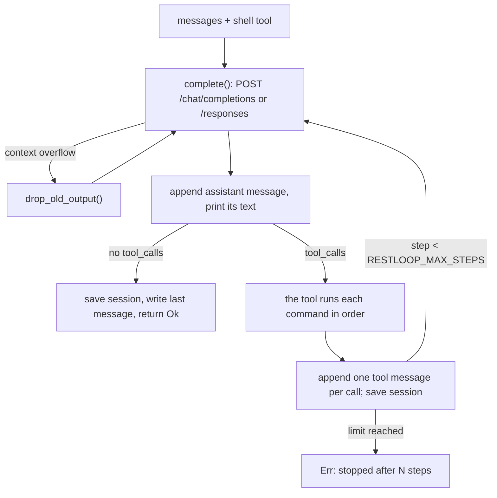

# 工作原理

[English](../03-how-it-works.md) · **中文**

`src/lib.rs` 的 `run()` 完成所有事情：一步就是一次模型回复，再加上它请求执行的命令。

来源: [lib.rs:82-114](../../src/lib.rs#L82-L114) · [lib.rs:181-185](../../src/lib.rs#L181-L185)

## 对话里有什么

第一条消息是系统 prompt（`system_prompt()`）：指令，加上操作系统、shell、工作目录、命令超时，以及设置了 deadline 时的预算。之后是用户任务；模型每次回复对应一条 assistant 消息，只保留 `content`、`tool_calls`，以及存在时的 `reasoning_content` 和 Responses API 的 `output_items`。

每个工具调用对应一条 `tool` 消息，带上匹配的 `tool_call_id`。

来源: [lib.rs:204-215](../../src/lib.rs#L204-L215) · [lib.rs:125-141](../../src/lib.rs#L125-L141) · [lib.rs:152-155](../../src/lib.rs#L152-L155) · [lib.rs:180-181](../../src/lib.rs#L180-L181)

## 请求与重试

`complete()` 向 `/chat/completions` POST `{"model", "messages", "tools"}`，设置了推理强度时再加上 `reasoning_effort`，没有采样参数、token 上限或流式输出。每次尝试都会重新读取 key；key 文件无法读取时以 `cannot read <path>` 失败，key 内部含换行时以 `the key cannot go in a header` 失败。不跟随重定向（3xx 即失败），所以额外的请求头（[用法与配置](02-usage.md)）永远不会发到另一台主机。

网络错误、HTTP 429、5xx、没有 `choices[0].message` 的 200（MiniMax 的错误，`333b7b64`），以及空回复（没有工具调用，除开头的 `<think>` 外也没有文字）都会重试：总共五次尝试，中间分别等待 2、4、8、16 s，并打印 `restloop: <what>, retrying`；第五次仍为空的回复即为最终回复。body 中出现 `insufficient_quota` 或 `subscription_sharing_usage_limit_exceeded` 时立即失败，除非回复为空。其他状态码和第五次失败都会让任务失败：`<what>: <text>`（`HTTP <status>`、`request failed` 或 `no reply`），或下文的 deadline 格式。不是 JSON 的 200 会立即以 `bad response` 失败。

来源: [lib.rs:319-450](../../src/lib.rs#L319-L450) · [commit 333b7b64](https://github.com/lhwzds/restloop/commit/333b7b64)

## Responses API

设置 `RESTLOOP_WIRE_API=responses` 后，`complete()` 改为 POST 到 `/responses`。对话仍是 chat 格式；`responses_request()` 在每次请求时做转换：开头的 system 消息变成 `instructions`，`tool` 消息变成 `function_call_output`，assistant 消息换成它的 `output_items`，没有时换成它的文本和 `function_call` 项。请求还会加上 `store: false`、`stream: true`、`include` 中的加密推理、由系统 prompt 哈希得到的 `prompt_cache_key`，以及设置了时的 `reasoning.effort`。

`responses_reply()` 读取事件流直到 `response.completed`，构造出一条 chat 回复：文本（或拒绝内容）、工具调用、改用 chat 名称的用量，以及 `output_items`，即按 `output_index` 排序、去掉了 message 和 call id 的输出。这些项会原样发回，因此推理内容无需服务端存储也能保留。事件流中断或提前结束时会重试；报告的失败（`response.failed`、`response.incomplete`、`error`）只有在是 `server_error`、`rate_limit` 或 `unavailable` 时才重试。

来源: [lib.rs:320-333](../../src/lib.rs#L320-L333) · [lib.rs:377-387](../../src/lib.rs#L377-L387) · [lib.rs:413-429](../../src/lib.rs#L413-L429) · [lib.rs:452-565](../../src/lib.rs#L452-L565)

## 上下文窗口满了之后的恢复

`too_long()`（`21f3c1dc`）负责识别上下文溢出：HTTP 400 或 413，或 Responses 事件流的失败（`no reply: `），且文本包含服务商的某个短语（`context_length_exceeded`、"maximum context length"、"context window exceeds"、"prompt is too long"、"exceeds the available context size"）。`04004c68` 去掉了 "too long" 这类更宽泛的词，过长的 `tool_call_id` 曾匹配到它们。

匹配成功后，`drop_old_output()` 把尚未缩短的 `tool` 消息中较早的一半（向上取整）缩成它们的第一行加上 `[output removed to fit the context window]`，用 `trim_thinking()` 清空旧的推理内容，然后重试请求。每次重试都会把剩下的再减半；没有可改动的内容时，返回该错误。命令和可见的回复都会保留。

来源: [lib.rs:103-114](../../src/lib.rs#L103-L114) · [lib.rs:248-284](../../src/lib.rs#L248-L284) · [commit 21f3c1dc](https://github.com/lhwzds/restloop/commit/21f3c1dc) · [commit 04004c68](https://github.com/lhwzds/restloop/commit/04004c68)

## 清空旧的推理内容

`trim_thinking()` 会清空除最后两条之外所有 assistant 消息的推理内容：`reasoning_content` 变为 `""`，`output_items` 中的 `reasoning` 项被删除（message 项保留其 phase），`content` 开头的 `<think>` 块被截掉。这个 key 保留为空值（`70f40924`）：DeepSeek 的思考模式会拒绝（HTTP 400）缺少它的工具轮次 assistant 消息。已经清空过的消息不算作有改动，因此重试一定会终止。

来源: [lib.rs:217-246](../../src/lib.rs#L217-L246) · [commit 70f40924](https://github.com/lhwzds/restloop/commit/70f40924) · [commit f09603f4](https://github.com/lhwzds/restloop/commit/f09603f4)

## 时间预算

`RESTLOOP_DEADLINE`（`f9d3b4f0`：Terminal-Bench 任务曾在不知情时耗尽时间）约束整个任务：

1. 新对话的系统 prompt 末尾加上 `You have Ns in total for this task; each tool result ends with the time used so far.`；恢复的 session 的新任务则附带一句类似的话（[用法与配置](02-usage.md)）。
2. 每条命令的工具结果末尾加上 `[time used: Ns of Ds]`。
3. 命令的超时取 `RESTLOOP_TIMEOUT` 和剩余时间中较小的那个（下限 1 s）；过了 deadline，CLI 不再启动命令。
4. 模型请求的超时是读取 key 之后的剩余时间（最多 600 s），deadline 之后不再发出请求：`restloop: deadline of <N>s reached`。重试前的等待到达 deadline 时，以 `deadline of <N>s reached (<what>: <text>)` 结束；第五次尝试失败时，只有 deadline 已经过去才这样报告（`a4ba4994`）。

时间从进程启动开始计算；同一个预算覆盖所有 stdin 任务。

来源: [lib.rs:207-215](../../src/lib.rs#L207-L215) · [main.rs:55-63](../../src/main.rs#L55-L63) · [lib.rs:158-163](../../src/lib.rs#L158-L163) · [lib.rs:169-174](../../src/lib.rs#L169-L174) · [lib.rs:340-364](../../src/lib.rs#L340-L364) · +4

## 执行一条命令

`run()` 以回调接收命令执行器；CLI 的执行器是公开的 `shell::shell()`，它让每条命令都在当前目录下一个全新的 shell 中执行：Unix 上用 `sh -c`；Windows 上，如果 `ProgramFiles` 或 `ProgramFiles(x86)` 下存在 `Git\bin\bash.exe` 就用它（模型写的是 bash；PowerShell 5.1 会加 BOM），否则用 `powershell -NoProfile -NonInteractive` 并设置 UTF-8 输出。stdin 为 null，并设置 `GIT_TERMINAL_PROMPT=0`；`PYTHONUTF8=1` 让 Python 的 I/O 保持 UTF-8。

shell 退出后，仍占用其管道的进程最多还有 2 s，且不超过超时；之后整个进程组（Windows 上是 job object）会被停止，而 `exit:` 报告的仍是 shell 的退出码。在 Unix 上，停止是先发 SIGTERM，最多等 1 s，再发 SIGKILL；Windows 上用 `TerminateJobObject`。重定向了输出的后台服务（`server > log 2>&1 &`）会一直运行到任务结束：[概览](01-overview.md)。继承的变量见 [用法与配置](02-usage.md)。

来源: [shell.rs:44-54](../../src/shell.rs#L44-L54) · [shell.rs:101-206](../../src/shell.rs#L101-L206) · [shell.rs:279-332](../../src/shell.rs#L279-L332) · [main.rs:65-67](../../src/main.rs#L65-L67) · [commit 92c09fd2](https://github.com/lhwzds/restloop/commit/92c09fd2) · +1

## 模型从命令中看到什么

命令的工具结果第一行是 `exit: <status>`，后面是合并后的输出。例外：参数无效时返回 `error: arguments must be JSON…`，shell 无法启动时返回 `error: <reason>`。status 是退出码；shell 被信号终止时为 `killed`，子进程已消失且没有状态时为 `exited, status unknown`，超时则为 `timeout after Ns`；被停止的命令未见退出时会加上 `(child did not exit after SIGKILL)`。超过 10,000 个字符（`MAX_OUTPUT`）的输出保留开头和结尾各 5,000 个字符，中间插入 `... [N chars truncated] ...`。超过 1 MiB 的输出会先被丢弃；无效的 UTF-8 会被替换。

来源: [shell.rs:171-176](../../src/shell.rs#L171-L176) · [shell.rs:184-189](../../src/shell.rs#L184-L189) · [shell.rs:14-16](../../src/shell.rs#L14-L16) · [shell.rs:136-139](../../src/shell.rs#L136-L139) · [shell.rs:199-219](../../src/shell.rs#L199-L219) · +1
