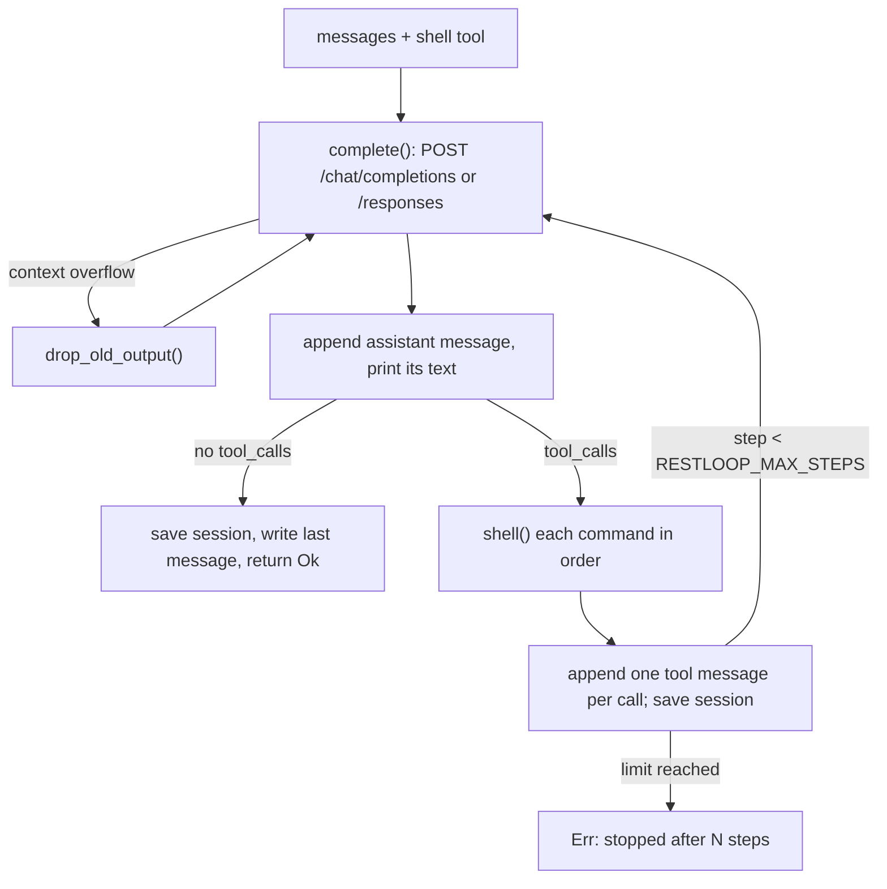
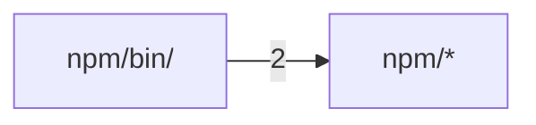

# restloop

<sub>[English](../all.md) · **中文**</sub>

这份文档比 README 更深入一层，介绍 RestLoop：一个单文件的 Rust agent 循环，只给模型提供一个 `shell` 工具。内容对应 v0.2.0 之后的 `main`。与 v0.1.0 相比，v0.2.0 新增了上下文溢出恢复、`RESTLOOP_SESSION`、带 CI 的测试套件，以及对没有回复的 HTTP 200 响应的重试，并移除了 `RESTLOOP_TRIM_THINKING_AT`；`main` 又加入了 Responses API、key 文件和推理强度。建议按顺序阅读：RestLoop 是什么以及第一次运行；完整的命令行与环境变量接口；循环、HTTP 客户端和命令执行器如何工作以及为什么这样设计；最后是二进制如何构建和发布，以及如何修改代码。

<a id="overview"></a>

## 概览

RestLoop 是一个只剩下循环本身的 coding agent：它把对话和唯一的工具 `shell` 发给一个 OpenAI 兼容的 `/chat/completions` 端点（或 OpenAI 的 `/responses`），执行模型请求的每条命令，把输出发回去，直到模型不再调用工具、直接给出回答时停止。整个程序就是 `src/main.rs`；仅有的依赖是用于 HTTPS 的 `ureq` 和 `serde_json`。

它的前身 RestFlow（到 0.5 为止）已经膨胀成一个 TUI、一个 daemon、一个 runner 加一套可执行 skill 系统，RestLoop 正是为此而生。commit `33511748` 把这些全部替换成一个文件、不做任何存储，`cad33d13` 将其改名为 RestLoop，版本号从 0.1.0 重新开始。之后的大多数功能（可配置的步数上限、时间预算、用量日志）都是针对 benchmark 运行（主要是 Terminal-Bench）加上的，每一项都是一个环境变量：时间预算和用量日志不设置就不启用，步数上限默认为 100 步。

<sub>来源: [main.rs:1-13](../../src/main.rs#L1-L13) · [README.md:33-35](../../README.md#L33-L35) · [Cargo.toml:1-11](../../Cargo.toml#L1-L11) · [commit 33511748](https://github.com/lhwzds/restloop/commit/33511748) · [commit cad33d13](https://github.com/lhwzds/restloop/commit/cad33d13)</sub>

### 刻意舍弃的部分

- **只有一个工具。** 模型通过 `shell` 读、写、编辑文件；没有文件编辑、搜索或打补丁工具。它唯一的参数是 `command`。
- **不给模型可调的开关。** 来自 `system_prompt()` 的系统 prompt 和工具 schema 都是固定的。commit `3b27682c` 记录了命令超时不作为工具参数的原因：A/B 测试中，让模型自己调超时会让步数大约翻倍。
- **没有配置文件，也没有数据库。** 所有选项都是在用到时才读取的环境变量；RestLoop 自己只会写可选的 session 文件和最终回复文件（见 [用法与配置](#usage)）。
- **没有沙箱，也没有确认。** 命令以你的权限在当前目录执行。隔离由调用方负责：用容器或一次性的 checkout。

<sub>来源: [main.rs:82-99](../../src/main.rs#L82-L99) · [main.rs:126-131](../../src/main.rs#L126-L131) · [commit 3b27682c](https://github.com/lhwzds/restloop/commit/3b27682c)</sub>

### 第一次运行

可以用 Homebrew（`brew install lhwzds/tap/restloop`）、npm（`npm install -g restloop`）或 `cargo install --git https://github.com/lhwzds/restloop` 安装。必填的只有 `RESTLOOP_MODEL`。端点默认是 `https://api.openai.com/v1`，所以用 OpenAI 时只需一个 key 和一个模型名：

```bash
export RESTLOOP_API_KEY=sk-...
export RESTLOOP_MODEL=<model-id>
cd some-checkout
restloop "make the failing test pass"
```

用其他服务商时，把 `RESTLOOP_BASE_URL` 设为 `/chat/completions` 之前的那部分。退出码和所有选项见 [用法与配置](#usage)。

<sub>来源: [README.md:19-26](../../README.md#L19-L26) · [README.md:31-39](../../README.md#L31-L39) · [main.rs:314-315](../../src/main.rs#L314-L315)</sub>

<a id="usage"></a>

## 用法与配置

RestLoop 除了 `-h`/`--help`（打印环境变量列表）之外没有其他命令行选项。其余的一切就是任务文本和环境变量。本页列出完整的接口；[工作原理](#how-it-works) 解释每个选项对循环有什么影响。

<sub>来源: [main.rs:15-27](../../src/main.rs#L15-L27)</sub>

### 单个任务或 stdin 会话

所有参数用空格拼接成一个任务：`restloop fix the build` 和 `restloop "fix the build"` 效果相同。

- **带任务时**，RestLoop 执行完就退出：模型正常完成返回状态 0，运行失败（重试后仍有 API 错误，或达到步数上限）返回 1。
- **不带任务时**，它在 stderr 上打印 `> `，然后从 stdin 每行读取一个任务，直到输入结束。空行会被跳过。所有任务共用一个对话，所以后面的行可以引用前面做过的事。某个任务失败时会在 stderr 上报告，循环继续。

状态 2 表示根本没有开始运行：`RESTLOOP_MODEL` 未设置，或者 `RESTLOOP_SESSION` 指向的文件不是 session 文件。

<sub>来源: [main.rs:15-27](../../src/main.rs#L15-L27) · [main.rs:29-62](../../src/main.rs#L29-L62)</sub>

### 环境变量

| 变量 | 默认值 | 作用 |
|---|---|---|
| `RESTLOOP_MODEL` | 必填 | 每个请求的 `model` 字段 |
| `RESTLOOP_API_KEY` | 空 | 以 `Authorization: Bearer <key>` 发送 |
| `RESTLOOP_API_KEY_FILE` | 未设置 | 改从这个文件读取 key，每次请求前都重新读取并去掉首尾空白，因此可以由另一个程序刷新短期 token |
| `RESTLOOP_BASE_URL` | `https://api.openai.com/v1` | 后面拼上 `/chat/completions`（或 `/responses`）；末尾的 `/` 会被忽略 |
| `RESTLOOP_WIRE_API` | chat completions | 设为 `responses` 时使用 OpenAI Responses API；其他值会被忽略 |
| `RESTLOOP_REASONING_EFFORT` | 未设置 | 例如 `low`，作为 `reasoning_effort`（或 `reasoning.effort`）发送 |
| `RESTLOOP_TIMEOUT` | `120` | 单条命令可运行的秒数 |
| `RESTLOOP_MAX_STEPS` | `100` | 每个任务的步数：一次模型回复及其命令（重试和溢出恢复都在同一步内重新请求） |
| `RESTLOOP_DEADLINE` | 未设置 | 整个任务的秒数；见 [工作原理](#how-it-works) |
| `RESTLOOP_LOG_USAGE` | 未设置 | 设为 `1` 时在 stderr 上记录每条模型回复的 token 用量 |
| `RESTLOOP_LAST_MESSAGE` | 未设置 | 接收最终回复的文件 |
| `RESTLOOP_SESSION` | 未设置 | 要恢复并保存的对话文件 |

数值无法解析为无符号整数时，会静默回退到默认值（`env_num`）。`RESTLOOP_LOG_USAGE` 必须恰好是 `1`；对 key 文件和推理强度来说，空字符串等同于未设置。

<sub>来源: [main.rs:10-13](../../src/main.rs#L10-L13) · [main.rs:101-124](../../src/main.rs#L101-L124) · [main.rs:132-140](../../src/main.rs#L132-L140) · [main.rs:313-346](../../src/main.rs#L313-L346) · [commit f09603f4](https://github.com/lhwzds/restloop/commit/f09603f4)</sub>

### stdout 和 stderr 各输出什么

stdout 只输出模型的文本：每条非空回复都会去掉首尾空白后打印，包括模型在调用工具时顺带写的简短说明。步骤之间没有分隔符，所以只需要最终答案的脚本应该用 `RESTLOOP_LAST_MESSAGE`。

其余内容都走 stderr：每条命令以暗色的 `$ <command>` 显示，接着是耗时和输出的前 10 行；还有重试和上下文溢出的提示；设置 `RESTLOOP_LOG_USAGE=1` 时，每一步拿到回复后输出一行，取自该回复的 usage（重试的请求不单独记录）：

```
usage: step=3 prompt_tokens=8123 completion_tokens=412 cached_tokens=7936 elapsed=41s
```

服务商没有返回的字段打印为 `null`。

<sub>来源: [main.rs:151-165](../../src/main.rs#L151-L165) · [main.rs:189-214](../../src/main.rs#L189-L214) · [main.rs:144-147](../../src/main.rs#L144-L147)</sub>

### 最终回复文件

设置 `RESTLOOP_LAST_MESSAGE=<path>` 后，每个任务开始时先删除该文件；当模型不调用工具直接回复时，把回复文本加上末尾换行写入该文件。对于把推理内容内联在回复里的模型，最后一个 `</think>` 及其之前的内容都会被截掉。删除只是尽力而为（错误会被忽略），所以提前结束的运行（步数上限、API 错误、被 kill）通常不会留下文件，而不是留下上一次的答案；需要确定性时，每次运行都传一个新路径。

<sub>来源: [main.rs:134-139](../../src/main.rs#L134-L139) · [main.rs:178-187](../../src/main.rs#L178-L187) · [commit e8312d19](https://github.com/lhwzds/restloop/commit/e8312d19)</sub>

### Session 文件：恢复与分叉

`RESTLOOP_SESSION=<path>` 会把对话以 JSON 形式持久化：

```json
{"version": 1, "messages": [{"role": "system", "content": "..."}, ...]}
```

`messages` 就是下一次请求要发送的内容，采用 OpenAI chat 格式（使用 Responses API 时，是转换之前的内容）。`conversation()` 负责加载：文件不存在时开始新对话，并在第一步之后创建文件；文件已存在时，要求 `version` 为 1 且 `messages` 数组非空，否则 RestLoop 以状态 2 退出。除此之外不做任何检查，所以可以在两次运行之间编辑文件：合法的 chat 消息都会原样发送。编辑某条 assistant 消息后，要删掉它的 `output_items`，否则发出去的仍是它们。

用同一路径再次运行即可恢复；先复制文件就是分叉。保存的系统 prompt 原样复用。设置了 `RESTLOOP_DEADLINE` 时，恢复后的任务末尾会追加 `[You have Ns in total for this request; the time used in tool results counts from now.]`。每一步之后都会通过 `<path>.<pid>.tmp` 重命名来替换文件，所以进程被 kill 后，文件里保存的是最后一个完整的步骤。并发运行不会损坏文件，但最后写入的会覆盖前面的。

<sub>来源: [main.rs:28-29](../../src/main.rs#L28-L29) · [main.rs:63-80](../../src/main.rs#L63-L80) · [main.rs:220-233](../../src/main.rs#L220-L233) · [README.md:61-78](../../README.md#L61-L78) · [commit ffd11c37](https://github.com/lhwzds/restloop/commit/ffd11c37) · +2</sub>

<a id="how-it-works"></a>

## 工作原理

所有事情都发生在 `run()` 里：一次迭代（即一步）就是一次模型回复，再加上它请求执行的命令。



<sub>来源: [main.rs:126-131](../../src/main.rs#L126-L131) · [main.rs:140-150](../../src/main.rs#L140-L150) · [main.rs:216-218](../../src/main.rs#L216-L218)</sub>

### 对话里有什么

第一条消息是 `system_prompt()` 生成的系统 prompt：agent 的指令，加上操作系统、shell（`sh`、`bash (Git Bash)` 或 `PowerShell`）、工作目录、命令超时，以及设置了 deadline 时的预算。之后是用户任务；模型每次回复对应一条 assistant 消息，只保留 `content`、`tool_calls`，以及存在时的 `reasoning_content` 和 Responses API 的 `output_items`。

每个工具调用对应一条 `tool` 消息，带上匹配的 `tool_call_id`。参数不是带 `command` 字符串的 JSON 时，返回一条引用了原参数的错误，让模型自行纠正。多个调用按顺序依次执行。

<sub>来源: [main.rs:82-99](../../src/main.rs#L82-L99) · [main.rs:161-177](../../src/main.rs#L161-L177) · [main.rs:189-214](../../src/main.rs#L189-L214)</sub>

### 请求与重试

`complete()` 向 `/chat/completions` POST `{"model", "messages", "tools"}`，设置了推理强度时再加上 `reasoning_effort`，没有采样参数、token 上限或流式输出。每次尝试前都会读取 key（见 [用法与配置](#usage)）；key 文件无法读取时，任务立即以 `cannot read <path>` 失败。每次尝试最多 600 s。

网络错误、HTTP 429、HTTP 5xx，以及没有 `choices[0].message` 的 HTTP 200（MiniMax 用这种方式报告某些错误，`333b7b64`）都会重试，总共五次尝试，中间分别等待 2、4、8、16 s，并打印 `restloop: <what>, retrying`。body 中出现 `insufficient_quota` 或 `subscription_sharing_usage_limit_exceeded`（额度或套餐用尽）时立即失败。其他任何状态码，或第五次失败，都会变成 `HTTP <status>: <body>`（或 `request failed: ...`、`no reply: ...`），任务失败（退出码见 [用法与配置](#usage)）。body 不是 JSON 的 200 会立即以 `bad response` 失败。

<sub>来源: [main.rs:313-399](../../src/main.rs#L313-L399) · [commit 333b7b64](https://github.com/lhwzds/restloop/commit/333b7b64)</sub>

### Responses API

设置 `RESTLOOP_WIRE_API=responses` 后，`complete()` 改为 POST 到 `/responses`。对话在内存和 session 文件中仍是 chat 格式；`responses_request()` 在每次请求时做转换：开头的 system 消息变成 `instructions`，`tool` 消息变成 `function_call_output`，assistant 消息换成它的 `output_items`，没有时换成它的文本和 `function_call` 项。请求还会加上 `store: false`、`stream: true`、`include` 中的加密推理、由系统 prompt 哈希得到的 `prompt_cache_key`，以及设置了时的 `reasoning.effort`。

`responses_reply()` 读取事件流直到 `response.completed`，构造出一条 chat 回复：文本（或拒绝内容）、工具调用、改用 chat 名称的用量，以及 `output_items`，即按 `output_index` 排序、去掉了 message 和 call id 的输出。这些项会原样发回，因此推理内容无需服务端存储也能保留。事件流中断或提前结束时会重试；流中报告的失败（`response.failed`、`response.incomplete`、`error`）只有在是 `server_error`、`rate_limit` 或 `unavailable` 时才重试。

<sub>来源: [main.rs:313-328](../../src/main.rs#L313-L328) · [main.rs:373-394](../../src/main.rs#L373-L394) · [main.rs:401-514](../../src/main.rs#L401-L514)</sub>

### 上下文窗口满了之后的恢复

自 `21f3c1dc` 起，`too_long()` 负责识别上下文溢出：HTTP 400 或 413，或 Responses 事件流报告的失败（`no reply: `），且文本包含服务商使用的某个短语（`context_length_exceeded`、"maximum context length"、"context window exceeds"、"prompt is too long"、"exceeds the available context size"）。`04004c68` 去掉了 "too long" 这类更宽泛的词，因为一个无关的 400（`tool_call_id` 过长）触发过历史裁剪。

匹配成功后，`drop_old_output()` 把尚未缩短的 `tool` 消息中较早的一半（向上取整）缩成它们的第一行加上 `[output removed to fit the context window]`，用 `trim_thinking()` 清空旧的推理内容，然后重试请求。每次重试都会把剩下的再减半；没有可改动的内容时，返回该错误。命令和可见的回复都会保留，所以模型仍然知道自己做过什么。

<sub>来源: [main.rs:141-150](../../src/main.rs#L141-L150) · [main.rs:268-311](../../src/main.rs#L268-L311) · [commit 21f3c1dc](https://github.com/lhwzds/restloop/commit/21f3c1dc) · [commit 04004c68](https://github.com/lhwzds/restloop/commit/04004c68)</sub>

### 清空旧的推理内容

`trim_thinking()` 会清空除最后两条之外所有 assistant 消息的推理内容：`reasoning_content` 变为 `""`，`output_items` 中的 `reasoning` 项被删除（message 项保留其 phase），`content` 中 `</think>` 及其之前的文本被截掉。自 `70f40924` 起，这个 key 会保留并置为空值，而不是删除，因为 DeepSeek 的思考模式在工具轮次中的 assistant 消息缺少该字段时会返回 HTTP 400。已经清空过的消息不算作有改动，因此反复的溢出重试一定会终止。

<sub>来源: [main.rs:235-266](../../src/main.rs#L235-L266) · [commit 70f40924](https://github.com/lhwzds/restloop/commit/70f40924) · [commit f09603f4](https://github.com/lhwzds/restloop/commit/f09603f4)</sub>

### 时间预算

`RESTLOOP_DEADLINE`（`f9d3b4f0`，起因是 Terminal-Bench 任务在不知道时限的情况下把时间耗在了安装和扫描上）做三件事：

1. 新对话的系统 prompt 末尾加上 `You have Ns in total for this task; each tool result ends with the time used so far.`。恢复的 session 则在新任务中附带一句类似的话（见 [用法与配置](#usage)）。
2. 每条命令的工具结果末尾加上 `[time used: Ns of Ds]`。
3. 每条命令的超时取 `RESTLOOP_TIMEOUT` 和剩余时间中较小的那个；只有剩余时间有 1 s 的下限。

deadline 到了，RestLoop 也不会让模型停下；由调用方负责。时间从进程启动开始计算，所以在 stdin 模式下，预算覆盖所有任务。

<sub>来源: [main.rs:86-98](../../src/main.rs#L86-L98) · [main.rs:101-111](../../src/main.rs#L101-L111) · [main.rs:195-206](../../src/main.rs#L195-L206) · [commit f9d3b4f0](https://github.com/lhwzds/restloop/commit/f9d3b4f0)</sub>

### 执行一条命令

每条命令都在当前目录下一个全新的 shell 中执行：Unix 上用 `sh -c`；Windows 上，如果 `ProgramFiles` 或 `ProgramFiles(x86)` 下存在 `Git\bin\bash.exe` 就用它（模型写的是 bash；PowerShell 5.1 会加 BOM），否则用 `powershell -NoProfile -NonInteractive` 并设置 UTF-8 输出。stdin 为 null，并设置了 `GIT_TERMINAL_PROMPT=0`，所以不会有任何东西等待输入；`PYTHONUTF8=1` 让 Python 的 I/O 保持 UTF-8。

shell 退出后，仍占用其管道的进程最多还有 2 s，且不超过超时；之后整个进程组（Windows 上是 job object）会被 kill，而 `exit:` 报告的仍是 shell 自身的退出码。输出被重定向的后台服务（`server > log 2>&1 &`）会继续运行。超时会 kill 该命令启动的所有进程。在 Unix 上，两种 kill 都使用 shell 内建的 `kill -9 -<pgid>`（精简容器里经常没有 `/bin/kill`）；Windows 上用 `TerminateJobObject`。

<sub>来源: [main.rs:516-606](../../src/main.rs#L516-L606) · [commit 92c09fd2](https://github.com/lhwzds/restloop/commit/92c09fd2) · [commit 3b27682c](https://github.com/lhwzds/restloop/commit/3b27682c)</sub>

### 模型从命令中看到什么

命令的工具结果第一行是 `exit: <status>`，后面是合并后的输出。有两种例外：参数无效时返回 `error: arguments must be JSON…`，shell 无法启动时返回 `error: <reason>`。status 是退出码；如果 shell 被信号终止则为 `killed`，超时则为 `timeout after Ns`。超过 10,000 个字符（`MAX_OUTPUT`）的输出只保留开头和结尾各 5,000 个字符，中间插入 `... [N chars truncated] ...`。无效的 UTF-8 会被替换。

<sub>来源: [main.rs:598-619](../../src/main.rs#L598-L619)</sub>

<a id="contributing"></a>

## 构建、发布与贡献

`cargo build --release` 生成 `target/release/restloop`。这个 crate 使用 edition 2024，并在 `if` 中使用 `let` 链（在 `shell()` 里），所以需要两者都已稳定的工具链（Rust 1.88 或更新）。release profile 针对体积优化（`opt-level = "z"`、LTO、单个 codegen unit、`panic = "abort"`、strip）。

测试位于 `src/tests.rs`，用 `cargo test` 运行；`.github/workflows/ci.yml` 会在每次 push 到 `main` 和每个 pull request 时，在 macOS、Linux 和 Windows 上运行 `cargo fmt --check`、`cargo clippy --all-targets -- -D warnings` 和测试。提 pull request 之前，请先在本地跑一遍这三条命令。

<sub>来源: [Cargo.toml:1-18](../../Cargo.toml#L1-L18) · [main.rs:577-584](../../src/main.rs#L577-L584) · [ci.yml:1-25](../../.github/workflows/ci.yml#L1-L25)</sub>

### 测试覆盖了什么

单元测试验证并防止其他页面所述行为回归：`too_long()` 接受记录在案的服务商措辞，并拒绝相近但不应匹配的情况（过长的 `tool_call_id`、500、网络错误）；`drop_old_output()` 把剩余输出不断减半，直到返回 0；`trim_thinking()` 保留最后两条回复，清空（而非删除）`reasoning_content`，并且只删除 `output_items` 中的 `reasoning` 项；`truncate()` 保留开头和结尾。`shell()` 的测试在每个 CI 平台上运行：同时有两路输出时的 exit 行、超时时的 kill，以及后台的 `sleep 30 &` 不会让命令一直挂着。

有一个端到端测试让 `run()` 对接一个回放预设回复的本地服务器（`serve()`）：一次工具调用、一次上下文溢出的 400 及其重试、从保存的 session 恢复、对没有 `choices` 的 200 的重试。然后切换到 Responses API：key 文件、按顺序发回的输出项（去掉 `message` 和 `function_call` 项的 `id` 字段，保留 reasoning 的 id 和 `call_id`）、对服务器错误和套餐暂时不可用的重试、溢出恢复，以及在套餐用尽、内容过滤、无效请求或 key 文件无法读取时立即失败。只有这个测试会涉及 `RESTLOOP_*` 变量；它会先清掉这些变量以及所有 `*_PROXY`。

<sub>来源: [tests.rs:8-97](../../src/tests.rs#L8-L97) · [tests.rs:96-139](../../src/tests.rs#L96-L139) · [tests.rs:141-370](../../src/tests.rs#L141-L370) · [commit 4c468f27](https://github.com/lhwzds/restloop/commit/4c468f27) · [commit 333b7b64](https://github.com/lhwzds/restloop/commit/333b7b64)</sub>

### 修改循环

历史中总结出的约定：

- **选项用环境变量，默认值保持旧行为。** 用 `env_num` 读取数值，这样无效值会回退到默认值；并把变量加到 `main()` 的 `--help` 文本和 README 里。
- **保持面向模型的部分固定不变**（见 [概览](#overview)）。修改 `system_prompt()` 或工具 schema 应附上 benchmark 证据。
- **保持 prompt 前缀稳定。** 任何改写早先消息的操作都会破坏服务商的 prompt 缓存；RestLoop 只在服务商报告溢出时才这样做。基于阈值的裁剪在一次 A/B 测试显示没有收益后已被移除（`f09603f4`）。
- **程序保持一个文件、两个依赖。** 程序就是 `src/main.rs`，测试在 `src/tests.rs`。程序的小巧和可读性正是意义所在。

<sub>来源: [main.rs:118-124](../../src/main.rs#L118-L124) · [tests.rs:1-6](../../src/tests.rs#L1-L6) · [commit 3b27682c](https://github.com/lhwzds/restloop/commit/3b27682c) · [commit 740555b1](https://github.com/lhwzds/restloop/commit/740555b1) · [commit f09603f4](https://github.com/lhwzds/restloop/commit/f09603f4)</sub>

### 如何发布一个版本

推送 `vX.Y.Z` 形式的 tag（预发布 tag 不匹配）会运行 `.github/workflows/release.yml`：

1. **build** 编译五个目标：macOS arm64 和 x86_64、Linux x86_64 和 arm64（静态 musl）、Windows x86_64，命名为 `restloop-<target>[.exe]`。
2. **release** 写出 `SHA256SUMS` 以及每个二进制对应的一个 `.sha256`，并创建 GitHub release。如果该 release 已存在，它会拒绝运行：已发布的二进制永远不会被替换，因为 npm 包固定了它们的校验和。此时应只重跑失败的 job。
3. **homebrew** 重新生成 `lhwzds/homebrew-tap` 中的 `restloop` formula（需要 `HOMEBREW_TAP_TOKEN` secret），只有内容变化时才提交。

手动运行该 workflow（`workflow_dispatch`）会构建并计算校验和，但不发布任何东西，相当于一次演练。

<sub>来源: [release.yml:1-75](../../.github/workflows/release.yml#L1-L75) · [release.yml:77-96](../../.github/workflows/release.yml#L77-L96) · [release.yml:124-139](../../.github/workflows/release.yml#L124-L139) · [commit b41c62a7](https://github.com/lhwzds/restloop/commit/b41c62a7) · [commit e077f5e0](https://github.com/lhwzds/restloop/commit/e077f5e0)</sub>

### npm 包

npm 包里不含二进制。`npm/bin/restloop.js` 在 `checksums.json` 中查找 `"<platform> <arch>"`，首次运行时从 `v<version>` GitHub release 下载对应的 asset，校验其 SHA-256，并存放在自己旁边（先写临时文件再重命名）。之后的运行跳过下载。无论哪种情况，launcher 都会运行该二进制，透传参数和 stdio，并返回其退出状态。

发布是手动的，因为 npm trusted publishing 需要修改账号设置（`a21f7c21`）：GitHub release 完成后，运行 `node npm/stamp.js X.Y.Z SHA256SUMS`，它会设置包版本并为五个平台重写 `checksums.json`，然后在 `npm/` 下执行 `npm publish --access public`。在这个 commit 上，`checksums.json` 包含 v0.2.0 的五个条目：`darwin arm64`、`darwin x64`、`linux x64`、`linux arm64`（musl）和 `win32 x64`。

<sub>来源: [restloop.js:1-61](../../npm/bin/restloop.js#L1-L61) · [stamp.js:1-31](../../npm/stamp.js#L1-L31) · [checksums.json](../../npm/checksums.json) · [release.yml:5-6](../../.github/workflows/release.yml#L5-L6) · [commit a21f7c21](https://github.com/lhwzds/restloop/commit/a21f7c21)</sub>

<a id="structure"></a>

## 代码结构

本页由 Codocia 根据代码自动生成，每次 build 重新计算：功能区划分、各区自带的说明、区之间的 import 依赖，以及讲解各区的页面。

范围内共 12 个文件，1,588 行；已排除 `Cargo.lock`、`LICENSE`、`.gitignore`

### 文件结构

**仓库根目录**

- （直接文件） — 233 行，3 个文件。A minimal agent loop: one model, one shell tool.\
  讲解：[概览](#overview) (2), [用法与配置](#usage) (1), [构建、发布与贡献](#contributing) (1)
- `.github/` — 164 行，2 个文件\
  讲解：[构建、发布与贡献](#contributing) (3)
- `src/` — 1,029 行，2 个文件\
  核心文件：`main.rs` `tests.rs`\
  讲解：[概览](#overview) (3), [用法与配置](#usage) (6), [工作原理](#how-it-works) (9), [构建、发布与贡献](#contributing) (3)

**`npm/`**

- （直接文件） — 101 行，4 个文件。A minimal coding-agent loop: it keeps working on your task so you can rest.\
  核心文件：`stamp.js`\
  讲解：[构建、发布与贡献](#contributing) (1)
- `bin/` — 61 行，1 个文件\
  核心文件：`restloop.js`\
  讲解：[构建、发布与贡献](#contributing) (1)


### 依赖结构

箭头 A → B 表示 A 中有文件 import 了 B，数字是这样的文件级 import 数。只画最强的 1 条（共 1 条）。


