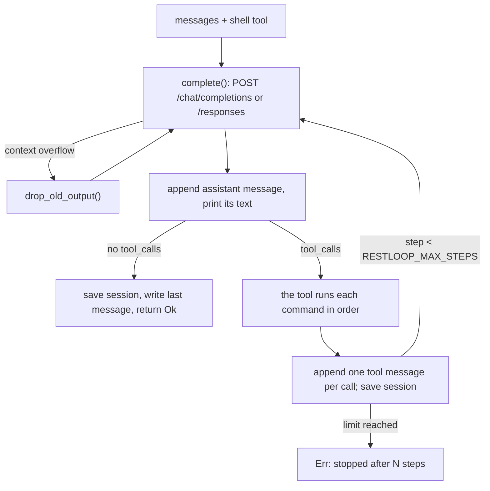

# restloop

<sub>[English](../all.md) · **中文**</sub>

这份文档比 README 更深入一层，介绍 RestLoop：一个小巧的 Rust agent 循环，只给模型提供一个 `shell` 工具。内容对应 v0.6.0：它新增了 `RESTLOOP_HEADERS`（额外的请求头），不再跟随重定向，并且在 key 无法放进 HTTP 请求头时结束运行。从 v0.5.0 起，任务结束时以及收到 SIGHUP、SIGINT 或 SIGTERM 时，任务的命令启动的进程组都会被停止，所以后台服务器不再活过它的任务（见概览）。从 v0.4.0 起，核心是一个库：`src/lib.rs` 根据 `Config` 和一个工具回调运行循环，可以单独使用；`src/shell.rs` 是默认的命令执行器，`src/main.rs` 是 CLI。建议按顺序阅读：RestLoop 是什么以及第一次运行；完整的命令行与环境变量接口；循环、HTTP 客户端和命令执行器如何工作以及为什么这样设计；最后是二进制如何构建和发布，以及如何修改代码。

<a id="overview"></a>

## 概览

RestLoop 是一个只剩下循环本身的 coding agent：它把对话和唯一的工具 `shell` 发给一个 OpenAI 兼容的 `/chat/completions` 端点（或 OpenAI 的 `/responses`），执行模型请求的每条命令，把输出发回去，直到模型不再调用工具、直接给出回答时停止。核心（循环和模型客户端）是 `src/lib.rs`，可以当作库使用；`src/shell.rs` 是默认的命令执行器，`src/main.rs` 是 CLI。仅有的依赖是用于 HTTPS 的 `ureq`、`serde_json`，以及 Unix 上的 `libc`。

它的前身 RestFlow（到 0.5 为止）已经膨胀成一个 TUI、一个 daemon、一个 runner 加一套可执行 skill 系统，RestLoop 正是为此而生。commit `33511748` 把这些全部替换成一个文件、不做任何存储，`cad33d13` 将其改名为 RestLoop，版本号从 0.1.0 重新开始。之后的大多数功能（可配置的步数上限、时间预算、用量日志）都是针对 benchmark 运行（主要是 Terminal-Bench）加上的，每一项都是一个环境变量：时间预算和用量日志不设置就不启用，步数上限默认为 100 步。

<sub>来源: [lib.rs:1-9](../../src/lib.rs#L1-L9) · [main.rs:1-4](../../src/main.rs#L1-L4) · [shell.rs:1](../../src/shell.rs#L1) · [README.md:54-56](../../README.md#L54-L56) · [Cargo.toml:1-15](../../Cargo.toml#L1-L15) · +2</sub>

### 刻意舍弃的部分

- **只有一个工具。** 模型通过 `shell` 读、写、编辑文件；没有文件编辑、搜索或打补丁工具。它唯一的参数是 `command`。
- **不给模型可调的开关。** 来自 `system_prompt()` 的系统 prompt 和工具 schema 都是固定的。commit `3b27682c` 记录了命令超时不作为工具参数的原因：A/B 测试中，让模型自己调超时会让步数大约翻倍。
- **没有配置文件，也没有数据库。** 所有选项都是环境变量，由 CLI 在启动时一次读入核心的 `Config`（key 则在每次请求前读取）；RestLoop 自己只会写可选的 session 文件和最终回复文件（见 [用法与配置](#usage)）。
- **没有沙箱，也没有确认。** 命令以你的权限在当前目录执行。隔离由调用方负责：用容器或一次性的 checkout。

<sub>来源: [lib.rs:93-97](../../src/lib.rs#L93-L97) · [lib.rs:204-215](../../src/lib.rs#L204-L215) · [main.rs:93-128](../../src/main.rs#L93-L128) · [commit 3b27682c](https://github.com/lhwzds/restloop/commit/3b27682c)</sub>

### 一次运行会留下什么

任务的命令启动的任何东西都不应比任务活得更久。任务结束时（stdin 模式下每个任务结束时都如此），以及处理到信号时，命令启动的每个进程组都会先收到 SIGTERM，大约一秒后，如果进程组还在，再收到 SIGKILL；任务的 deadline 会缩短这段等待。在 Unix 上，处理的信号是 SIGHUP、SIGINT 和 SIGTERM，除非继承时就被忽略（`nohup`），RestLoop 随后以 129、130 或 143 退出。在 Windows 上则关闭 job object，这会 kill 其中的进程，没有优雅退出阶段。后台服务器在同一任务的各步之间会继续运行。

这些属于 CLI 的设置：把 `shell::shell()` 当库调用的程序要自己调用 `shell::install()` 和 `shell::stop_all()`。

<sub>来源: [main.rs:42-46](../../src/main.rs#L42-L46) · [main.rs:68-69](../../src/main.rs#L68-L69) · [shell.rs:56-75](../../src/shell.rs#L56-L75) · [shell.rs:279-311](../../src/shell.rs#L279-L311) · [shell.rs:396-421](../../src/shell.rs#L396-L421) · +1</sub>

### 这种清理的限制

- 在 Unix 上，调用 `setsid` 或变成 daemon 的进程会逃脱；请用容器或 cgroup。
- 在 Unix 上同时最多存在 32 个进程组；再下一条命令会得到错误，而不会运行。
- 每条命令超过 1 MiB 的输出会被丢弃。
- 继承来的文件描述符会被标记为 close-on-exec，标记失败会被忽略；无法读取 `/dev/fd` 时，只标记编号不超过 1023 的。
- 同一进程内进程组 id 被复用，是一个已知的小缺口。
- 通过 npm 安装时，只发给启动器（`npm/bin/restloop.js`）的 SIGTERM 会杀掉 node，而 RestLoop 和它的命令会继续运行。

<sub>来源: [shell.rs:229-232](../../src/shell.rs#L229-L232) · [shell.rs:354-360](../../src/shell.rs#L354-L360) · [shell.rs:423-437](../../src/shell.rs#L423-L437) · [restloop.js:56-58](../../npm/bin/restloop.js#L56-L58)</sub>

### 第一次运行

可以用 Homebrew（`brew install lhwzds/tap/restloop`）、npm（`npm install -g restloop`）或 `cargo install --git https://github.com/lhwzds/restloop` 安装。必填的只有 `RESTLOOP_MODEL`。端点默认是 `https://api.openai.com/v1`，所以用 OpenAI 时只需一个 key 和一个模型名：

```bash
export RESTLOOP_API_KEY=sk-...
export RESTLOOP_MODEL=<model-id>
cd some-checkout
restloop "make the failing test pass"
```

用其他服务商时，把 `RESTLOOP_BASE_URL` 设为 `/chat/completions` 之前的那部分。退出码和所有选项见 [用法与配置](#usage)。

<sub>来源: [README.md:40-47](../../README.md#L40-L47) · [README.md:52-60](../../README.md#L52-L60) · [main.rs:100-101](../../src/main.rs#L100-L101)</sub>

<a id="usage"></a>

## 用法与配置

RestLoop 除了 `-h`/`--help`（打印环境变量列表）之外没有其他命令行选项。其余的一切就是任务文本和环境变量；[工作原理](#how-it-works) 解释每个选项对循环有什么影响。

<sub>来源: [main.rs:17-25](../../src/main.rs#L17-L25)</sub>

### 单个任务或 stdin 会话

所有参数用空格拼接成一个任务：`restloop fix the build` 和 `restloop "fix the build"` 效果相同。

- **带任务时**，RestLoop 执行完就退出：模型正常完成返回状态 0，运行失败（重试后仍有 API 错误、key 出错，或达到步数上限）返回 1。
- **不带任务时**，它在 stderr 上打印 `> `，然后从 stdin 每行读取一个任务，跳过空行。所有任务共用一个对话，所以后面的行可以引用前面做过的事。某个任务失败时会在 stderr 上报告，循环继续。

状态 2 表示根本没有开始运行：`RESTLOOP_MODEL` 未设置，`RESTLOOP_HEADERS` 不是有效的 UTF-8，或其中有一行不合法，或者 `RESTLOOP_SESSION` 指向的文件不是 session 文件。在 Unix 上，SIGHUP、SIGINT 和 SIGTERM 分别对应 129、130 和 143（[概览](#overview)）。

<sub>来源: [main.rs:17-36](../../src/main.rs#L17-L36) · [main.rs:76-90](../../src/main.rs#L76-L90) · [shell.rs:390-394](../../src/shell.rs#L390-L394) · [main.rs:26-37](../../src/main.rs#L26-L37)</sub>

### 环境变量

| 变量 | 默认值 | 作用 |
|---|---|---|
| `RESTLOOP_MODEL` | 必填 | 每个请求的 `model` 字段 |
| `RESTLOOP_API_KEY` | 空 | 以 `Authorization: Bearer <key>` 发送 |
| `RESTLOOP_API_KEY_FILE` | 未设置 | 改从这个文件读取 key，每次请求前都重新读取并去掉首尾空白，因此短期 token 可以被刷新 |
| `RESTLOOP_BASE_URL` | `https://api.openai.com/v1` | 后面拼上 `/chat/completions`（或 `/responses`）；末尾的 `/` 会被忽略 |
| `RESTLOOP_WIRE_API` | chat completions | 设为 `responses` 时使用 OpenAI Responses API；其他值会被忽略 |
| `RESTLOOP_REASONING_EFFORT` | 未设置 | 例如 `low`，作为 `reasoning_effort`（或 `reasoning.effort`）发送 |
| `RESTLOOP_HEADERS` | 未设置 | 额外的请求头；见下文 |
| `RESTLOOP_TIMEOUT` | `120` | 单条命令可运行的秒数 |
| `RESTLOOP_MAX_STEPS` | `100` | 每个任务的步数：一次模型回复及其命令（重试和溢出恢复都算在同一步内） |
| `RESTLOOP_DEADLINE` | 未设置 | 整个任务的秒数；见 [工作原理](#how-it-works) |
| `RESTLOOP_LOG_USAGE` | 未设置 | 设为 `1` 时在 stderr 上记录每条模型回复的 token 用量 |
| `RESTLOOP_LAST_MESSAGE` | 未设置 | 接收最终回复的文件 |
| `RESTLOOP_SESSION` | 未设置 | 要恢复并保存的对话文件 |

无效的数值（不是无符号整数）会静默回退到默认值（`env_num`）。`RESTLOOP_LOG_USAGE` 必须恰好是 `1`；对 key 文件和推理强度来说，空字符串等同于未设置。

<sub>来源: [main.rs:12-15](../../src/main.rs#L12-L15) · [main.rs:93-128](../../src/main.rs#L93-L128) · [main.rs:169-177](../../src/main.rs#L169-L177) · [commit f09603f4](https://github.com/lhwzds/restloop/commit/f09603f4)</sub>

### 命令会继承什么

RestLoop 自己的设置不会传入命令：命令启动前会去掉所有 `RESTLOOP_*` 名称（`restloop_var`），所以 key、key 文件、URL 和请求头都不会传给命令；在 Windows 上匹配不区分大小写。其他变量命令都会继承，包括以其他名字保存的 key 副本。以同一用户运行的命令仍然可以读到 restloop 的环境（`/proc/$PPID/environ`、`ps -E`），知道路径时也能读 key 文件；真正的解决办法是沙箱或换一个用户。

<sub>来源: [shell.rs:29-42](../../src/shell.rs#L29-L42) · [shell.rs:130-135](../../src/shell.rs#L130-L135) · [commit 8d5e3a78](https://github.com/lhwzds/restloop/commit/8d5e3a78)</sub>

### 额外的请求头

`RESTLOOP_HEADERS` 存放额外的请求头，每行一个 `Name: value`（跳过空行，CRLF 也可以），随每个模型请求一起发送；同一个名字写两次就发两次。例如 OpenCode Go 需要 `x-opencode-session: <id>`。以下名字不论大小写都会被拒绝：`Authorization`、`Proxy-Authorization`、`Content-Type`、`Content-Length`、`Host`、`Transfer-Encoding`、`Accept-Encoding`；其他合法的名字都会发送。某一行不合法（没有 `:`、请求头无效或被拒绝）或文本不是 UTF-8 时，程序在一开始就以 2 退出。错误信息给出行号（`RESTLOOP_HEADERS: line 2 has no ':'`），名字被拒绝时还给出该名字，但从不包含值；UTF-8 错误没有行号。作为库调用时设置 `Config.headers`，由 `run()` 先拒绝（`restloop::bad_header()`）。

<sub>来源: [main.rs:26-37](../../src/main.rs#L26-L37) · [main.rs:179-201](../../src/main.rs#L179-L201) · [lib.rs:46-75](../../src/lib.rs#L46-L75) · [lib.rs:82-92](../../src/lib.rs#L82-L92)</sub>

### stdout 和 stderr 各输出什么

stdout 只输出模型的文本：每条非空回复都会去掉首尾空白后打印，包括模型在调用工具时顺带写的说明。步骤之间没有分隔符；只需要最终答案时，用 `RESTLOOP_LAST_MESSAGE`。

其余内容都走 stderr：每条命令以暗色的 `$ <command>` 显示，接着是耗时和输出的前 10 行；还有重试和上下文溢出的提示；设置 `RESTLOOP_LOG_USAGE=1` 时，每一步拿到回复后输出一行，取自该回复的 usage（重试的请求不记录）：

```
usage: step=3 prompt_tokens=8123 completion_tokens=412 cached_tokens=7936 elapsed=41s
```

服务商没有返回的字段打印为 `null`。这些输出来自核心的 `run()`，所以作为库调用的程序也会得到它们；只有 stdin 提示符 `> ` 属于 CLI。默认的命令执行器在对仍存在的进程组发送 SIGKILL 失败时，会输出 `restloop: cannot stop a process group`。

<sub>来源: [shell.rs:270-277](../../src/shell.rs#L270-L277) · [lib.rs:77-81](../../src/lib.rs#L77-L81) · [lib.rs:115-129](../../src/lib.rs#L115-L129) · [lib.rs:156-157](../../src/lib.rs#L156-L157) · [lib.rs:164-168](../../src/lib.rs#L164-L168) · +2</sub>

### 最终回复文件

设置 `RESTLOOP_LAST_MESSAGE=<path>` 后，每个任务开始时先删除该文件（除非 RestLoop 已先以状态 2 退出），然后当模型不调用工具直接回复时，把回复文本加上末尾换行写入该文件。开头的 `<think>` 块（内联的推理内容）会被截掉，截到第一个 `</think>` 为止（没有闭合时什么都不剩）；其他回复即使引用了 `</think>` 也会完整写入。两种情况都会去掉首尾空白。删除只是尽力而为，所以提前结束的运行（步数上限、API 错误、被 kill）通常不会留下文件，而不是留下上一次的答案；要确定的话，每次运行都传一个新路径。

<sub>来源: [lib.rs:98-102](../../src/lib.rs#L98-L102) · [lib.rs:142-150](../../src/lib.rs#L142-L150) · [lib.rs:286-294](../../src/lib.rs#L286-L294) · [commit e8312d19](https://github.com/lhwzds/restloop/commit/e8312d19) · [main.rs:26-37](../../src/main.rs#L26-L37) · +1</sub>

### Session 文件：恢复与分叉

`RESTLOOP_SESSION=<path>` 会把对话以 JSON 形式持久化：

```json
{"version": 1, "messages": [{"role": "system", "content": "..."}, ...]}
```

`messages` 就是下一次请求要发送的内容，采用 OpenAI chat 格式（在任何 Responses 转换之前）。`conversation()` 负责加载：文件不存在时开始新对话，并在第一步之后创建文件；文件已存在时，要求 `version` 为 1 且 `messages` 数组非空，否则 RestLoop 以状态 2 退出。除此之外不做任何检查，所以可以在两次运行之间编辑文件。编辑某条 assistant 消息后，要删掉它的 `output_items`，否则发出去的仍是它们。

用同一路径再次运行即可恢复；先复制文件就是分叉。保存的系统 prompt 原样复用。设置了 `RESTLOOP_DEADLINE` 时，恢复后的任务末尾会追加 `[You have Ns in total for this request; the time used in tool results counts from now.]`。每一步之后都会通过 `<path>.<pid>.tmp` 重命名来替换文件，所以进程被 kill 后，文件里保存的是最后一个完整的步骤；并发运行不会损坏文件，最后写入的胜出。

<sub>来源: [main.rs:54-64](../../src/main.rs#L54-L64) · [main.rs:130-153](../../src/main.rs#L130-L153) · [lib.rs:188-202](../../src/lib.rs#L188-L202) · [README.md:84-102](../../README.md#L84-L102) · [commit ffd11c37](https://github.com/lhwzds/restloop/commit/ffd11c37) · +1</sub>

<a id="how-it-works"></a>

## 工作原理

`src/lib.rs` 的 `run()` 完成所有事情：一步就是一次模型回复，再加上它请求执行的命令。



<sub>来源: [lib.rs:82-114](../../src/lib.rs#L82-L114) · [lib.rs:181-185](../../src/lib.rs#L181-L185)</sub>

### 对话里有什么

第一条消息是系统 prompt（`system_prompt()`）：指令，加上操作系统、shell、工作目录、命令超时，以及设置了 deadline 时的预算。之后是用户任务；模型每次回复对应一条 assistant 消息，只保留 `content`、`tool_calls`，以及存在时的 `reasoning_content` 和 Responses API 的 `output_items`。

每个工具调用对应一条 `tool` 消息，带上匹配的 `tool_call_id`。

<sub>来源: [lib.rs:204-215](../../src/lib.rs#L204-L215) · [lib.rs:125-141](../../src/lib.rs#L125-L141) · [lib.rs:152-155](../../src/lib.rs#L152-L155) · [lib.rs:180-181](../../src/lib.rs#L180-L181)</sub>

### 请求与重试

`complete()` 向 `/chat/completions` POST `{"model", "messages", "tools"}`，设置了推理强度时再加上 `reasoning_effort`，没有采样参数、token 上限或流式输出。每次尝试都会重新读取 key；key 文件无法读取时以 `cannot read <path>` 失败，key 内部含换行时以 `the key cannot go in a header` 失败。不跟随重定向（3xx 即失败），所以额外的请求头（[用法与配置](#usage)）永远不会发到另一台主机。

网络错误、HTTP 429、5xx、没有 `choices[0].message` 的 200（MiniMax 的错误，`333b7b64`），以及空回复（没有工具调用，除开头的 `<think>` 外也没有文字）都会重试：总共五次尝试，中间分别等待 2、4、8、16 s，并打印 `restloop: <what>, retrying`；第五次仍为空的回复即为最终回复。body 中出现 `insufficient_quota` 或 `subscription_sharing_usage_limit_exceeded` 时立即失败，除非回复为空。其他状态码和第五次失败都会让任务失败：`<what>: <text>`（`HTTP <status>`、`request failed` 或 `no reply`），或下文的 deadline 格式。不是 JSON 的 200 会立即以 `bad response` 失败。

<sub>来源: [lib.rs:319-450](../../src/lib.rs#L319-L450) · [commit 333b7b64](https://github.com/lhwzds/restloop/commit/333b7b64)</sub>

### Responses API

设置 `RESTLOOP_WIRE_API=responses` 后，`complete()` 改为 POST 到 `/responses`。对话仍是 chat 格式；`responses_request()` 在每次请求时做转换：开头的 system 消息变成 `instructions`，`tool` 消息变成 `function_call_output`，assistant 消息换成它的 `output_items`，没有时换成它的文本和 `function_call` 项。请求还会加上 `store: false`、`stream: true`、`include` 中的加密推理、由系统 prompt 哈希得到的 `prompt_cache_key`，以及设置了时的 `reasoning.effort`。

`responses_reply()` 读取事件流直到 `response.completed`，构造出一条 chat 回复：文本（或拒绝内容）、工具调用、改用 chat 名称的用量，以及 `output_items`，即按 `output_index` 排序、去掉了 message 和 call id 的输出。这些项会原样发回，因此推理内容无需服务端存储也能保留。事件流中断或提前结束时会重试；报告的失败（`response.failed`、`response.incomplete`、`error`）只有在是 `server_error`、`rate_limit` 或 `unavailable` 时才重试。

<sub>来源: [lib.rs:320-333](../../src/lib.rs#L320-L333) · [lib.rs:377-387](../../src/lib.rs#L377-L387) · [lib.rs:413-429](../../src/lib.rs#L413-L429) · [lib.rs:452-565](../../src/lib.rs#L452-L565)</sub>

### 上下文窗口满了之后的恢复

`too_long()`（`21f3c1dc`）负责识别上下文溢出：HTTP 400 或 413，或 Responses 事件流的失败（`no reply: `），且文本包含服务商的某个短语（`context_length_exceeded`、"maximum context length"、"context window exceeds"、"prompt is too long"、"exceeds the available context size"）。`04004c68` 去掉了 "too long" 这类更宽泛的词，过长的 `tool_call_id` 曾匹配到它们。

匹配成功后，`drop_old_output()` 把尚未缩短的 `tool` 消息中较早的一半（向上取整）缩成它们的第一行加上 `[output removed to fit the context window]`，用 `trim_thinking()` 清空旧的推理内容，然后重试请求。每次重试都会把剩下的再减半；没有可改动的内容时，返回该错误。命令和可见的回复都会保留。

<sub>来源: [lib.rs:103-114](../../src/lib.rs#L103-L114) · [lib.rs:248-284](../../src/lib.rs#L248-L284) · [commit 21f3c1dc](https://github.com/lhwzds/restloop/commit/21f3c1dc) · [commit 04004c68](https://github.com/lhwzds/restloop/commit/04004c68)</sub>

### 清空旧的推理内容

`trim_thinking()` 会清空除最后两条之外所有 assistant 消息的推理内容：`reasoning_content` 变为 `""`，`output_items` 中的 `reasoning` 项被删除（message 项保留其 phase），`content` 开头的 `<think>` 块被截掉。这个 key 保留为空值（`70f40924`）：DeepSeek 的思考模式会拒绝（HTTP 400）缺少它的工具轮次 assistant 消息。已经清空过的消息不算作有改动，因此重试一定会终止。

<sub>来源: [lib.rs:217-246](../../src/lib.rs#L217-L246) · [commit 70f40924](https://github.com/lhwzds/restloop/commit/70f40924) · [commit f09603f4](https://github.com/lhwzds/restloop/commit/f09603f4)</sub>

### 时间预算

`RESTLOOP_DEADLINE`（`f9d3b4f0`：Terminal-Bench 任务曾在不知情时耗尽时间）约束整个任务：

1. 新对话的系统 prompt 末尾加上 `You have Ns in total for this task; each tool result ends with the time used so far.`；恢复的 session 的新任务则附带一句类似的话（[用法与配置](#usage)）。
2. 每条命令的工具结果末尾加上 `[time used: Ns of Ds]`。
3. 命令的超时取 `RESTLOOP_TIMEOUT` 和剩余时间中较小的那个（下限 1 s）；过了 deadline，CLI 不再启动命令。
4. 模型请求的超时是读取 key 之后的剩余时间（最多 600 s），deadline 之后不再发出请求：`restloop: deadline of <N>s reached`。重试前的等待到达 deadline 时，以 `deadline of <N>s reached (<what>: <text>)` 结束；第五次尝试失败时，只有 deadline 已经过去才这样报告（`a4ba4994`）。

时间从进程启动开始计算；同一个预算覆盖所有 stdin 任务。

<sub>来源: [lib.rs:207-215](../../src/lib.rs#L207-L215) · [main.rs:55-63](../../src/main.rs#L55-L63) · [lib.rs:158-163](../../src/lib.rs#L158-L163) · [lib.rs:169-174](../../src/lib.rs#L169-L174) · [lib.rs:340-364](../../src/lib.rs#L340-L364) · +4</sub>

### 执行一条命令

`run()` 以回调接收命令执行器；CLI 的执行器是公开的 `shell::shell()`，它让每条命令都在当前目录下一个全新的 shell 中执行：Unix 上用 `sh -c`；Windows 上，如果 `ProgramFiles` 或 `ProgramFiles(x86)` 下存在 `Git\bin\bash.exe` 就用它（模型写的是 bash；PowerShell 5.1 会加 BOM），否则用 `powershell -NoProfile -NonInteractive` 并设置 UTF-8 输出。stdin 为 null，并设置 `GIT_TERMINAL_PROMPT=0`；`PYTHONUTF8=1` 让 Python 的 I/O 保持 UTF-8。

shell 退出后，仍占用其管道的进程最多还有 2 s，且不超过超时；之后整个进程组（Windows 上是 job object）会被停止，而 `exit:` 报告的仍是 shell 的退出码。在 Unix 上，停止是先发 SIGTERM，最多等 1 s，再发 SIGKILL；Windows 上用 `TerminateJobObject`。重定向了输出的后台服务（`server > log 2>&1 &`）会一直运行到任务结束：[概览](#overview)。继承的变量见 [用法与配置](#usage)。

<sub>来源: [shell.rs:44-54](../../src/shell.rs#L44-L54) · [shell.rs:101-206](../../src/shell.rs#L101-L206) · [shell.rs:279-332](../../src/shell.rs#L279-L332) · [main.rs:65-67](../../src/main.rs#L65-L67) · [commit 92c09fd2](https://github.com/lhwzds/restloop/commit/92c09fd2) · +1</sub>

### 模型从命令中看到什么

命令的工具结果第一行是 `exit: <status>`，后面是合并后的输出。例外：参数无效时返回 `error: arguments must be JSON…`，shell 无法启动时返回 `error: <reason>`。status 是退出码；shell 被信号终止时为 `killed`，子进程已消失且没有状态时为 `exited, status unknown`，超时则为 `timeout after Ns`；被停止的命令未见退出时会加上 `(child did not exit after SIGKILL)`。超过 10,000 个字符（`MAX_OUTPUT`）的输出保留开头和结尾各 5,000 个字符，中间插入 `... [N chars truncated] ...`。超过 1 MiB 的输出会先被丢弃；无效的 UTF-8 会被替换。

<sub>来源: [shell.rs:171-176](../../src/shell.rs#L171-L176) · [shell.rs:184-189](../../src/shell.rs#L184-L189) · [shell.rs:14-16](../../src/shell.rs#L14-L16) · [shell.rs:136-139](../../src/shell.rs#L136-L139) · [shell.rs:199-219](../../src/shell.rs#L199-L219) · +1</sub>

<a id="contributing"></a>

## 构建、发布与贡献

`cargo build --release` 生成 `target/release/restloop`。这个 crate 使用 edition 2024，并在 `if` 中使用 `let` 链，所以需要两者都已稳定的工具链（Rust 1.88 或更新）。release profile 针对体积优化（`opt-level = "z"`、LTO、单个 codegen unit、`panic = "abort"`、strip）。

核心和命令执行器的测试在 `src/tests.rs`，CLI 的测试（设置、key 文件、session 文件）在 `src/main.rs`，都用 `cargo test` 运行；`.github/workflows/ci.yml` 会在每次 push 到 `main` 和每个 pull request 时，在 macOS、Linux 和 Windows 上运行 `cargo fmt --check`、`cargo clippy --all-targets -- -D warnings` 和测试；在 Unix 上还会以 release 运行 `tests/cleanup.rs`。提 pull request 之前，请先在本地跑一遍这三条命令。另有一个在 Linux 上运行的 `docs` job，检出完整历史（`fetch-depth: 0`，这样引用的 commit 才能找到），安装 Codocia 0.2 并运行 `codocia check`，所以过时的文档或 `README_CN.md` 会让 CI 失败。

<sub>来源: [Cargo.toml:1-22](../../Cargo.toml#L1-L22) · [tests.rs:1-2](../../src/tests.rs#L1-L2) · [main.rs:208-209](../../src/main.rs#L208-L209) · [ci.yml:1-37](../../.github/workflows/ci.yml#L1-L37)</sub>

### 测试覆盖了什么

`src/tests.rs` 中的单元测试锁定：`too_long()` 匹配记录在案的服务商措辞，而不匹配相近的说法；`drop_old_output()` 不断减半，直到返回 0；`trim_thinking()` 保留最后两条回复；`truncate()` 保留开头和结尾。`shell()`：同时有两路输出时的 exit 行、超时 kill、后台的 `sleep 30 &` 不会阻塞。

有一个端到端测试让 `run()` 对接 `serve()`，一个回放预设回复的服务器：一次工具调用、溢出恢复、恢复 session、对空回复或没有 `choices` 的回复的重试；按顺序发回的 Responses 输出项、可重试和致命的失败；设置 deadline 时，挂起、500 和空回复都会提前以 `deadline of` 结束。命令拿不到 restloop 的任何设置。用到环境的测试共用一把锁并恢复环境；发请求的测试会清掉 `*_PROXY`。其他核心测试检查：已过 deadline 时不运行任何命令；key 失败或无法放进请求头时结束运行；额外的请求头能送达，重复的名字送两次；配置中不合法的请求头会先让运行停下；不跟随重定向。`src/main.rs` 测试 `config()`、请求头解析、key 文件和 session 文件；`tests/cleanup.rs`（Unix）检查没有进程活过一次运行；`tests/cli.rs`（所有平台）检查不合法的 `RESTLOOP_HEADERS` 时的退出（[用法与配置](#usage)）。

<sub>来源: [tests.rs:168-311](../../src/tests.rs#L168-L311) · [tests.rs:30-96](../../src/tests.rs#L30-L96) · [tests.rs:472-497](../../src/tests.rs#L472-L497) · [tests.rs:861-937](../../src/tests.rs#L861-L937) · [tests.rs:939-1078](../../src/tests.rs#L939-L1078) · +9</sub>

### 修改循环

历史中总结出的约定：

- **选项用环境变量，默认值保持旧行为。** CLI 在 `config()` 中把它读进 `Config` 的一个字段；用 `env_num` 读取数值，这样无效值会回退到默认值；并把变量加到 `main()` 的 `--help` 文本和 README 里。
- **保持面向模型的部分固定不变**（见 [概览](#overview)）。修改 `system_prompt()` 或工具 schema 应附上 benchmark 证据。
- **保持 prompt 前缀稳定。** 任何改写早先消息的操作都会破坏服务商的 prompt 缓存；RestLoop 只在服务商报告溢出时才这样做。基于阈值的裁剪在一次 A/B 测试显示没有收益后已被移除（`f09603f4`）。
- **核心的设置都放在 `Config`，保持很少的依赖。** `src/lib.rs` 不直接读取环境变量（其 HTTP 客户端 `ureq` 会遵循 `*_PROXY`），也不启动任何进程；这些属于 CLI（`src/main.rs`）和默认的命令执行器，即公开模块 `src/shell.rs`。小巧和可读性正是意义所在。

<sub>来源: [lib.rs:1-9](../../src/lib.rs#L1-L9) · [main.rs:203-206](../../src/main.rs#L203-L206) · [tests.rs:1-2](../../src/tests.rs#L1-L2) · [commit 3b27682c](https://github.com/lhwzds/restloop/commit/3b27682c) · [commit 740555b1](https://github.com/lhwzds/restloop/commit/740555b1) · +1</sub>

### 如何发布一个版本

推送 `vX.Y.Z` 形式的 tag（预发布 tag 不匹配）会运行 `.github/workflows/release.yml`：

1. **build** 编译五个目标：macOS arm64 和 x86_64、Linux x86_64 和 arm64（静态 musl）、Windows x86_64，命名为 `restloop-<target>[.exe]`。
2. **release** 写出 `SHA256SUMS` 以及每个二进制对应的一个 `.sha256`，并创建 GitHub release。如果该 release 已存在，它会拒绝运行：已发布的二进制永远不会被替换，因为 npm 包固定了它们的校验和。此时应只重跑失败的 job。
3. **homebrew** 重新生成 `lhwzds/homebrew-tap` 中的 `restloop` formula（需要 `HOMEBREW_TAP_TOKEN` secret），只有内容变化时才提交。
4. **npm** 同样在 **release** 之后运行，用 trusted publishing stamp 并发布 npm 包；下面的 npm 包一节会详细说明。

手动运行该 workflow（`workflow_dispatch`）会构建并计算校验和，但不发布任何东西，相当于一次演练。

<sub>来源: [release.yml:1-75](../../.github/workflows/release.yml#L1-L75) · [release.yml:76-95](../../.github/workflows/release.yml#L76-L95) · [release.yml:123-138](../../.github/workflows/release.yml#L123-L138) · [release.yml:140-164](../../.github/workflows/release.yml#L140-L164) · [commit b41c62a7](https://github.com/lhwzds/restloop/commit/b41c62a7) · +1</sub>

### npm 包

npm 包里不含二进制。`npm/bin/restloop.js` 在 `checksums.json` 中查找 `"<platform> <arch>"`，首次运行时从 `v<version>` GitHub release 下载对应的 asset，校验其 SHA-256，并存放在自己旁边（先写临时文件再重命名）。之后的运行跳过下载。无论哪种情况，launcher 都会运行该二进制，透传参数和 stdio，并返回其退出状态。

推送 tag 后由 CI 发布该包（`f76038cb`）：GitHub release 完成后，`npm` job 运行 `node npm/stamp.js X.Y.Z dist/SHA256SUMS`，它会设置包版本并为五个平台重写 `checksums.json`，然后在 `npm/` 下执行 `npm publish --access public`。它使用 npm trusted publishing（OIDC、`id-token: write`、npm 11.5.1 或更高版本），因此不涉及任何 npm token 或 secret。更早的版本是手动发布的（`a21f7c21`）。

stamp 后的 `package.json` 和 `checksums.json` 只存在于 runner 上，从不提交回仓库，因此仓库中的副本停留在最后一次手动 stamp（0.3.0），会落后于已发布的版本。在这个 commit 上，`checksums.json` 包含 v0.3.0 的五个条目：`darwin arm64`、`darwin x64`、`linux x64`、`linux arm64`（musl）和 `win32 x64`。

<sub>来源: [restloop.js:1-61](../../npm/bin/restloop.js#L1-L61) · [stamp.js:1-31](../../npm/stamp.js#L1-L31) · [checksums.json](../../npm/checksums.json) · [release.yml:140-164](../../.github/workflows/release.yml#L140-L164) · [commit a21f7c21](https://github.com/lhwzds/restloop/commit/a21f7c21) · +1</sub>

<a id="structure"></a>

## 代码结构

本页由 Codocia 根据代码自动生成，每次 build 重新计算：功能区划分、各区自带的说明、区之间的 import 依赖，以及讲解各区的页面。

范围内共 16 个文件，4,392 行；已排除 `Cargo.lock`、`LICENSE`、`.gitignore`

### 文件结构

**仓库根目录**

- （根目录文件） — 340 行，3 个文件。A minimal agent loop: one model, one shell tool.\
  讲解：[概览](#overview) (2), [用法与配置](#usage) (1), [构建、发布与贡献](#contributing) (1)
- `.github/` — 201 行，2 个文件\
  讲解：[构建、发布与贡献](#contributing) (3)
- `npm/` — 162 行，5 个文件。A minimal coding-agent loop: it keeps working on your task so you can rest.\
  核心文件：`bin/restloop.js` `stamp.js`\
  讲解：[概览](#overview) (1), [构建、发布与贡献](#contributing) (1)
- `src/` — 3,012 行，4 个文件。RestLoop's core: the agent loop and the model client.\
  核心文件：`lib.rs` `shell.rs` `tests.rs`\
  讲解：[概览](#overview) (5), [用法与配置](#usage) (8), [工作原理](#how-it-works) (9), [构建、发布与贡献](#contributing) (3)
- `tests/` — 677 行，2 个文件\
  讲解：[用法与配置](#usage) (1), [构建、发布与贡献](#contributing) (1)
