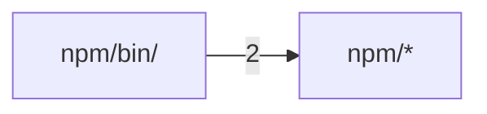

# 代码结构

[English](../structure.md) · **中文**

本页由 Codocia 根据代码自动生成，每次 build 重新计算：功能区划分、各区自带的说明、区之间的 import 依赖，以及哪一页讲了它。

范围内共 12 个文件, 1,236 行；已排除 `Cargo.lock`, `LICENSE`, `.gitignore`

## 文件结构

**仓库根目录**

- （直接文件） — 205 行，3 个文件。A minimal agent loop: one model, one shell tool.\
  讲解：[概览](01-overview.md) (2), [用法与配置](02-usage.md) (1), [构建、发布与贡献](04-contributing.md) (1)
- `.github/` — 164 行，2 个文件\
  讲解：[构建、发布与贡献](04-contributing.md) (3)
- `src/` — 705 行，2 个文件\
  核心文件：`main.rs` `tests.rs`\
  讲解：[概览](01-overview.md) (3), [用法与配置](02-usage.md) (6), [工作原理](03-how-it-works.md) (8), [构建、发布与贡献](04-contributing.md) (3)

**`npm/`**

- （直接文件） — 101 行，4 个文件。A minimal coding-agent loop: it keeps working on your task so you can rest.\
  核心文件：`stamp.js`\
  讲解：[构建、发布与贡献](04-contributing.md) (1)
- `bin/` — 61 行，1 个文件\
  核心文件：`restloop.js`\
  讲解：[构建、发布与贡献](04-contributing.md) (1)

## 依赖结构

箭头 A → B 表示 A 中有文件 import 了 B，数字是这样的文件级 import 数。只画最强的 1 条（共 1 条）。

